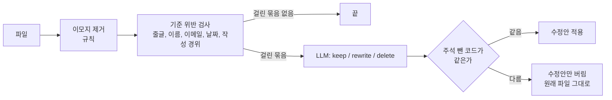

# 개발 보조 에이전트 개발 문서

- 설계와 결정의 기준: `docs/planning/15-agents.md`. 이 문서는 **지금까지 만든 것, 코드 위치, 확인 결과, 남은 일**만 적습니다.
- 개발: 본인 (Jimin). 브랜치 `jimins-claude/feature-render-workflows`
- Render Workflow 서비스: 슬러그 `memoamo-agent` (AI 스크리닝 재판정과 같은 서비스, `docs/dev/render-workflows.md`)

## 현재 상태 (새 세션은 여기부터 읽기)

마지막 갱신: 2026-11-27

| 항목 | 상태 |
|---|---|
| 만든 에이전트 | ① 코드 점검 에이전트만 진행 중. ② PR 리뷰(open-code-review), ③ impeccable은 착수 전 |
| 끝난 것 | 공통 연결 코드(DB 읽기, Render 로그, LLM), 읽기 전용 계정 `agent_ro`, 주석 기준과 규칙 검사, 평가 세트 32건 |
| Render에서 확인 | `agentCheck.env` 성공, `agentCheck.db` 성공 (테이블 36개, 인증 테이블 차단) |
| 막힌 것 | `agentCheck.llm`: OpenAI 크레딧 없음(429). **LLM 공급자 결정 대기** (아래 4장, 이슈 #127) |
| 다음 할 일 | 공급자 결정 → 키 또는 크레딧 준비 → `agentCheck.llm` 성공 → 주석 정리 로컬 미리보기 → 7단계(리팩터링 제안), 8단계(GitHub PR) |
| 사용자가 할 일 | 공급자 결정, Render Workflow Environment에 `CODE_REVIEW_PERSON_NAMES`, 로그용 `RENDER_API_KEY`, `RENDER_OWNER_ID`, `RENDER_WEB_SERVICE_ID` |

## 1. 에이전트 세 가지와 지금 위치

| | 이름 | 하는 일 | 상태 |
|---|---|---|---|
| ① | 코드 점검 에이전트 | 직접 개발. main 코드를 받아 주석 정리, 리팩터링 제안, PR 생성. Render Workflows에서 실행 | **진행 중** (15 문서 8장 1, 3, 5, 6단계) |
| ② | PR 리뷰 | open-code-review를 GitHub Actions로 설정. PR마다 줄 단위 댓글 | 착수 전 (키 필요) |
| ③ | impeccable | Claude Code 디자인 스킬로 UI 품질 점검 | 착수 전 |

## 2. 코드 위치 (`workflows/src/`)

```
common/
  config.ts         환경 변수 읽기
  db.ts             재판정용 쓰기 연결 (moderation_worker)
  db-readonly.ts    에이전트용 읽기 전용 연결 (agent_ro), 인증 테이블 쿼리 거부
  render-api.ts     웹 서비스 로그, 배포 조회 (비밀값 가림)
  llm.ts            LLM 호출 한곳. OpenAI(기본)와 Claude 둘 다 지원, JSON 구조화 출력, 비용 기록
  report.ts         에이전트 결과 모양, 비밀값 가리기
agent-check/
  tasks.ts          agentCheck.env / db / logs / llm 확인 task
code-review/
  policy.ts         주석 기준 문구, 검사 기준 값
  rules.ts          주석 찾기, 이모지 제거, 기준 위반 검사, 코드 불변 비교 (LLM 없음)
  comments.ts       걸린 주석만 LLM으로 다시 쓰고, 코드가 바뀌면 그 수정안을 버림
  cli.ts            로컬 실행 (npm run comments)
  evals/            평가 세트 (npm run eval)
```

### task 목록

| 이름 | 입력 | 하는 일 |
|---|---|---|
| `agentCheck.env` | `[]` | 필요한 환경 변수가 task 안에서 보이는지 (값은 안 보여 줌) |
| `agentCheck.db` | `[]` | `agent_ro`로 테이블 수, 큰 테이블 5개, 인증 테이블 차단 여부 |
| `agentCheck.logs` | `[]` | 웹 서비스 최근 로그 20줄 |
| `agentCheck.llm` | `[]` | LLM 1회 호출, 토큰과 비용 |

### 명령 (`workflows` 폴더)

| 명령 | 하는 일 |
|---|---|
| `npm run check` | 타입 검사 |
| `npm run eval` | 주석 규칙 평가 세트 32건 |
| `npm run build` | `dist/index.js` 묶음 (Render도 같은 빌드) |
| `npm run comments -- <파일...>` | 주석 정리 미리보기. `--write`를 붙이면 파일에 적용. LLM 키 필요 |

## 3. 주석 정리 흐름

기준은 15 문서 6-1-1과 CLAUDE.md "주석 규칙"입니다.



- 사람 이름 목록은 코드에 두지 않고 환경 변수 `CODE_REVIEW_PERSON_NAMES`(쉼표 구분)에서 읽습니다.
- 2026-11-27 저장소 전체 검사: 122개 파일에서 줄글 227, 날짜 13, 이름 3, 작성 경위 2. `workflows/`는 직접 정리해 0건. 나머지는 에이전트가 PR로 고칩니다 (팀원 코드 포함이므로 PR 때 알림).
- 이미 적용된 마이그레이션 파일(`db/migrations/`)은 고치지 않습니다.

## 4. 결정 대기: LLM 공급자 [미정]

OpenAI 키를 넣었지만 크레딧이 없어 429가 납니다. OpenAI도 유료이므로 공급자를 팀과 다시 정합니다. 코드는 `AGENT_LLM_PROVIDER`로 바꿀 수 있어 어느 쪽이든 수정이 적습니다.

| 선택지 | 비용 | 자동 실행(Render) | 메모 |
|---|---|---|---|
| OpenAI API (`gpt-5-mini`) | 충전 필요. 주석 정리 저장소 전체 1회 50센트 이하 예상 [가설] | 가능, 코드 준비됨 | Moderation(채팅 검사)만 무료이고 생성 모델은 유료 |
| Claude API (`claude-opus-5-5`) | 충전 필요. OpenAI보다 비쌈 | 가능, 코드 준비됨 | Pro, Max 구독에는 API 크레딧이 없음 (15 문서 6-6) |
| 무료 API (Gemini 무료 등급, GitHub Models) | 0원, 호출 수 제한 | 가능, 연결 코드 추가 필요 | 조건 확인 필요 [가설]. Gemini 무료 등급은 입력을 학습에 쓸 수 있어 팀 코드에는 부적합 |
| Claude Code (구독 안에서 사람이 실행) | 구독 요금 안 | 불가. 사람이 Claude Code 세션에서 돌림 | 규칙 검사와 평가 세트는 그대로 쓰고, 다시 쓰기만 Claude Code가 함. Render Workflows를 쓰는 에이전트라는 설명은 약해짐 |

- Render 트랙 조건(Workflows 사용)은 AI 스크리닝 재판정으로 이미 채웁니다. 에이전트를 Claude Code로 돌려도 트랙 조건에는 영향이 없습니다.

## 5. 확인 기록

| 날짜 | 내용 |
|---|---|
| 2026-11-27 | `agent_ro` 생성. 로컬에서 공개 테이블 읽기 OK, `user`는 `id`, `role`만, `account`/`session`/`verification`과 쓰기는 거부 확인 |
| 2026-11-27 | 평가 세트 32건 통과 (이모지 16, 검사 10, 코드 비교 6) |
| 2026-11-27 | 첫 실행 때 task가 환경 변수를 못 읽음 → 값을 넣은 뒤의 새 배포에서 `agentCheck.env`로 정상 확인. 환경 변수를 바꾼 뒤에는 배포가 끝난 다음 실행 |
| 2026-11-27 | Render `agentCheck.db` 성공. `agentCheck.llm`은 OpenAI 크레딧 없음(429) |
