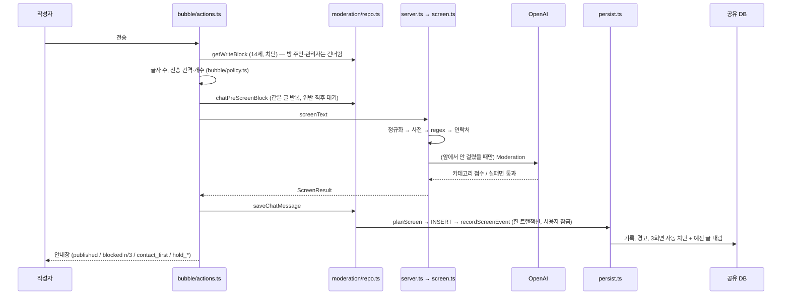
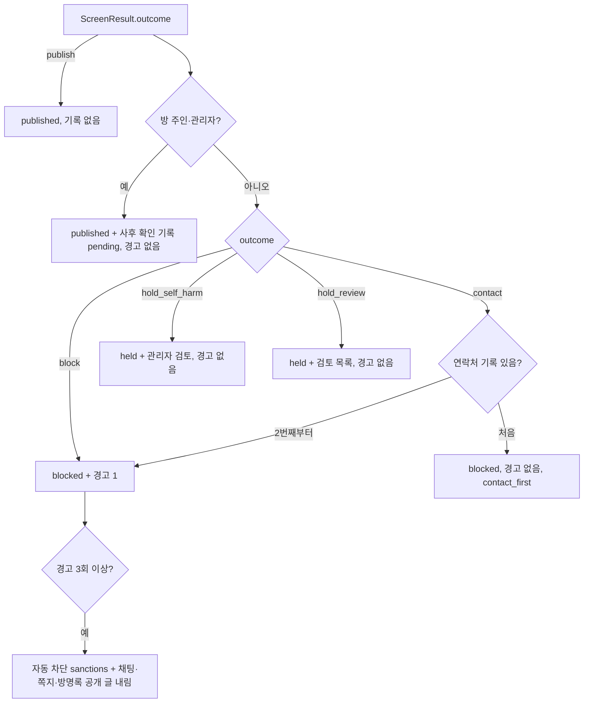
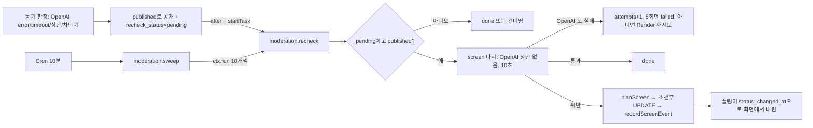

# AI 스크리닝 개발 문서 (코드 구조와 흐름)

- 규칙의 기준: `docs/planning/12-ai-screening.md` (무엇을 어떻게 판정하고 처리하는지). 이 문서는 **그 규칙이 어느 코드에 어떻게 들어 있는지**만 적습니다. 둘이 어긋나면 12 문서가 이깁니다.
- 한국어 보강 작업 지시서: `docs/dev/moderation-korean.md` (구현 전)
- 사후 재판정(Render Workflows): 설계 `docs/planning/16-render-workflows.md`, 작업 목록 `docs/dev/render-workflows.md`
- 마지막 확인: 2026-11-26, 브랜치 `jimins-claude/feature-render-workflows` (main + `persist.ts` 분리, 재판정 코드)

## 1. 표면과 담당

| 표면 | 판정 연결 | 저장 | 화면 | 마이그레이션 | 담당 |
|---|---|---|---|---|---|
| 버블 채팅 (`chat`) | `src/lib/bubble/actions.ts` 전송 | `moderation/repo.ts` `saveChatMessage` | `components/bubble/*`, `components/moderation/chat-moderation.tsx` | `0011` | 본인 |
| 쪽지 (`note`) | `src/lib/heap/actions.ts` `screenForHeap` → `addNoteAction` | `heap/notes-repo.ts` | 힙 방 엔진 패널 | `0013` | 힙 담당 |
| 방명록 (`guestbook`) | 같은 `screenForHeap` → `addGuestbookAction` | `heap/repo.ts` | 힙 방 엔진 패널 | `0013` | 힙 담당 |
| 닉네임 (`nickname`) | `api/signup/nickname` → `moderation/nickname.ts` | 저장 안 함 (판정만) | `app/signup/page.tsx` | 없음 | 본인 |
| 사후 재판정 (버블) | Render Workflow `moderation.recheck` | `moderation/persist.ts` `recheckChatMessage` | 폴링으로 반영 | `0014` (미적용) | 본인 |

## 2. 파일 지도

### 2-1. 판정 (순수 모듈, DB 없음)

| 파일 | 하는 일 | 테스트 |
|---|---|---|
| `moderation/policy.ts` | 모든 숫자와 문구: OpenAI 모델·시간 제한·상한·차단기, 카테고리 기준값, 경고 3회, 도배 방지, 관리자 연락처 | |
| `moderation/normalize.ts` | 소문자, 전각→반각, 구분자 제거, 반복 축약, 숫자·기호 치환 → `{text, tokens, squeezedTokens, compact}` | `moderation.test.ts` |
| `moderation/lexicon.ts` | 사전 구조 만들기(`buildLexicon`)와 비교(`matchLexicon`) | 〃 |
| `moderation/patterns.ts` | 코드에 둔 욕설·위협 regex | 〃 |
| `moderation/contact.ts` | 연락처(전화, 이메일, 메신저 ID)와 링크 수 | 〃 |
| `moderation/openai.ts` | OpenAI Moderation `fetch`. 사용자당 상한, 장애 차단기(프로세스 메모리) | 〃 |
| `moderation/screen.ts` | **판정 함수 하나** `screen(input, deps)`. 싼 것부터: 사전 → regex → 연락처 → OpenAI → 결정 | 〃, `eval.live.test.ts` |

- 이 파일들은 `server-only`, `@/` 별칭, DB를 쓰지 않습니다. 그래서 Render Workflow도 그대로 import합니다. 이 성질을 깨면 Workflow 빌드가 깨집니다.

### 2-2. 저장 (DB)

| 파일 | 하는 일 | 누가 쓰나 |
|---|---|---|
| `moderation/persist.ts` | 판정 결과 반영: `planScreen`(결과 → 저장 계획), `recordScreenEvent`(판정 기록 + 경고 + 자동 차단), `applyAutoBlock`, `takeDownPosts`, `lockUser`, `countStrikes`, 사전 읽기 `loadScreenLists`, 재판정 `needsRecheck`, `recheckChatMessage` | 웹 서비스, Render Workflow |
| `moderation/repo.ts` | 웹 서비스 전용 저장 계층: 쓰기 가능 확인, 도배 방지, 채팅 저장, 신고, 차단, 검토, 재검토 요청, 원문 열람 기록. `persist.ts`의 함수를 같은 이름으로 다시 내보냄 | 웹 서비스 |
| `moderation/server.ts` | `screenText()`: 사전을 메모리에 5분 캐시하고 `screen()`에 OpenAI를 붙임. 개발 로그 | 웹 서비스 |
| `moderation/dictionary-repo.ts`, `dictionary-actions.ts` | 관리자 사전 화면: 사전 읽기, 허용 목록 추가·삭제 | `/admin/moderation/terms` |
| `moderation/actions.ts` | Server Actions: 신고, 크리에이터 차단, 원문 보기, 재검토 요청, 판정·제재 결정 | 버블, 검토 화면 |
| `moderation/notice.ts` | 저장 결과 → 작성자 안내창 문구 | 버블 |
| `moderation/nickname.ts` | 닉네임 판정 (저장 없음), 요청자 키 | 가입 API |
| `heap/screen-view.ts` | 쪽지·방명록 상태를 보는 사람별로 `hide/removed/own/plain`으로 | 힙 |
| `heap/moderation-actions.ts` | 쪽지·방명록 신고, 작성자 차단, 원문 보기, 개인 숨기기 | 힙 |

### 2-3. 화면

| 경로 | 파일 | 누가 |
|---|---|---|
| `/admin/moderation` | `app/admin/moderation/page.tsx`, `components/moderation/review-board.tsx`, `review-controls.tsx` | 관리자: 전체 검토, 자해 원문, 전체 차단 |
| `/admin/moderation/terms` | `app/admin/moderation/terms/page.tsx`, `components/moderation/dictionary-controls.tsx` | 관리자: 사전 보기, 허용 목록 |
| `/creator/moderation` | `app/creator/moderation/page.tsx` | 방 주인: 내 방 범위 검토, 크리에이터 차단 |
| 버블 안 | `components/moderation/chat-moderation.tsx` | 신고, 차단, 삭제 문구, 원문 보기 |

### 2-4. 데이터

| 테이블·열 | 마이그레이션 | 내용 |
|---|---|---|
| `bubble_messages.screen_status`, `screened_at`, `status_changed_at`, `normalized_hash` | `0011` | 판정 상태와 폴링 기준점 |
| `moderation_events` | `0011` | 글 하나에 기록 하나 (`unique(surface, target_id)`) |
| `sanctions`, `sanction_appeals` | `0011` | 자동·크리에이터·전체 차단과 재검토 요청 |
| `moderation_terms`, `moderation_allowlist`, `moderation_patterns` | `0011` | 사전, 허용 목록, DB regex |
| `moderation_access_log`, `user_age_checks` | `0011` | 원문 열람 기록, 14세 확인 |
| `heap_notes.screen_status` 등, `heap_guestbook.screen_status` 등 | `0013` | 쪽지·방명록 판정 상태 |
| `heap_blocks` | `0013` | 개인 숨기기 (보는 사람 기준으로 특정 작성자 글을 안 보이게) |
| `bubble_messages.openai_status`, `recheck_status`, `recheck_attempts`, `rechecked_at` | `0014` (파일만, 공유 DB 미적용) | 사후 재판정 표시 |

## 3. 흐름

### 3-1. 버블 전송 (동기 판정)

### 3-2. 판정 결과 → 저장 계획 (`planScreen`)

### 3-3. 사후 재판정 (Render Workflows, 버블)

- 2026-11-26 기준 구현: `recheck`, `sweep` task와 `recheckChatMessage`. 아직 안 한 것: 저장 때 `pending` 표시(0014 적용 후), 웹 서비스의 `startTask`, Cron.

## 4. 바꿀 때 지킬 것

| 바꾸는 것 | 같이 볼 곳 |
|---|---|
| 숫자, 기준값, 문구 | `policy.ts`만. 버블 규칙 값은 `bubble/policy.ts` |
| 판정 단계 순서나 결과 종류 | `screen.ts`, `persist.ts` `planScreen`, `notice.ts`, 12 문서 4·6장, 테스트 |
| 경고·차단 규칙 | `persist.ts`. 웹 서비스와 Workflow가 같이 바뀜 → Workflow 재배포 필요 |
| 새 표면 | `PostSurface`, `moderation_events.surface` check(마이그레이션), `takeDownPosts`, 검토 화면 범위 |
| `persist.ts`의 import | `@/`, `server-only`, `@/lib/db` 금지. 상대 경로만 |
| 테이블 열 | `db/migrations/000N_*.sql` 새 번호 + `schema.ts` + `moderation_worker` 권한(16 문서 5장) |

## 5. 확인 방법

| 무엇 | 명령 |
|---|---|
| 단위 테스트 | `npm test` (판정 모듈, 재판정 대상, 힙 화면 상태) |
| 평가셋 (실제 OpenAI 호출) | `npm run moderation:eval` (`.env.local` 필요, 문장은 저장소 밖) |
| 사전 적재 | `npm run moderation:terms -- extract <dataset>` → 사람 검토 → `load <csv>` (`.moderation-private/`, gitignore) |
| 개발 로그 | `npm run dev`에서 자동, 운영은 `MODERATION_DEBUG=1`. 원문과 사전 단어는 찍지 않음 |
| Workflow | `cd workflows && npm run check`, 배포 후 대시보드에서 `moderation.recheck` 실행 (`["chat", "<id>"]`) |
| E2E | 12 문서 19-0의 30개 항목, 관리자 8개 항목 (브라우저 수동) |
