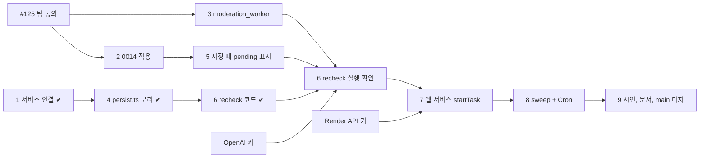

# Render Workflows 개발 계획 (AI 스크리닝 사후 재판정, 버블)

- 설계와 결정의 기준: `docs/planning/16-render-workflows.md`. 이 문서는 **무엇을 어떤 순서로 만들고 어떻게 확인하는지**만 적습니다.
- 개발: 본인 (Jimin). 팀 합의가 필요한 항목은 GitHub 이슈에서 받습니다 (0장).
- 브랜치: `jimins-claude/feature-render-workflows`. 모든 단계를 여기서 하고 마지막에 main에 머지합니다.
- 마감: 2026-12-05. 시연 최소선은 6단계입니다.

## 현재 상태 (새 세션은 여기부터 읽기)

마지막 갱신: 2026-11-27

| 항목 | 상태 |
|---|---|
| 끝난 단계 | 1 (Workflow 서비스, 슬러그 `memoamo-agent`), 4 (`persist.ts` 분리), 6·8의 코드 작성 (`moderation.recheck`, `moderation.sweep`), 묶음 빌드 확인 (`check.shared` 성공, 지움) |
| 대기 | 2 마이그레이션 `0014`(파일은 작성, **공유 DB 미적용**), 3 DB 계정 `moderation_worker` . #125 동의 받음 (2026-11-26), 적용만 남음 |
| 다음 할 일 | 2단계 적용 → 3단계 계정 → Workflow Environment에 `DATABASE_URL`, `OPENAI_API_KEY` → 5단계(`saveChatMessage`에 표시 저장) → 6단계 실행 확인. 동의 전에는 5단계 코드를 넣지 않음 (열이 없으면 저장이 실패함) |
| 남은 확인 | 4단계 화면 확인 (로컬 위반 문장 → 숨김, 경고 n/3). `recheck`, `sweep`의 실제 DB 실행 |
| 주의 | `schema.ts`에 0014 열 정의가 먼저 들어가 있음. 읽기·쓰기 코드가 이 열을 쓰지 않으므로 미적용 DB에서도 앱은 정상 동작 (전체 열 select 없음 확인) |
| 사용자가 할 일 | Workflow 전용 OpenAI 키, Render API 키 발급 (0장) |
| 관련 이슈 | #124 `jimins-claude/feature-agents` 삭제 제안 (답 대기), #125 공유 DB·공용 코드 변경 동의 (동의 받음) |
| Render 설정 | Branch `jimins-claude/feature-render-workflows`, Root `workflows`, Build `npm ci`, Start `npm start`, Singapore |

- 단계를 끝낼 때마다 이 표와 맨 아래 "진행 기록"을 같이 고칩니다.
- 함께 진행 중인 다른 계획: 개발 보조 에이전트, PR 리뷰, impeccable (`docs/planning/15-agents.md`). 에이전트 진행 상태는 `docs/dev/agents.md`

## 단계 흐름

- ✔: 끝남 (코드만 끝난 것 포함). 6단계 실행 확인이 시연 최소선입니다.

## 0. 시작 전 조건

| 항목 | 상태 | 막히는 단계 |
|---|---|---|
| Render Workflow 서비스 생성 | 완료 (2026-11-26) | 1 |
| 팀 합의: 마이그레이션 `0014` 번호 | #125 동의 (2026-11-26) | 2 |
| 팀 합의: DB 계정 `moderation_worker` (힙 테이블 일부 수정 권한 포함) | #125 동의 (2026-11-26) | 3 |
| 팀 합의: `src/lib/moderation/` 저장 로직 분리 (`persist.ts`) | #125 동의 (2026-11-26) | 4 |
| Workflow 전용 OpenAI 키 | 본인 발급 필요 | 6 |
| Render API 키 | 본인 발급 필요 | 7 |

합의를 기다리는 동안 1단계와 4단계의 코드 작성(공유 DB를 건드리지 않는 부분)을 먼저 합니다.

## 1. Workflow 서비스 연결과 뼈대 확인

Render 대시보드 설정

| 칸 | 값 |
|---|---|
| Repository | `jimin-ni/CMMS` (이름 변경 후 `jimin-ni/memoamo`) |
| Branch | `jimins-claude/feature-render-workflows` |
| Region | Singapore |
| Language | Node |
| Root Directory | `workflows` |
| Build Command | `npm ci` |
| Start Command | `npm start` |
| Auto-Deploy | On (이 브랜치에 푸시하면 다시 배포) |

할 일
- [x] 첫 배포 후 대시보드에 `hello`, `helloMany`가 보이는지 확인
- [x] 대시보드에서 `hello`를 `["memoamo"]`로 실행 → `Hello, memoamo!`
- [x] `workflows/src/check/shared.ts`: `../../../src/lib/moderation/normalize.ts`를 import하는 `check.normalize` task 추가
- [x] 배포 후 `check.normalize`를 `["ㅅ ㅂ 테스트"]`로 실행해 정규화 결과가 나오면 Root Directory 밖의 파일을 읽을 수 있음
- [x] (필요 없었음) Root Directory `workflows` 그대로 `../src`의 파일을 읽을 수 있음. `check.normalize` 성공 (2026-11-26). 확인 task는 지움
- [x] Workflow 슬러그: `memoamo-agent` (task 식별자 예: `memoamo-agent/hello`). 환경 변수 `RENDER_WORKFLOW_SLUG`에 씀

검사: `cd workflows && npm run check`

## 2. 마이그레이션 `0014_bubble_recheck.sql`

- [ ] 이슈에서 번호 합의 확인
- [x] `db/migrations/0014_bubble_recheck.sql` 작성 (내용은 16 문서 4장)
- [x] `src/lib/schema.ts`의 `bubbleMessages`에 `openaiStatus`, `recheckStatus`, `recheckAttempts`, `recheckedAt` 추가
- [ ] 적용 전 `bubble_migrations`에서 미적용 파일이 `0014`뿐인지 확인
- [ ] `npm run db:bubble`로 공유 DB 적용
- [ ] 확인: 기존 버블 화면에서 메시지 보내기, 삭제, 폴링이 그대로 동작

## 3. DB 계정 `moderation_worker`

- [ ] 이슈에서 권한 범위 합의 확인
- [ ] 비밀번호를 로컬에서 만들고 16 문서 5장 SQL 실행 (SQL과 비밀번호는 커밋하지 않음)
- [ ] 확인: 이 계정으로 `SELECT email FROM "user"` 거부, `DELETE FROM bubble_messages` 거부, `SELECT id FROM bubble_messages LIMIT 1` 성공
- [ ] Render Workflow 서비스 Environment에 `DATABASE_URL` (Internal URL + 이 계정)

## 4. 저장 로직 분리 (`persist.ts`)

동작을 바꾸지 않는 리팩터링입니다.

- [x] `src/lib/moderation/persist.ts` 새로 만들기: `lockUser`, `countStrikes`, `takeDownPosts`, `applyAutoBlock`, `planScreen`, `recordScreenEvent`를 옮김. `@/` 별칭과 `@/lib/db` import 없이 `tx`(또는 실행기)만 받음
- [x] 사전 읽기 `loadScreenLists(exec)`를 `server.ts`에서 떼어 `persist.ts`로
- [x] `repo.ts`, `server.ts`는 `persist.ts`를 import해서 기존 이름 그대로 export
- [x] 다른 파일의 import 경로는 바꾸지 않음
- [x] 검사: `npm test`, `npx tsc --noEmit`, `npx eslint src scripts`, `npm run build`
- [ ] 확인: 로컬에서 위반 문장 전송 → 숨김, 경고 안내 n/3 (기존과 같음). 코드상 동작은 같음 (함수 본문을 그대로 옮김), 화면 확인은 남음

## 5. 저장할 때 재판정 표시

- [ ] `saveChatMessage`: `openaiStatus = result.openai` 저장
- [ ] 재판정 대상(`error`, `timeout`, `skipped_rate`, `skipped_breaker`)이고 `plan.status === "published"`면 `recheckStatus = "pending"`
- [ ] 단위 테스트: `openai` 값별로 `recheckStatus`가 맞게 정해지는지 (`moderation.test.ts`에 추가)
- [ ] 확인: 로컬 `.env.local`의 `OPENAI_API_KEY`를 일부러 틀린 값으로 두고 보통 문장 전송 → DB에서 `recheck_status = 'pending'`

## 6. `moderation.recheck` task (시연 최소선)

파일
- [x] `workflows/src/common/config.ts`: 필요한 환경 변수가 없으면 바로 실패
- [x] `workflows/src/common/db.ts`: Drizzle + pg, `moderation_worker` 연결
- [x] `workflows/src/moderation/moderate.ts`: OpenAI Moderation 호출. 사용자 상한 없음, 시간 제한과 재시도만
- [x] `workflows/src/moderation/tasks.ts`: `recheck(surface, messageId)` (동작은 16 문서 6-3)
- [x] **의존성 해석 문제 대응**: `../src/lib/schema.ts`가 쓰는 `drizzle-orm`을 Render에서 찾을 수 있게 `workflows/build.mjs`(esbuild)로 `dist/index.js` 한 파일로 묶음. `npm ci`의 `postinstall`이 빌드하므로 Render 설정은 그대로. `drizzle-orm` 0.45.4, `pg` 8.23.1 추가. `tsconfig.json`의 `paths`로 타입도 한 벌로 맞춤. 레포 밖 빈 폴더에서 `dist/index.js` 단독 실행 확인. Render에서 `check.shared` 실행 확인은 남음
- [ ] Render Workflow Environment에 `OPENAI_API_KEY` (Workflow 전용 키)

확인
- [ ] 5단계에서 만든 `pending` 메시지 id로 대시보드 실행 `["chat", "<id>"]`
  - 보통 문장: `recheck_status = 'done'`, 화면 변화 없음
  - 위반 문장: 다른 구독자 화면에서 내려감, `moderation_events`에 `source = 'auto'` 기록, 경고 수 +1
- [ ] 같은 id로 한 번 더 실행해도 아무것도 바뀌지 않음 (중복 안전)
- [ ] 이미 삭제한 메시지 id로 실행하면 `done`으로만 바뀜

## 7. 웹 서비스에서 자동 실행

- [ ] 루트에 `@renderinc/sdk` 설치
- [ ] `src/lib/workflows.ts` (`server-only`): `startRecheck(surface, id)`. `RENDER_API_KEY`나 `RENDER_WORKFLOW_SLUG`가 없으면 아무것도 안 함
- [ ] `src/lib/bubble/actions.ts`: 저장 결과가 `pending`이면 `after(() => startRecheck("chat", id))`. 오류는 로그만
- [ ] `.env.example`에 두 키 추가 (값 없이)
- [ ] Render 웹 서비스 Environment에 두 키 추가
- [ ] 검사: `npx tsc --noEmit`, `npx eslint src scripts`, `npm run build`
- [ ] 확인: 배포 환경에서 위반 문장이 판정 실패로 공개된 뒤 몇 초 안에 내려가는지, 걸린 시간 기록

## 8. `moderation.sweep` + Cron Job

- [x] `tasks.ts`에 `sweep()` 추가 (16 문서 6-3)
- [ ] `workflows/src/cron/sweep.ts`: `startTask("<slug>/moderation.sweep", [])`만 하고 끝
- [ ] Render Cron Job 서비스 생성: 같은 브랜치, Singapore, 일정 `*/10 * * * *`, 명령 `cd workflows && npm ci && npx tsx src/cron/sweep.ts`, Environment에 `RENDER_API_KEY`, `RENDER_WORKFLOW_SLUG`
- [ ] 확인: 웹 서비스의 `RENDER_API_KEY`를 잠시 빼고 위반 문장 전송 → 10분 안에 내려감

## 9. 마무리

- [ ] 시연 녹화 (16 문서 9장 시나리오)
- [ ] 측정값 기록: 전송→숨김 시간, task 실행 시간, 재시도 수
- [ ] 문서 갱신: 16 문서 상태, 12 문서 21장, 03 문서 버전 표, 04 결정 로그
- [ ] 테스트 계정, 테스트 메시지 정리 여부 확인
- [ ] main 머지 후 Workflow 서비스와 Cron Job의 Branch를 main으로 변경

## 진행 기록

| 날짜 | 단계 | 내용 |
|---|---|---|
| 2026-11-26 | 0 | 계획 작성, Workflow 서비스 생성 |
| 2026-11-26 | 1 | Workflow 서비스 배포, `hello`, `check.normalize` 실행 성공. 슬러그 `memoamo-agent` |
| 2026-11-26 | 4 | `persist.ts` 분리. `npm test`(73개 통과), `tsc`, `eslint`, `build` 통과 |
| 2026-11-26 | 6 준비 | 묶음 빌드(`build.mjs`) 추가, 확인용 `check.shared` task 추가 |
| 2026-11-26 | 6 준비 | Render에서 `check.shared` 성공 (표 이름, 함수, 정규화 결과). 확인 task 삭제 |
| 2026-11-26 | 2, 6, 8 코드 | `0014` 파일과 `schema.ts` 열 정의 작성(DB 미적용). `persist.ts`에 `needsRecheck`, `recheckChatMessage` 추가와 단위 테스트. Workflow에 `moderation.recheck`, `moderation.sweep` 등록. `npm test` 76개, `tsc`, `eslint`, `build` 통과 |
| 2026-11-27 | 0 | #125 팀원 동의 확인. 2, 3단계 진행 가능 |
