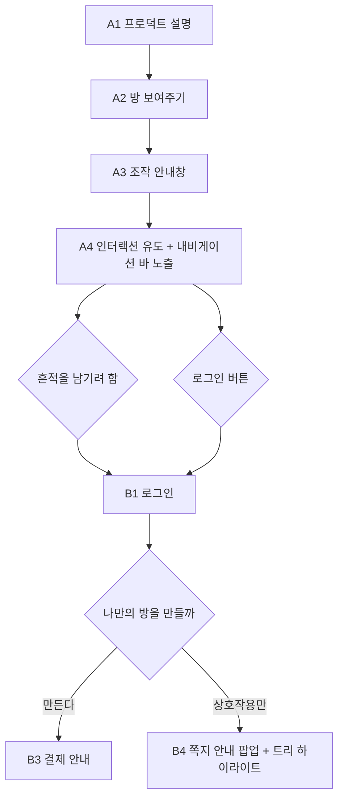
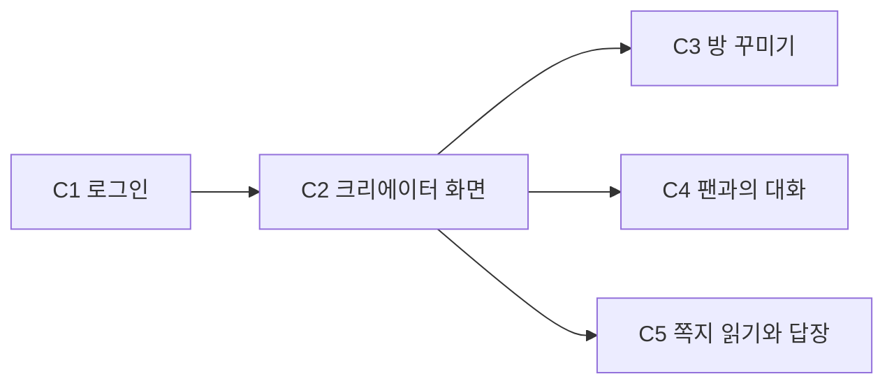

# 08. 디자인 (현재 화면 기준)

- 상태: [사실] 2026-11-13 `main`(`707be6d`)의 실제 화면을 분석해 정리. 디자인 개편안은 아님
- 범위: 데스크톱 1440px. 모바일은 아직 확인하지 않음
- Figma: [Hack the Audience 공모전 · "CMMS 현재 화면 (2026-11-13)" 페이지](https://www.figma.com/design/AZZHvJlFq9jtDkPjSETYxL/?node-id=35-2)
- 관련 문서: 02 (기능), 03 (기술 스택), 04 (역할 분담, 결정 로그), 09 (방 구성)

이 문서는 지금 앱이 어떻게 생겼는지 기록합니다. Figma에서 디자인을 고칠 때 출발점으로 씁니다. 코드와 Figma가 어긋나면 코드가 기준입니다.

> **2026-11-14 전제 변경 안내**
> §1~§5(색, 글꼴, 레이아웃, 컴포넌트)와 §8~§11은 2026-11-13 화면을 적은 기록입니다. 그래서 제거하기로 한 크리에이터 톡과 프로필 사진이 아직 남아 있습니다.
> **§6(화면과 접근 규칙)과 §7(사용자 흐름)은 전제 변경 뒤의 목표 상태로 다시 썼습니다.** 두 곳이 어긋나면 §6·§7이 기준입니다.

> **2026-11-14 코드 점검 반영**
> `main`(`a790e56`)과 `jimins-claude/feature-onboarding-concepts`(`d108912`)의 코드를 다시 읽고 고쳤습니다.
> - 힙 꾸미기: 위 막대, 더 보기 메뉴, 독 탭 5개, 색·무늬, 템플릿, 채널, 체크리스트, 공유, 팔로워로 보기 (§2-2, §4-4, §5-3, §8-3)
> - 첫 화면의 온보딩 컨셉 A·B·C 블록과 빈 페이지 (§3-2, §4, §5-2, §6). 이 부분은 아직 브랜치에만 있습니다.
> - 앱 화면(로그인, 회원가입, 크리에이터, 버블)은 11-13 이후 GA 이벤트만 더해졌고 화면은 그대로입니다.
> - 새로 적은 컴포넌트는 아직 Figma에 없습니다 (§10-1).

## 1. 한눈에 보기

CMMS 화면은 성격이 다른 두 영역으로 나뉩니다.

| 영역 | 화면 | 분위기 | 바탕 | 글꼴 |
|---|---|---|---|---|
| 앱 화면 | 홈, 온보딩 컨셉, 로그인, 회원가입, 기능, 크리에이터 페이지, 버블 채팅, 미니홈 목록 | 밝고 단정한 카드형. 연회색 바탕에 흰 카드, 갈색 포인트 | `key-mist` (#e6eaec) | `system-ui` |
| 힙 미니룸 | `/room/[slug]`, `/room/me`, 꾸미기 | 따뜻한 저조도 3D 방. 올리브와 종이색, 손글씨 | `heap/olive` (#565344) | IBM Plex Sans KR, Nanum Pen Script |

- [사실] 두 영역은 같은 헤더(`src/components/header.tsx`)를 함께 씁니다.
- [사실] 힙 미니룸 스타일은 `src/components/heap/heap-room.css` 안에서 `.heap-room` 아래로만 적용되며, 앱 화면에는 영향을 주지 않습니다.
- [사실] 버블 대화방은 카카오톡과 비슷한 임시 색(`talk-bg`, `talk-yellow`)을 씁니다. `globals.css` 주석에 "임시 색"이라고 적혀 있습니다.

## 2. 색

### 2-1. 색 토큰

Figma에는 로컬 변수 컬렉션 `CMMS colors`로 만들었습니다. 모든 컴포넌트의 채우기와 테두리가 이 변수에 묶여 있습니다.

| Figma 변수 | HEX | 코드 이름 | 정의한 곳 | 쓰임 |
|---|---|---|---|---|
| `key/brown` | #6b4e37 | `--color-key-brown` | `src/app/globals.css` | 헤더 바탕, 주 버튼, 제목 글자, 선택된 탭·토글 |
| `key/mist` | #e6eaec | `--color-key-mist` | `globals.css` | 페이지 바탕, 헤더 글자, 보조 버튼과 비활성 탭 바탕, 상태 배지 |
| `key/blue` | #8fb0cf | `--color-key-blue` | `globals.css` | 역할 배지 바탕. 40% 투명도로 아바타 바탕 |
| `key/stone` | #9ea09e | `--color-key-stone` | `globals.css` | 보조 설명, 안내 문구, 입력칸 테두리(50%), 글자 수 |
| `talk/bg` | #b2c7da | `--color-talk-bg` | `globals.css` | 버블 대화방 메시지 영역과 대화방 머리 |
| `talk/yellow` | #fee500 | `--color-talk-yellow` | `globals.css` | 내 말풍선, "참여" 버튼, 전송 버튼(활성) |
| `text/body` | #2b2b2b | `body { color }` | `globals.css` | 기본 글자 |
| `text/strong` | #111827 | Tailwind `gray-900` | 각 컴포넌트 | 채팅 제목, 대화방 목록 제목, 말풍선 글자 |
| `base/white` | #ffffff | `bg-white` | 각 컴포넌트 | 카드, 입력칸, 상대 말풍선 |
| `state/error` | #b91c1c | Tailwind `red-700` | 각 폼 | 오류 문구, 글자 수 초과 |
| `heap/olive` | #565344 | `--olive` | `heap-room.css` | 방 바탕, 꾸미기 탭(선택), 패널 머리, 도구줄 경계선 |
| `heap/clay` | #a6613c | `--clay` | `heap-room.css` | 힙 주 버튼, 방 이름(꾸미기), 강조 링크, 기능 태그 |
| `heap/paper` | #f3eadb | `--paper` | `heap-room.css` | 힙 글자(방 위), 패널·도구줄·독 바탕, 힌트 알약(90%) |
| `heap/ink` | #2f2c24 | `--ink` | `heap-room.css` | 패널 글자, 고스트 버튼(78%), 미니홈 만들기 화면 바탕 |

### 2-2. 변수로 만들지 않은 색

| 값 | 쓰는 곳 | 비고 |
|---|---|---|
| `rgba(243,234,219,0.74)` (`--paper-dim`) | 방 HUD의 보조 줄 | Figma에서는 `heap/paper` 74% |
| #fff8ec | 꾸미기 입력칸, 칩, 가구 타일 바탕 | 종이보다 밝은 크림색 |
| #4a4338 | 고른 가구 위 막대(`.ed-bar`) 버튼 | |
| #7d9a4a | 기능이 붙은 기능 카드 테두리(`.ed-fncard.set`) | 유일한 초록 |
| #efe6d6 | 방 안 휴대폰 화면 바탕 | |
| `orange-500` | 미니홈 카드의 "새 소식" 점 | Tailwind 기본색 |
| `gray-500/600/700` | 삭제된 메시지, 시간, 보낸 사람 이름 | Tailwind 기본색이 토큰과 섞여 있음 (9절) |
| black 60% | `/room/me` 배경 위 덮개 | |
| #c2452d | 방 이름 입력 오류 테두리, 오류 말풍선(`.ed-name-err`) 바탕 | 힙 오류색 |
| #a23a2a | 방 이름 글자 수 초과(`.ed-bad`) | |
| #4f6a2a | 성공 안내 글자 (공유 결과 `.share-note`, 체크리스트 `.setup-note`) | 힙 성공색 |
| `rgba(47,44,36,0.88)` | 팔로워로 보기 알약(`.ed-preview`) 바탕 | `heap/ink` 88% |
| `rgba(243,234,219,0.96)` | 체크리스트 카드와 진행 알약 바탕 | `heap/paper` 96% |

### 2-3. 미니홈 카드 그라데이션

`src/components/heap-funnel/room-card.tsx`가 방 주소(slug)의 해시로 4색 중 하나를 고릅니다. 사진 없이 색으로 방을 구분합니다. 모두 135° 선형 그라데이션입니다.

| Figma 변형 | 시작 | 끝 | 현재 쓰는 방 |
|---|---|---|---|
| `Color=Olive` | #565344 | #7d7860 | 없음 |
| `Color=Clay` | #A6613C | #c98a5f | Lovesoo |
| `Color=Brown` | #6b4e37 | #9a7656 | 샘플 방 |
| `Color=Teal` | #4f6a62 | #7f9a8f | Dname |

### 2-4. 대비 (WCAG 2.x 계산값)

| 글자 / 바탕 | 대비 | 본문 기준 4.5:1 |
|---|---|---|
| `key/brown` / 흰색 | 약 7.7:1 | 통과 |
| `key/mist` / `key/brown` (헤더) | 약 6.3:1 | 통과 |
| `key/brown` / `key/blue` (역할 배지) | 약 3.4:1 | 미달 |
| `key/stone` / 흰색 (보조 설명) | 약 2.6:1 | 미달 |

- [사실] 보조 설명과 안내 문구의 대부분이 `key/stone`으로 되어 있어 읽기 어렵습니다. 9절에 개선 후보로 적었습니다.

## 3. 글꼴

### 3-1. 글꼴 종류

| 영역 | 코드 | Figma에서 쓴 글꼴 | 비고 |
|---|---|---|---|
| 앱 화면 | `system-ui, -apple-system, "Segoe UI", sans-serif` | Noto Sans KR | [사실] 운영체제마다 실제 글꼴이 다름. Windows에서는 Segoe UI와 맑은 고딕 |
| 힙 UI | `"IBM Plex Sans KR", system-ui` (`--ui`) | IBM Plex Sans KR | |
| 힙 손글씨 | `"Nanum Pen Script"` (`--hand`) | Nanum Pen | 방 이름, 방명록 이름, 토스트, 큰 숫자 |

- [미정] 앱 화면 글꼴을 하나로 정할지. 지금은 기기마다 다르게 보입니다.

### 3-2. 크기 단계 (앱 화면)

| Tailwind | px | 굵기 | 쓰는 곳 |
|---|---|---|---|
| `text-3xl` | 30 | bold | 홈 환영 제목, 온보딩 컨셉 페이지 제목, "아직 내 미니홈이 없어요" |
| `text-2xl` | 24 | bold | 페이지 제목 (로그인, 회원가입, 주요 기능, 미니홈 목록, 내 미니홈 만들기) |
| `text-xl` | 20 | bold | "채팅", "크리에이터 페이지" |
| `text-lg` | 18 | bold / semibold | 카드 제목 (기능 카드, 온보딩 블록), 섹션 제목 (추천 방, 프로필 사진, AI 반응 미리보기 설정) |
| `text-base` | 16 | regular | 설명 문단, 버튼 글자 |
| `text-sm` | 14 | regular | 폼 라벨, 입력값, 목록 보조, 헤더 메뉴, 말풍선 |
| `text-xs` | 12 | regular | 도움말, 글자 수, 참여 인원, 배지 |
| `text-[10px]` | 10 | regular | 말풍선 시간 |

### 3-3. 크기 단계 (힙 미니룸)

| 요소 | 크기 | 글꼴 |
|---|---|---|
| 방 이름 (HUD) | 42 | Nanum Pen |
| 꾸미기 도구줄의 방 이름 | 26 | Nanum Pen |
| 방 HUD 보조 줄 | 13 | IBM Plex, 자간 0.02em, 숫자 고정폭 |
| 버튼 | 14 SemiBold (작은 버튼 12) | IBM Plex |
| 힌트 알약 | 13 | IBM Plex |
| 꾸미기 탭 | 13 SemiBold | IBM Plex |
| 칩, 검색칸 | 12.5 | IBM Plex |

## 4. 레이아웃

### 4-1. 공통 틀

- 헤더: 높이 62px, 바탕 `key/brown`. 안쪽 폭은 `max-w-5xl`(1024px)에 좌우 여백 24px. 1440 화면에서 로고는 x=232에서 시작합니다.
- 본문: 헤더 아래 `key-mist` 바탕. 위아래 여백은 48px(`py-12`)이고, 채팅과 크리에이터 페이지는 40px(`py-10`)입니다.

### 4-2. 본문 폭 3종

| 클래스 | 내용 폭 | 화면 |
|---|---|---|
| `max-w-5xl` | 976 | 홈, 온보딩 컨셉 페이지, 주요 기능, 미니홈 목록 |
| `max-w-2xl` | 624 | 크리에이터 페이지, 채팅 목록, 크리에이터 톡 |
| `max-w-md` | 400 | 로그인, 회원가입, 내 미니홈(구독자 안내) |
| 대화방 | 640 | `/bubble/[roomId]`, `/bubble/talk/[chatId]` |
| 미니홈 만들기 폼 | 512 | `/room/me` (`max-w-lg`) |

### 4-3. 카드

- 흰 바탕, 모서리 16px(`rounded-2xl`).
- 안쪽 여백은 32px(`p-8`, 홈·로그인·회원가입)이나 24px(`p-6`, 크리에이터 페이지 섹션, 기능 카드)입니다.
- 그림자 `shadow-sm`은 홈, 온보딩 블록과 페이지, 로그인, 회원가입, 기능 카드, 미니홈 카드에만 있습니다. 크리에이터 페이지와 채팅 카드에는 없습니다.
- 누를 수 있는 카드(기능 카드, 온보딩 블록)는 마우스를 올리면 2px 떠오르고 그림자가 `shadow-md`로 커집니다.
- 카드 사이 간격: 크리에이터 페이지 32px, 기능 카드와 온보딩 블록 24px, 미니홈 카드 16px.
- 홈에서는 환영 카드 아래 32px(`mt-8`)에 온보딩 블록 줄이 옵니다. `md`(768px) 이상에서 3열, 그보다 좁으면 1열입니다.

### 4-4. 힙 미니룸 틀

- 방은 헤더 아래를 전부 채웁니다. 1440×900 화면에서 3D 영역은 1440×838입니다.
- HUD: 왼쪽 위 16px에 방 이름과 보조 줄. 아래쪽 가운데에 버튼 줄과 힌트 알약.
- 꾸미기: 위 도구줄 52px(`--ed-top`), 아래 독 150px(`--ed-dock`). 3D 캔버스는 그 사이로 줄어 1440×636이 됩니다.
  - 채널 탭을 열면 글줄이 많아 독이 220px로 높아집니다 (`.heap-room:has(.ch-pane)`).
  - 더 보기 메뉴(`.ed-menu`)는 도구줄 4px 아래에 폭 220px로 펼칩니다.
  - 안내 알약과 알림(토스트)은 독 10px 위 가운데에 한 줄기로 쌓입니다 (`.ed-float`). 둘 중 하나가 두 줄이 되어도 겹치지 않습니다.
  - 팔로워로 보기를 켜면 캔버스가 방 전체로 돌아가고, 방 HUD가 다시 보이며, 아래 16px에 알약 하나만 남습니다.
- 첫 방 열기 체크리스트: 방에서는 왼쪽 16px, 위 116px(방 이름 아래). 꾸미기에서는 왼쪽 12px, 도구줄 10px 아래.
- 공유 판(`.share-pop`): 아래 버튼 줄 위(아래에서 112px) 가운데. 폭은 최대 380px입니다.
- 좁은 창 (컨테이너 쿼리, 방 영역 폭 기준)
  - 860px 이하: 도구줄의 "꾸미기" 글자를 숨기고, 방 이름 폭을 150px로 줄입니다.
  - 760px 이하: 채널 탭 왼쪽을 42%로 줄이고, 영상 목록의 날짜·조회수를 숨깁니다.
  - 700px 이하: 방 이름을 96px·22px로 줄이고, 저장 상태 글을 숨깁니다.
- 겹쳐 뜨는 창(`.overlay`): 반투명 덮개 위 가운데에 패널(최대 폭 420px, 종이색, 머리는 올리브)을 띄웁니다. PC 링크, 기념품, 달력, 영상 목록, 방명록, 휴대폰(330×640, 모서리 34px)이 이 방식입니다.

## 5. 컴포넌트

Figma "Components" 프레임에 있는 컴포넌트와 코드 위치입니다. 텍스트는 모두 컴포넌트 속성(TEXT property)으로 바꿀 수 있습니다.

### 5-1. 앱 공통

| Figma | 변형 / 속성 | 코드 | 규격 |
|---|---|---|---|
| `Header` | `State` = Guest / Subscriber / Creator | `src/components/header.tsx` | 1440×62. Guest: 로그인, 회원가입. 로그인 후: 기능, RoleBadge, 로그아웃 |
| `RoleBadge` | `Role` | `header.tsx`, `src/lib/access.ts`의 `roleLabel` | 바탕 `key/blue`, 글자 `key/brown` 14px, 좌우 10 / 위아래 2, 알약형 |
| `Button` | `Style` 9종, `Label` | 여러 곳 | 아래 표 |
| `TextField` | `State` = Empty / Placeholder / Filled, `Label`, `Value` | 로그인, 회원가입, 폼들 | 라벨 14px, 간격 4, 입력칸 모서리 8, 테두리 `key/stone` 50%, 안쪽 12/8 |
| `ChoiceToggle` | `Selected` = true / false, `Label` | `src/app/signup/page.tsx` | 모서리 8. 선택하면 `key/brown` 바탕에 `key/mist` 글자 |
| `Avatar` | `Letter` | `src/components/avatar.tsx` | 기본 44px, 모서리 38%, 바탕 `key/blue` 40%, 글자 크기는 지름의 38%. 사진이 있으면 사진 |

`Button` 변형:

| Style | 바탕 / 테두리 | 글자 | 여백 | 쓰는 곳 |
|---|---|---|---|---|
| Primary | `key/brown` | `key/mist` 16 | 20/8 | 로그인, 가입하기, 주요 기능 보기, 방 만들기 |
| Primary Small | `key/brown` | `key/mist` 14 | 20/8 | 검색, 대화방 열기, 저장, 내 미니홈 |
| Primary Large | `key/brown` | `key/mist` 18 medium | 28/12 | 내 미니홈 만들기 |
| Secondary | `key/mist` | `key/brown` 14 | 16/6 | 파일 선택, 크리에이터 톡 검색 |
| Outline Light | 테두리 `key/mist` 60% | `key/mist` 14 | 12/4 | 헤더 로그아웃 |
| Outline Stone | 테두리 `key/stone` | `key/brown` 12 | 12/3 | 대화방 닫기 |
| Yellow | `talk/yellow` | `text/strong` 12 | 12/3 | 대화방 참여 |
| Text | 없음 | `key/brown` 16 | 20/8 | 닫기 |
| Disabled | Primary에 60% 투명도 | | | 사진 저장, 대화 시작(선택 전) |

### 5-2. 콘텐츠

| Figma | 변형 / 속성 | 코드 | 규격 |
|---|---|---|---|
| `FeatureCard` | `Status`, `Title`, `Desc`, `Owner` | `src/app/features/page.tsx`, `src/lib/features.ts` | 폭 309, 여백 24, 상태 배지(`key/mist`), 구분선 위에 담당 표시 |
| `OnboardingBlock` | `Status`, `Title`, `Desc` | `src/app/page.tsx`, `src/lib/onboarding.ts` | `FeatureCard`에서 담당 줄을 뺀 모양. 언제나 링크(`/onboarding/[id]`). 상태 배지는 지금 모두 "준비 중". [미정] Figma에 아직 없음 |
| `RoomCard` | `Color` 4종, `Initial`, `Name`, `Owner`, `Blurb` | `src/components/heap-funnel/room-card.tsx` | 폭 315, 위 16:9 그라데이션에 첫 글자 48px(흰색 90%), 아래 12 여백 |
| `ChatListRow` | `Trailing` = Join / Status, `Title`, `Sub` | `src/app/bubble/page.tsx` | 높이 68, 좌우 20, 아바타 44. 참여 전 구독자에게는 Join, 그 밖에는 "열림/닫힘" |
| `ChatTabs` | `Active` = Subscribers / Creators | `src/components/bubble/chat-tabs.tsx` | 크리에이터에게만 보임. 선택 탭은 `key/brown`, 나머지는 `key/mist` |
| `ChatHeader` | `CloseButton` = true / false, `Title`, `Sub` | `src/components/bubble/room-chat.tsx`, `room-controls.tsx` | 640×64, 바탕 `talk/bg`, 뒤로 가기 표시, 방 주인에게만 "대화방 닫기" |
| `ChatBubble` | `From` = Me / Other, `Text`, `Time`, `Name` | `room-chat.tsx` | 모서리 16, 안쪽 12/8. Me는 노랑에 시간이 왼쪽, Other는 흰색에 아바타 36과 이름. 같은 사람이 이어 보내면 이름과 아바타는 한 번만 |
| `ChatComposer` | `Count` | `src/components/bubble/composer.tsx` | 흰 바탕, 여백 12. 전송 버튼은 비활성일 때 `key/mist`, 활성일 때 `talk/yellow`. 글자 수 표시(구독자 200, 크리에이터 500) |
| `CreatorPickCard` | `Name` | `src/components/bubble/creator-picker.tsx` | 288×74, 모서리 12, 아바타 48, "크리에이터" 배지, 선택 원 |
| `TemplateOption` | `Selected`, `Title`, `Desc` | `src/components/heap-funnel/claim-room.tsx` | 448×66, 모서리 12. 선택하면 테두리 `key/brown`, 바탕 `key/mist` |

### 5-3. 힙 미니룸

| Figma | 변형 / 속성 | 코드 (`heap-room.css`) | 규격 |
|---|---|---|---|
| `Heap/Button` | Clay, Ghost, Paper, 각 Small, Small Disabled | `.btn`, `.btn.ghost`, `.btn.paper`, `.btn.small` | 알약형. 기본 14 SemiBold, 안쪽 16/9. Small은 12, 안쪽 11/6. 비활성은 45% 투명도 |
| `Heap/Hint` | `Text` | `.hint` | `heap/paper` 90%, 13px, 안쪽 12/6. 꾸미기 안내는 `heap/ink` 78% 바탕에 종이색 글자 |
| `Heap/RoomTitle` | `Name`, `Meta`, `Visit` | `.who` | 방 이름 42 Nanum Pen, 보조 줄 13px 종이색 74% |
| `Heap/EditorToolbar` | `RoomName`, `SaveState` | `.ed-top` (`room-editor.tsx`) | 1440×52, 종이색, 아래 2px 올리브. 왼쪽부터 "꾸미기", 방 이름, 되돌리기, 다시 하기, 위에서, 맞추기, ⋯ … 저장 상태, 저장, 나가기. 방 이름은 최대 220px이고 넘치면 말줄임. 맞추기는 확대하거나 옮긴 뒤에만 보임 |
| `Heap/RoomNameEdit` | `Value`, `Count`, `Error` | `.ed-name`, `.ed-name-err` | 도구줄의 방 이름을 누르면 그 자리에서 입력칸(220px, 22px Nanum Pen, 크림 바탕, 테두리 `heap/clay`)으로 바뀜. 옆에 글자 수 `n/40`. 오류는 입력칸 아래 빨간 말풍선 |
| `Heap/EditorMenu` | 항목 3~4개 | `.ed-menu` | ⋯를 누르면 열림. 폭 220, 종이색, 테두리 2px 올리브, 모서리 10. 시간 · (지금 시간), 처음으로, 저장 전으로(저장한 뒤에만), 팔로워로 보기 `V` |
| `Heap/Chip` | `Selected`, `Label` | `.ed-chip` | 알약형 12.5px. 선택하면 올리브 바탕에 종이색 글자. 비활성은 50% |
| `Heap/FurnitureTile` | `Name` | `.ed-tile` | 84×84, 썸네일 76×56은 3D 모델 렌더 이미지 |
| `Heap/EditorDock` | `Tab` = 가구 / 기능 / 색·무늬 / 템플릿 / 채널 | `.ed-dock`, `.ed-tabs`, `.ed-pane` | 1440×150 (채널 탭 220). 탭 5개, 오른쪽에 "가구 n개"와 "가구: Kenney (CC0)" 링크. 가구 탭은 검색, 분류 칩 12개(침대 … 크리스마스), 가구 타일 줄 |
| `Heap/PaletteCard` | `Mine` = true / false, `Name` | `.ed-palcard` (`colour-pane.tsx`) | 색·무늬 탭의 팔레트 카드. 내 색 카드는 점선 테두리이고, 색을 조정했으면 "· 조금 조정함" |
| `Heap/BrandColours` | 내 색, 직접, 배경 | `.ed-brand`, `.ed-backdrop` | 색 우물(26×22, 모서리 4)과 HEX 입력칸(66px). 배경은 원형 점 20px |
| `Heap/PiecePaint` | 부분 줄 n개 | `.ed-paint` (`piece-colour.tsx`) | 고른 가구 막대 위 6px에 뜨는 판. 줄마다 부분 이름, 색 점 20px, 내 색, 색 고르기, 프리셋 알약(`heap/clay` 테두리). 화면 위가 모자라면 막대 아래로 |
| `Heap/TemplateCard` | `Name`, `Note` | `.ed-tplcard` | 템플릿 탭. 폭 170, 크림 바탕, 모서리 10. 위 52px 그림, 아래 이름과 한 줄 설명 11px |
| `Heap/ChannelPane` | 연결 전 / 연결 후 | `.ch-pane` (`channel-tab.tsx`) | 왼쪽(최대 380px) 채널 연결, 채널 목록, 게시물 링크 붙여넣기. 오른쪽 가져온 영상 목록: 종류(`heap/clay` 11px), 제목, 날짜·조회수, 칩. 뺀 영상은 60%에 취소선 |
| `Heap/SetupChecklist` | `Open` = true / false, `Done` | `.setup-check`, `.setup-pill` (`setup-checklist.tsx`) | 방 주인에게만. 펼치면 236px 카드: 제목 "방 열기 n/7", 진행 막대 5px(올리브), 7줄(URL 정하기, 방 이름 짓기, 채널 연결, 링크 놓기, 기념품 놓기, 방 꾸미고 저장하기, 링크 공유하기). 끝난 줄은 올리브 원에 체크. 접으면 진행 알약. 다 차면 사라짐 |
| `Heap/SharePop` | `Text`, 내려받기 | `.share-pop` (`share-button.tsx`) | 방 HUD의 "공유"를 누르면 뜸. 방 사진을 복사하고 주소도 복사. 종이색, 모서리 12, 13px |
| `Heap/PreviewPill` | `Text` | `.ed-preview` | 팔로워로 보기 중 아래 가운데. `heap/ink` 88% 알약, 13px, 오른쪽에 돌아가기 버튼 |

### 5-4. 3D 캡처 컴포넌트

| Figma | 크기 | 원본 |
|---|---|---|
| `3D/Room · Dname` | 1440×838 | `/room/dname`의 three.js 캔버스(`#scene`). HUD를 숨기고 캡처 |
| `3D/Room · Dname · 꾸미기` | 1440×636 | 꾸미기 모드의 캔버스 |
| `3D/Template · Studio` | 1440×838 (원본 1280×660) | `public/heap/templates/studio.png` |

## 6. 화면과 접근 규칙

아래 표는 2026-11-14 전제 변경 뒤의 **목표 상태**입니다. 변경 전 화면은 §6-1에 남겨 둡니다.

| 라우트 | 화면 | 로그인 전 | 구독자 (`public`) | 크리에이터 (`creator`) |
|---|---|---|---|---|
| `/` | 프로덕트 설명 (최초 접속 첫 화면) | 설명과 "방 들어가기" | 바로 방으로 보낼지 [미정] | 바로 `/creator`로 |
| `/onboarding/[concept]` | 온보딩 컨셉 A·B·C 시안 (`a`, `b`, `c`) | 사용 | 사용 | 사용 |
| `/room/[slug]` | 크리에이터의 방 | 둘러보기, 폴라로이드와 쇼츠, 쪽지·방명록 읽기 | 위 전부 + 쪽지 걸기, 방명록 쓰기 | 주인이면 "꾸미기" |
| `/login` | 로그인 | 사용 | 사용 | 사용. 역할을 고르지 않음 |
| `/signup` | 회원가입 | 가입하면 모두 구독자 | | 가입 경로 없음 (계정은 팀이 발급) |
| `/welcome` | 로그인 뒤 분기 (나만의 방 / 상호작용만) | `/login`으로 | 첫 로그인에 1회 | 건너뜀 |
| `/plan` | 나만의 방 결제 안내 | `/login`으로 | 사용 | — |
| `/bubble/[roomId]` | 크리에이터와의 대화 | `/login`으로 | 내 메시지와 크리에이터 메시지만 보임 | 모든 메시지 |
| `/creator` | 크리에이터 화면 (방 꾸미기, 대화, AI 성격) | `/login`으로 | `/`로 | 사용 |
| `/room/me` | 내 방 | `/login`으로 | 방이 있으면 내 방, 없으면 `/plan`으로 | 방이 있으면 `/room/[slug]` |
| `/rooms` | 방 목록 | [미정] 크리에이터가 1명이라 목록이 필요한지 재검토 | | |

변경 내용

| 라우트 | 변경 |
|---|---|
| `/` | 홈(환영·로그인 버튼) → 프로덕트 설명 페이지 |
| `/signup` | "크리에이터인가요? 예/아니오" 제거 |
| `/creator` | 프로필 사진 항목 제거, 방 꾸미기 진입 추가 |
| `/bubble` | 목록과 탭 제거. 크리에이터가 1명이라 고를 대상이 없음 |
| `/bubble/talk`, `/bubble/talk/[chatId]` | 제거 |
| `/room/me` | "크리에이터만 만들 수 있어요" → 팬도 결제하면 만들 수 있음 |
| `/features` | [미정] 기능 카드 화면을 남길지. 방이 입구가 되면 역할이 겹침 |

- [사실] 지금 `/`는 위에 환영 카드(로그인 여부에 따라 다름), 아래에 온보딩 컨셉 A·B·C 블록 3개가 있습니다. 블록은 로그인과 상관없이 보이고 세션을 읽지 않습니다 (`jimins-claude/feature-onboarding-concepts`, 2026-11-14).
- [사실] `/onboarding/a`, `/b`, `/c`는 "준비 중" 배지, 제목, 안내 한 줄, "처음으로" 버튼만 있는 빈 페이지입니다. 그 밖의 주소는 404입니다. 시안 목록은 `src/lib/onboarding.ts`에서만 바꿉니다.
- [미정] 세 시안 중 하나를 고른 뒤 블록과 페이지를 남길지, §7-1 A1 화면으로 바꿀지.
- [사실] 관리자(`admin`) 화면은 아직 없습니다. 공유 DB에도 관리자 계정이 없습니다(2026-11-13 조회).
- [미정] 방의 주소를 `/room/[slug]`로 둘지, 크리에이터가 1명이므로 `/`에서 바로 열지.

### 6-1. 변경 전 화면 (2026-11-13 기준, 기록용)

`/` 홈(환영·로그인), `/features` 기능 카드 2개, `/bubble` 채팅 목록(구독자/크리에이터 톡 탭), `/bubble/talk` 크리에이터 톡, `/rooms` 미니홈 목록. 헤더에는 버블과 미니홈으로 바로 가는 메뉴가 없고 "기능" 화면의 카드를 거쳐 들어갔습니다.

## 7. 사용자 흐름 [결정] (2026-11-14)

흐름은 두 갈래뿐입니다. 모든 최초 접속자는 팬이고, 크리에이터는 팀이 발급한 계정으로 들어옵니다 (01 문서 §2).

### 7-1. 최초 접속자 (팬)

| 단계 | 화면 | 하는 일 | 로그인 |
|---|---|---|---|
| A1 | 프로덕트 설명 | 이 방이 무엇인지 한 화면으로 설명하고 "방 들어가기"로 보냄 | 불필요 |
| A2 | 방 | 방을 보여줌. 설명 없이 먼저 보게 함 | 불필요 |
| A3 | 조작 안내창 | 방에서 움직이는 방법을 안내 (회전, 확대, 오브제 누르기) | 불필요 |
| A4 | 방 + 내비게이션 바 | 첫 폴라로이드를 집어 보게 유도하고 내비게이션 바를 드러냄 | 불필요 |
| A5 | — | 쪽지 걸기, 방명록 쓰기, 채팅처럼 흔적을 남기는 동작에서 로그인으로 보냄 | 필요 |
| B1 | 로그인 | 역할을 고르지 않음. 가입하면 모두 구독자 | — |
| B2 | 분기 | "나만의 방을 만들까" / "크리에이터 방에서 상호작용만 할까" | — |
| B3 | 결제 안내 | 나만의 방 가격과 구성을 안내 | — |
| B4 | 방으로 돌아감 | "트리에 쪽지를 남길 수 있어요" 팝업을 띄우고 트리 오브제를 하이라이트 | — |

설계 의도

- 로그인 벽을 입구가 아니라 흔적을 남기는 순간에 둡니다. 구경만 하려는 팬이 가입 없이 돌아볼 수 있습니다.
- A2가 A3보다 먼저입니다. 조작법을 읽기 전에 방을 먼저 보여 줍니다.
- 내비게이션 바는 처음부터 띄우지 않고 A4에서 드러냅니다. 첫 화면에서 방에 집중하게 합니다.
- B4에서 하이라이트하는 오브제는 쪽지 트리 하나입니다. 여러 개를 한꺼번에 가리키지 않습니다.

[미정]

- A1을 한 번 본 사람에게 다시 보여줄지, 건너뛸지
- B2 분기를 첫 로그인에만 물을지, 매번 물을지
- B3에서 모의 결제까지 만들지, 안내 화면까지만 둘지

### 7-2. 크리에이터

| 단계 | 하는 일 |
|---|---|
| C1 | 팀이 발급한 계정으로 로그인. 역할 선택 없음 |
| C2 | 로그인하면 바로 크리에이터 화면으로 감 |
| C3 | 방 꾸미기 (가구 배치, 색, 오브제에 기능 붙이기) |
| C4 | 팬이 보낸 메시지 확인과 답장 |
| C5 | 쪽지 트리에 걸린 쪽지를 읽고 답장. 답장은 쪽지 안에 접힌 두 번째 종이 (09 문서 §3) |

- [사실] 회원가입은 역할을 가입 요청에 넣지 않습니다 (CLAUDE.md의 역할 규칙). 크리에이터 계정은 DB에서 직접 `role`을 바꿔 만듭니다.
- [미정] 크리에이터 계정을 몇 개 만들지 (1~3개), 발급 방법

## 8. 상태와 인터랙션

### 8-1. 로딩, 빈 상태, 오류

| 상황 | 표시 |
|---|---|
| 세션을 읽는 동안 (Suspense) | "불러오는 중..." (`text-sm key-stone`) 또는 흰 60% 상자. `/room/me`는 `#2f2c24` 바탕 |
| 버튼 처리 중 | 문구가 바뀜: "확인 중...", "처리 중...", "여는 중...", "저장 중..." + 60% 투명도 |
| 대화방 없음 | 구독자 "열린 대화방이 없어요.", 크리에이터 "아직 연 대화방이 없어요." |
| 메시지 없음 | "아직 메시지가 없어요." |
| 쪽지 없음 | "아직 걸린 쪽지가 없어요." (문구 [미정]) |
| 닫힌 방 없음 | "아직 닫은 대화방이 없어요." |
| 미니홈 없음 | 템플릿 방 그림 위에 "아직 내 미니홈이 없어요"와 큰 버튼 |
| 삭제된 메시지 | "삭제된 메시지입니다." 기울임, `gray-500` |
| 폼 오류 | `text-sm red-700`. 글자 수를 넘으면 카운터가 빨강 |

- [사실] 크리에이터로 가입한 직후 `/creator`에서 "불러오는 중..."이 1초 넘게 보였습니다 (2026-11-13 캡처).

### 8-2. 시간과 숫자 규칙

| 규칙 | 값 | 정의한 곳 |
|---|---|---|
| 메시지 글자 수 | 구독자 200, 크리에이터 500 | `src/lib/bubble/policy.ts` |
| 본인 메시지 삭제 | 10분 안 | `policy.ts` |
| 연속 전송 | 10초 간격, 10분에 15건 | `policy.ts` |
| AI 반응 미리보기 | 입력을 멈추고 3초 뒤 요청. 컴포저 위에 이모지와 "예상 반응 (AI 참고용)" | `policy.ts`, `composer.tsx` |
| 버블 새로고침 | 5초 폴링 (임시) | CLAUDE.md, 04 문서 |
| 힙 방 새로고침 | 10초 폴링 | `src/lib/heap/policy.ts` |
| 방 이름 / 주소 | 이름 40자, 주소 영문 소문자·숫자·하이픈 3~24자, 만든 뒤 변경 불가 | `heap/policy.ts`, `claim-room.tsx` |
| 프로필 사진 | PNG, JPEG, WebP, GIF, 512KB 이하 (2026-11-14 기능 제거, 기록용) | 04 문서 결정 로그 |

### 8-3. 힙 미니룸 조작

- 방 안: 캐릭터를 움직이고, 문을 누르거나 `E`를 눌러 다른 방으로 갑니다. 가구에 붙은 기능(PC 링크, 기념품, 달력)은 패널로 열립니다. 영상은 공식 플레이어로만 재생합니다.
- 방 HUD: 방 주인에게는 "꾸미기", 모두에게 "공유"가 보입니다. 공유는 지금 보이는 방을 사진으로 복사하고 방 주소도 복사합니다.
- 꾸미기: 가구를 눌러 고르고 끌어서 옮깁니다. 아래 목록에서 새 가구를 꺼냅니다. 실행 취소는 Ctrl+Z, 다시 하기는 Ctrl+Shift+Z, 저장은 Ctrl+S입니다. 저장하지 않고 나가면 확인 패널이 뜹니다. 꾸미기 중에는 음악이 멈춥니다.
- 꾸미기 단축키

| 동작 | 키 |
|---|---|
| 위에서 보기 켜고 끄기 | T |
| 방 전체 보기 (맞추기) | Home 또는 0 |
| 팔로워로 보기 | V |
| 돌리기 | R |
| 복제 | Ctrl+D |
| 높이 올리기 / 내리기 (벽·천장 가구) | PageUp / PageDown |
| 지우기 | Del |
| 판 닫기 | Esc |

- 고른 가구 위 막대(`.ed-bar`): 돌리기, 높이(벽·천장 가구만), 복제, 조명 켜고 끄기(조명만), 이 가구만 색 바꾸기, 지우기. 같은 기능을 달 수 있는 다른 모양으로 바꾸는 목록도 뜹니다.
- 방 이름은 도구줄에서 바로 고칩니다. Enter로 확정하고 Esc로 취소합니다. 저장해야 팔로워에게 보입니다.

## 9. 발견한 디자인 문제와 개선 후보

근거가 있는 것만 적었습니다. 고칠지는 담당자가 정합니다.

| 번호 | 문제 | 근거 | 개선 후보 |
|---|---|---|---|
| D1 | 헤더에서 버블과 미니홈으로 바로 갈 수 없음 | `header.tsx`의 메뉴가 "기능"뿐 | 헤더에 채팅, 미니홈 메뉴 추가 |
| D2 | 로그인하면 역할과 상관없이 홈으로 감. 홈에는 환영 문구와 버튼 하나뿐 | `login/page.tsx`의 `router.push("/")` | 역할별 첫 화면 또는 홈을 대시보드로 |
| D3 | 보조 글자 대비 부족 | 2-4절, `key/stone` 2.6:1 | 보조 글자를 더 진한 회색으로 바꾸거나 새 토큰 추가 |
| D4 | 역할 배지 대비 부족 | 2-4절, 3.4:1 | 배지 글자를 진하게 하거나 바탕을 밝게 |
| D5 | 토큰과 Tailwind 기본색이 섞임 | 채팅 제목 `gray-900`, 시간 `gray-600` 등 | `text/strong`, `text/muted` 같은 토큰으로 통일 |
| D6 | 카드 그림자가 화면마다 다름 | 4-3절 | 한 가지 규칙으로 정리 |
| D7 | 버튼 모양이 여러 가지 | 전송 `rounded-md` 노랑, 검색은 알약형 갈색 또는 `rounded-lg` 회색 | 버튼 변형을 줄이고 용도별로 고정 |
| D8 | 본문 폭이 5가지 | 4-2절 | 넓음, 보통, 좁음 3단으로 |
| D9 | 앱 글꼴이 기기마다 다름. 힙은 IBM Plex | 3-1절 | 앱도 IBM Plex Sans KR로 맞출지 검토 |
| D10 | 구독자가 `/bubble/talk`에 들어가면 안내 없이 `/bubble`로 돌아감 | 2026-11-13 캡처 | 해결 불필요. 2026-11-14에 크리에이터 톡 자체를 뺌 |
| D11 | 버블 색이 임시 색 | `globals.css` 주석 | 브랜드 색으로 바꿀지 결정 |
| D12 | 크리에이터 톡 선택 카드에서 긴 닉네임이 잘림 | 캡처 "테스트크리..." | 해결 불필요. 2026-11-14에 크리에이터 톡 자체를 뺌 |

## 10. Figma 파일 구조와 작업 규칙

- 페이지: "CMMS 현재 화면 (2026-11-13)"
  - `Components · CMMS`: 5절의 컴포넌트와 3D 캡처 컴포넌트
  - `Flow 0` ~ `Flow 3` 섹션: 화면 29개. 각 화면 위에 이름, 라우트, 메모. 화면 사이는 화살표와 동작 이름으로 연결
- 화면 프레임은 1440×900이고, 긴 화면은 1000~1050입니다. 헤더는 인스턴스이며, 본문은 auto layout과 컴포넌트 인스턴스로 되어 있습니다.
- 3D 영역만 이미지입니다. 방을 다시 그리지 말고, 바뀌면 다시 캡처해서 `3D/…` 컴포넌트의 이미지를 바꿉니다.
- 색을 바꿀 때는 변수 `CMMS colors`를 바꿉니다. Figma에서 정한 값은 `globals.css`의 `@theme`와 `heap-room.css`의 변수에 반영해야 앱에 적용됩니다.
- 화면 캡처 방법: dev 서버(`localhost:3000`)에 Playwright와 Edge headless로 접속합니다. 뷰포트는 1440×900입니다. 3D는 `#scene` 요소만 찍고, HUD와 Next 개발 표시를 숨긴 뒤 찍습니다.

### 10-1. 남은 Figma 작업

- [미정] 페이지 맨 위 안내 박스 (Figma MCP 호출 한도로 넣지 못함)
- [미정] `Heap/EditorDock`의 칩 영역 폭을 352에서 390으로 (CSS `flex: 0 1 380px` 기준)
- [사실] S2 화면의 닉네임이 "구독자테스트0fj"로 되어 있음. 실제는 "구독자테스트p0fj"
- [미정] 모바일 폭(390) 화면
- [미정] 2026-11-14에 문서에 더한 컴포넌트를 Figma에 그리기: `OnboardingBlock`, `Heap/RoomNameEdit`, `Heap/EditorMenu`, `Heap/PaletteCard`, `Heap/BrandColours`, `Heap/PiecePaint`, `Heap/TemplateCard`, `Heap/ChannelPane`, `Heap/SetupChecklist`, `Heap/SharePop`, `Heap/PreviewPill`
- [미정] `Heap/EditorToolbar`와 `Heap/EditorDock`을 지금 코드에 맞게 고치기 (위에서·맞추기·⋯ 버튼, 탭 5개)
- [미정] 아직 그리지 않은 상태: AI 반응 미리보기가 뜬 컴포저, 방의 패널(PC, 기념품, 달력, 방명록, 휴대폰), 꾸미기의 기능·색 탭, 저장 확인 패널, 따라가는 방 줄

## 11. 테스트 계정 (공유 DB, 2026-11-13 조회)

비밀번호와 이메일은 문서에 적지 않습니다. 닉네임으로만 구분합니다.

| 닉네임 | 역할 | 미니홈 | 버블 방 | 용도 |
|---|---|---|---|---|
| creatorTest01 | creator | `lovesoo` | 닫힌 방 1 | 1번 방 주인 |
| creatorTest02 | creator | `dname` | 열린 방 1 | 2번 방 주인. Flow 3 캡처 |
| creatorTest03 | creator | `sample` | 열린 방 1 | 3번 방 주인 |
| creatorTest04 | creator | 없음 | 없음 | 미니홈이 없는 크리에이터 |
| 크리에이터테스트p0fj | creator | 없음 | 없음 | Flow 2 캡처용 (2026-11-13 생성) |
| 구독자테스트p0fj | public | | 참여 없음 | Flow 1 캡처용 (2026-11-13 생성) |

그 밖의 테스트 계정 8개(test01, subscriberTest01, test06, 테스트크리에이터 1~3, 테스트팬1~2)는 버블 다인원 시험용입니다.
