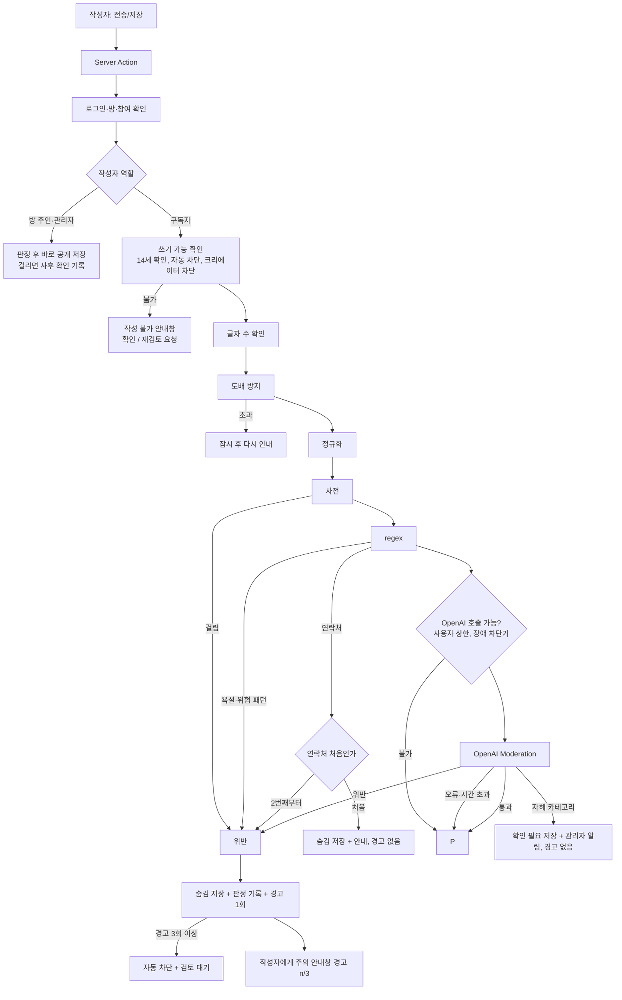

# 12. AI 스크리닝 (커뮤니티 규칙 위반 판정과 제재)

- 상태: [결정] 2026-11-20 기준 최신. #82, #83 댓글 결정 반영. 버블부터 구현 중
- 이 문서 하나가 AI 스크리닝의 **유일한 기준 문서**입니다. 예전 `12-moderation.md`, `13-sanctions.md`는 이 문서로 합치고 지웠습니다.
- 대상 크리에이터: 러브쑤(lovesoo)
- 이번 구현 목표: **판정 모듈**과 **검토 화면** (19장)
- 관련 이슈
  - #82 위험도 높음 항목 논의
  - #83 판단이 필요한 설계 항목
  - #81 개인정보 처리방침 (초안은 14 문서)
  - #25 마이그레이션 번호 통보
  - #19 실시간 전달
- 표기: [결정] 정한 것, [기본값] 판단 없이 가장 보수적으로 정해 진행하는 것, [논의] 이슈에서 논의 중인 것, [사실] 코드나 자료로 확인한 것

## 1. 한눈에 보기

| 항목 | 내용 |
|---|---|
| 판정하는 곳 | 버블 채팅, 쪽지(본문·표시 이름), 방명록(이름 12자) |
| 판정하는 글 | **모든 글**. 방 주인·관리자 글은 판정하되 바로 게시하고, 걸리면 관리자가 사후 확인 (3-2) |
| 언어 | 영어 중심. 한국어는 보조 |
| 도구 | 정규화 → 사전 → regex → OpenAI Moderation(`omni-moderation-latest`). 싼 것부터, 앞에서 걸리면 뒤는 부르지 않음 |
| 순서 | 먼저 판정, 그다음 저장. 위반 글은 다른 팬에게 한 번도 보이지 않음 |
| 위반 글 | 공개하지 않고 원문은 숨김 상태로 저장. 작성자에게 주의 안내창 |
| 경고 | 위반 1건 = 1회, 크리에이터 신고 1건 = 1회. 가입 후 영원히, 세 곳 합산. 해지해도 줄지 않음 (#82 1번 A안) |
| 자동 차단 | 경고 3회 이상이면 채팅·쪽지·방명록 쓰기만 막음. 로그인과 읽기는 됨. 크리에이터·관리자가 검토 |
| 연락처 공유 | 처음은 안내 + 숨김만. 2번째부터 걸릴 때마다 경고 1회 |
| 자해 관련 글 | 숨기고 알림. 경고 없음. 원문과 작성자는 관리자만 봄. 관리자가 3~7일 안에 해제·유지 결정 |
| 신고로 내린 글 | 말풍선 자리에 "커뮤니티 정책 위반으로 삭제되었습니다". 원문은 방 주인·관리자만 봄 |
| 판정 실패 | 통과. 크리에이터의 신고·차단으로 보완 |
| 14세 확인 | 회원가입 때만 "만 14세 이상인가요?" 아니오면 "일부 서비스를 이용할 수 없어요" 안내창. 세 곳에 쓸 수 없음 |
| 크리에이터 차단 | 크리에이터가 사람 단위로 차단. 차단된 사람은 그 크리에이터의 모든 방에서 쓸 수 없음 (9장) |
| 차단 시 예전 글 | 차단하면 그 범위의 예전 공개 글을 모두 내림. 해제 시 복구는 나중에 정함 |
| 익명 쪽지 | 작성자를 방 주인에게 숨기지 않음. 내용은 판정함 |
| 보관 | 가입부터 탈퇴까지. 경고·제재 이력이 있으면 탈퇴 후 90일 동안 이메일 확인용 값과 요약 보관 |

## 2. 용어

| 용어 | 뜻 |
|---|---|
| 판정 | 구독자 글이 커뮤니티 규칙을 어기는지 서버가 확인하는 일 |
| 위반 글 | 판정에서 걸린 글. 공개하지 않고 숨김 상태(`blocked`)로 저장 |
| 확인 필요 글 | 자해 관련으로 숨긴 글(`held`). 경고 없음 |
| 경고 | 사용자에게 쌓이는 횟수. 3회 이상이면 자동 차단 |
| 자동 차단 | 경고 3회 이상일 때 시스템이 거는 쓰기 차단 |
| 크리에이터 차단 | 크리에이터가 특정 사용자(회원 id)에게 거는 쓰기 차단. 그 크리에이터가 주인인 모든 방에 적용. 관리자는 전체 범위로 걸 수 있음 |
| 계정 정지 | 관리자만 거는 로그인 차단 (Better Auth `banUser`). 나중 범위 |
| 신고 | 방 주인·관리자가 구독자 글을 내리는 일. 경고 1회 |
| 검토 | 자동 차단을 유지할지 해지할지 사람이 판단하는 일 |
| 재검토 요청 | 차단된 사용자가 "다시 봐 달라"는 뜻만 남기는 일 |
| 방 주인 | `heap_rooms.creator_id`, `bubble_rooms.creator_id`에 해당하는 사용자. 지금은 러브쑤 계정 |

## 3. 판정 대상

### 3-1. 표면별

| 표면 | 저장 테이블 | 판정하는 글 | 위반 시 안내 위치 |
|---|---|---|---|
| 버블 채팅 | `bubble_messages` | 구독자 메시지 | 입력창 위 |
| 쪽지 | `heap_notes` | 구독자 쪽지 본문과 표시 이름. 익명 쪽지 포함 | 쓰기 종이 위. 접어서 걸기 전에 판정 |
| 쪽지 답장 | `heap_note_replies` | 판정 안 함 (방 주인이 씀) | 없음 |
| 방명록 | `heap_guestbook` | 구독자가 남기는 이름(12자). 본문은 없음 | 방명록 패널 안 |

- [기본값] 방명록 이름은 짧아서 OpenAI 판정이 불안정할 수 있습니다. 사전·regex 결과를 우선하고, OpenAI 결과는 평가셋으로 확인한 뒤 씁니다.
- [결정] 익명 쪽지도 판정합니다. 방 주인은 작성자를 볼 수 있습니다.
- [기본값] 익명 쪽지 쓰기 화면에 "규칙을 어기면 방 주인과 관리자가 작성자를 확인할 수 있어요"를 보여 줍니다.

### 3-2. 방 주인·관리자의 글 [결정] 2026-11-20 (#83 4번)

- 모든 글을 판정합니다. 작성자가 누구인지와 관계없이 판정을 먼저 합니다.
- 작성자가 **그 방의 주인**이거나 `admin`이면 판정 결과와 관계없이 **바로 게시**합니다.
  - 판정에 걸리면 `moderation_events`에 사후 확인용 기록(`source = 'auto'`, `counts_as_strike = false`, `review_status = 'pending'`)만 남깁니다.
  - 관리자가 검토 화면에서 보고 제재가 정당하면 제재합니다.
- "나만의 방" 주인인 일반 구독자도 자기 방에서는 같은 규칙입니다. 다른 사람의 방에서는 구독자 규칙을 따릅니다.
- 방 주인·관리자에게는 판정용 도배 방지(같은 글 반복, 위반 직후 대기)를 적용하지 않습니다. 기존 글자 수·간격 규칙은 그대로입니다.
- [사실] OpenAI Moderation API는 무료입니다 (공식 문서 기준, 구현 전 다시 확인). 모든 글을 판정해도 비용이 늘지 않습니다.

### 3-3. 14세 확인 [결정] 2026-11-20 (#83 2번)

- **회원가입 화면에서만** "만 14세 이상인가요?" 예/아니오를 묻습니다. 로그인 때는 묻지 않습니다.
- **예**: 그대로 이용합니다.
- **아니오**: "만 14세 미만은 일부 서비스를 이용할 수 없어요" 안내창을 띄웁니다. 채팅 참여, 쪽지 작성, 방명록 작성을 할 수 없습니다. 읽기와 방 구경은 됩니다.
- [사실] 이미 가입한 일반 사용자가 없어서 기존 사용자에게 다시 묻지 않습니다. 답 기록이 없는 계정은 테스트 계정으로 보고 쓰기를 막지 않습니다.
- 사용자는 답을 바꿀 수 없고, 관리자만 초기화할 수 있습니다.
- 저장: 별도 테이블 `user_age_checks`. Better Auth `user` 테이블에 칸을 더하지 않습니다 (과거 `additionalFields`로 가입이 실패한 적이 있습니다).
- 쓰기 전에 확인하는 공통 함수(`assertCanWrite`)가 14세 확인과 차단을 함께 봅니다.
- 남은 법적 위험(만 14세 미만 개인정보, 미국 13세 미만 규정)은 #82 4번과 #81에서 다룹니다.

## 4. 판정 흐름



| 단계 | 내용 |
|---|---|
| 쓰기 가능 확인 | `assertCanWrite(userId, roomOwnerId)`. 14세 확인, 활성 자동 차단, 그 방 주인이 건 크리에이터 차단, 관리자 전체 차단 |
| 도배 방지 | 13장. 위반 글도 같은 테이블에 저장하므로 함께 셈 |
| 정규화 ~ OpenAI | 5장 |
| 저장 | 공개 글, 위반 글, 확인 필요 글 모두 같은 테이블. `screen_status`로 구분 |

- 경고 기록과 자동 차단은 **한 트랜잭션**에서 만듭니다.
- 판정은 Server Action 안에서 동기로 합니다. 작성자는 응답으로 결과를 바로 받습니다.

## 5. 판정 도구

### 5-1. 정규화

- 소문자로 바꿉니다.
- 전각 문자를 반각으로 바꿉니다.
- 숫자·기호를 비슷한 글자로 바꿉니다 (`@`→a, `1`→i, `$`→s, `3`→e, `0`→o).
- 같은 글자가 3번 넘게 반복되면 2번으로 줄입니다.
- 글자 사이 구분자를 지웁니다 (`f.u.c.k`).
- 한글 자모 처리는 보조입니다.
- 원문은 따로 보존합니다. regex는 원문과 정규화한 글 양쪽에 돌립니다.
- [기본값] 정규화한 뒤에도 **단어 경계**를 지킵니다. 숫자·기호 치환 때문에 정상 단어 안에서 욕설이 생기는 오탐(assassin, Scunthorpe, cocktail 같은 경우)을 허용 목록과 함께 막습니다.

### 5-2. 사전

- 출처: ProfanityBench (https://huggingface.co/datasets/BibbyResearch/ProfanityBench). MIT 라이선스, 연락처 공유 동의 후 내려받는 방식.
  - 약 8만 2천 개 항목. 단어마다 `severity`(심한 정도), `category`, `tone`, `notes` 등이 붙어 있습니다.
  - 라벨은 전문가 검증이 아닙니다. 가볍거나 원래 뜻을 되찾아 쓰는 말도 섞여 있어 사람 검토가 필요합니다.
- [기본값] 첫 버전 범위: **영어**, `severity` 5와 혐오 표시 항목만. 사람이 검토해 확정합니다.
- [기본값] 3글자 이하 짧은 단어는 정확히 같은 단어일 때만 잡습니다.
- 보관: DB 테이블 `moderation_terms`. 공개 저장소에는 넣지 않습니다. 저장소에는 추출 스크립트만 둡니다.
- 서버가 처음 판정할 때 메모리에 올리고, 5분마다 다시 읽습니다.
- 허용 목록(`moderation_allowlist`)으로 오탐을 뺍니다.
- [결정] 2026-11-21 첫 사전 적재: 후보 841개 중 사람이 approve=y로 고르거나 자동 추천(suggest=y)을 받아들인 703개를 넣었습니다. 애매한 138개는 넣지 않았습니다.
- [결정] 2026-11-21 사전에 걸리면 OpenAI 판단 없이 바로 경고가 쌓입니다. 그래서 본뜻이 흔한 일상어(`queen`, `body`, `monday` 등), 정치·사회 용어, 가벼운 욕(`stupid`, `idiot` 등) 135개를 허용 목록에 넣었습니다. 이 단어들은 OpenAI 판정만 받습니다. 허용 목록은 어미를 뗀 형태(`queens`)에도 적용됩니다.
- 실제 사전을 붙인 평가셋에서 사전 오탐은 0건입니다 (`MODERATION_EVAL_DB=1`).
- 한국어는 보조 목록으로, 공백을 지운 글에서 부분 일치로 찾습니다.
- 판정 기록에는 걸린 단어를 남기지 않고 근거 종류만 남깁니다 (예: `lexicon:en:sev5`).

### 5-3. regex

| 종류 | 예 | 위치 |
|---|---|---|
| 우회 표기 | 글자 사이에 기호·공백을 끼운 욕설 | DB (`moderation_patterns`) |
| 위협 문장 틀 | "I'll find/hurt/kill you" 꼴 | 코드 `src/lib/moderation/patterns.ts` |
| 성적 요구 문장 틀 | 사진 요구, 속옷 질문. OpenAI가 놓친 것을 보완 (18-1) | 코드 `src/lib/moderation/patterns.ts` |
| 연락처 | 아래 표 | 코드 `src/lib/moderation/contact.ts` |

**연락처 패턴**

| 대상 | 잡는 모양 | 첫 버전 |
|---|---|---|
| 전화번호 | `010-1234-5678`, 공백·점 구분, `+82`, 전각 숫자 | 켬 |
| 이메일 | `a@b.com`, `a at b dot com`, `a[at]b` | 켬 |
| 메신저·SNS 링크 | `open.kakao.com`, `line.me`, `instagram.com`, `t.me`, `discord.gg` | 켬 |
| "키워드 + 아이디 모양" | "kakao/카톡/line/라인/insta/ig/dm" 뒤 아이디, `@아이디` | 평가셋 확인 뒤 켬 |

- 오탐 주의: 점수, 날짜, 시각, 주문 번호, "카톡 왔어요", 크리에이터를 부르는 `@러브쑤`.
- [기본값] 패턴은 수십 개 이내로 단순하게 유지합니다. 정규식이 지나치게 오래 도는 문제(ReDoS)를 피하고, 패턴마다 "걸려야 할 문장"과 "걸리면 안 되는 문장" 테스트를 붙입니다.

### 5-4. OpenAI Moderation

- 모델: `omni-moderation-latest`. 텍스트만 보냅니다. 이름·이메일은 보내지 않습니다.
- 키: 서버 환경 변수 `OPENAI_API_KEY`. 키가 비어 있으면 OpenAI 단계를 건너뜁니다.
- 시간 제한: 1.5초. 넘으면 통과.
- 사용자당 상한: 10분에 20회. 넘으면 OpenAI 없이 사전·regex 결과로 판정.
- [기본값] **장애 차단기**: 30초 안에 연속 5번 실패하면 60초 동안 OpenAI를 부르지 않습니다. 장애 동안 메시지마다 1.5초씩 기다리지 않게 하기 위해서입니다. 이 기간은 지표에 남깁니다.

**카테고리별 처리** (OpenAI는 13개 카테고리마다 걸렸는지 여부와 0~1 점수를 돌려줍니다)

| 묶음 | 카테고리 | 처리 | 경고 |
|---|---|---|---|
| 바로 위반 | `sexual/minors`, `harassment/threatening`, `hate/threatening`, `hate`, `sexual` | OpenAI가 걸면 점수를 다시 따지지 않고 위반 | +1 |
| 검토 숨김 [결정] 2026-11-20 | `harassment` | 평가셋(18-1)에서 팬 관용 표현이 걸려 "숨김 + 경고 없음 + 검토 목록"(`hold_review`)으로 시작 | 없음 |
| 점수 기준 | `violence`, `violence/graphic`, `illicit`, `illicit/violent` | 점수 0.7 이상이면 위반 (평가셋 18-1) | +1 |
| 자해 | `self-harm`, `self-harm/intent`, `self-harm/instructions` | 확인 필요로 숨김 (6-3). 바로 위반 묶음 다음, 점수 기준·`harassment`보다 먼저 봄 | 없음 |

- 바로 위반 묶음의 기준은 평가셋으로 더 엄격하게 할 수는 있어도 느슨하게 하지 않습니다.
- [결정] `sexual`은 OpenAI가 걸지 않아도 점수 0.5 이상이면 위반입니다. 평가셋에서 성적 요구 문장이 0.60인데도 걸리지 않았습니다.
- [사실] OpenAI는 SDK 없이 `fetch`로 부릅니다 (`src/lib/moderation/openai.ts`). AI 미리보기(`ai-preview.ts`)와 같은 방식입니다.
- [결정] 2026-11-20 `harassment`는 팬끼리의 장난에도 걸릴 수 있습니다. 연결 전에 평가셋(18-1)을 실제 OpenAI로 돌려 처리 방식을 정합니다 (#82 1번).
- 받은 13개 점수는 모두 기록합니다.

### 5-5. 판정 모듈 계약 [기본값]

세 표면이 같은 결과를 내도록 판정은 함수 하나로만 합니다.

```ts
// src/lib/moderation/screen.ts (server-only)
type Surface = "chat" | "note" | "guestbook";

type ScreenInput = {
  text: string;            // 원문
  surface: Surface;
  authorId: string;
};
// 방 주인·관리자 여부는 screen()이 아니라 결과를 받은 repo 계층이 정합니다 (3-2).

type ScreenOutcome =
  | "publish"              // 공개 저장
  | "block"                // 위반. 숨김 저장 + 경고
  | "contact"              // 연락처. 처음이면 경고 없이 숨김, 2번째부터 block과 같음 (repo 계층이 정함)
  | "hold_self_harm"       // 확인 필요. 숨김 저장, 경고 없음, 관리자 알림
  | "hold_review";         // 오탐 위험 카테고리. 숨김 저장, 경고 없음, 검토 목록

type ScreenResult = {
  outcome: ScreenOutcome;
  reasons: string[];       // 근거 종류만. 예: "lexicon:en:sev5", "regex:contact:phone", "openai:harassment"
  scores: Record<string, number> | null;  // OpenAI 13개 점수
  openai: "called" | "skipped_earlier_hit" | "skipped_rate" | "skipped_breaker" | "skipped_no_key" | "error" | "timeout";
  versions: { lexicon: string; patterns: string; thresholds: string; model: string | null };
  normalizedHash: string;  // 같은 글 반복 확인용
};
```

- `screen()`은 DB에 쓰지 않습니다. 결과만 돌려줍니다. "연락처 처음인지"는 결과를 받은 쪽(repo 계층)이 경고 기록을 볼 때 정합니다.
- 판정 모듈, 사전 로더, OpenAI 호출 파일에는 `server-only`를 붙여 브라우저 번들에 들어가지 않게 합니다.
- 정책 숫자는 `src/lib/moderation/policy.ts` 한 곳에만 둡니다.

### 5-6. 판정 기록의 버전 [기본값]

모든 판정 기록에 사전 버전, regex 버전, 기준값 버전, OpenAI 모델 이름을 남깁니다. "왜 걸렸는지" 설명하고 오탐을 분석할 때 필요합니다.

## 6. 결과별 처리

### 6-1. 위반 (`block`)

- 글은 `screen_status = 'blocked'`로 저장합니다. 다른 팬에게 보이지 않고, 대화방에 자리도 만들지 않습니다.
- `moderation_events`에 한 행을 쓰고 경고 1회를 더합니다.
- 작성자 안내: "규칙 위반으로 게시되지 않았어요 (경고 n/3)". 3회째면 "이제 글을 쓸 수 없어요"와 재검토 요청 버튼.
- 방 주인(자기 방)과 관리자는 검토 화면에서 원문과 작성자를 봅니다.

### 6-2. 연락처 공유 (`contact_first`, 2번째부터 `block`)

- 처음 걸리면 "연락처나 SNS 계정은 공유할 수 없어요" 안내 + 숨김 저장. 경고 없음.
- 2번째부터는 걸릴 때마다 경고 1회.
- "처음"인지는 그 사용자의 연락처 기록(`kind = 'contact'`)이 이미 있는지로 판단합니다. 가입 후 영원히 셉니다.

### 6-3. 자해 관련 (`hold_self_harm`)

- 글은 `screen_status = 'held'`로 저장합니다. 공개하지 않습니다.
- 경고를 더하지 않습니다.
- [결정] 2026-11-20 **원문과 작성자는 관리자만** 봅니다. 방 주인에게는 "확인 필요 n건"처럼 건수만 보여 줍니다.
- 작성자 안내: 처벌하지 않는 문구와 상담 연락처.
- [결정] 2026-11-20 (#82 3번) 관리자가 원문을 읽고 **3~7일 안에** 숨김 해제 또는 유지를 정합니다.
- 원문 보관 기간은 다른 글과 같습니다 (가입부터 탈퇴까지).
- 작성자 안내 문구와 상담 연락처는 정해진 문구(boilerplate)로 둡니다. 국가별로 나누지 않습니다.

### 6-4. 판정 실패

- OpenAI 오류, 시간 초과, 장애 차단기 작동, 사용자 상한 초과, 키 없음: 사전·regex를 통과했으면 공개 저장합니다.
- 경고는 없습니다. 실패 사유는 기록합니다 (지표용).

## 7. 경고와 자동 차단

### 7-1. 경고가 생기는 경우

| 경우 | 기록 (`moderation_events`) | 경고 |
|---|---|---|
| 자동 판정 위반 | `source = 'auto'`, `kind = 'abuse'` | +1 |
| 연락처 처음 | `kind = 'contact'`, `counts_as_strike = false` | 0 |
| 연락처 2번째부터 | `kind = 'contact'`, `counts_as_strike = true` | +1 |
| 자해 관련 | `kind = 'self_harm'`, `counts_as_strike = false` | 0 |
| 방 주인·관리자 신고 | `source = 'report'`, `kind = 'abuse'` | +1 |
| 판정 실패 | 기록 없음 | 0 |
| 방 주인·관리자 글이 걸림 | `source = 'auto'`, `counts_as_strike = false`, 사후 확인 대기 | 0 (관리자가 제재 결정) |

### 7-2. 세는 방법

- 경고 수 = `moderation_events` 중 `counts_as_strike = true`이고 `voided_at`이 비어 있는 행 수 + 재가입으로 이어받은 수.
- [결정] 해지해도 경고는 줄지 않습니다 (#82 1번 A안). `voided_at`은 나중에 "오탐 인정"을 넣을 때를 위한 칸이고, 지금은 항상 비어 있습니다.
- 글 하나에는 기록이 하나만 생깁니다 (`surface`, `target_id` 유니크). 같은 글을 여러 번 신고해도 경고는 한 번입니다. 이미 숨겨진 글은 신고할 수 없습니다.

### 7-3. 자동 차단

| 항목 | 내용 |
|---|---|
| 거는 조건 | 경고가 생긴 직후 경고 수가 3 이상이고, 활성 자동 차단이 없을 때 |
| 막는 것 | 모든 방의 채팅 전송, 쪽지 쓰기, 방명록 쓰기 |
| 막지 않는 것 | 로그인, 읽기, 방 구경, 쇼츠 재생, 계정 설정, 재검토 요청, 탈퇴 |
| 처음 상태 | 검토 대기 (`review_status = 'pending'`) |
| 검토 | 유지(`upheld`) 또는 해지(`revoked_at`) |
| 해지 후 | 경고 수가 그대로 3 이상이므로 다음 경고 1회로 바로 다시 자동 차단 |

- 활성 자동 차단은 사용자당 하나만 있게 유니크 조건을 둡니다. 위반 글 두 건이 동시에 들어와도 자동 차단은 하나만 생깁니다.

## 8. 신고와 삭제 문구 표시

- 방 주인·관리자 화면의 구독자 말풍선, 쪽지, 방명록 항목에 "신고" 버튼을 둡니다. 방 주인은 자기 방의 글만 신고합니다.
- 신고하면 한 트랜잭션에서
  1. 글을 `screen_status = 'removed'`로 바꾸고 `status_changed_at`을 DB 현재 시각으로 바꿉니다.
  2. `moderation_events`에 `source = 'report'`, `reported_by`를 기록합니다 (경고 +1).
  3. 경고가 3 이상이면 자동 차단합니다.
- 내린 글은 말풍선을 지우지 않고, 같은 자리에 **"커뮤니티 정책 위반으로 삭제되었습니다"**를 보여 줍니다. 쪽지와 방명록도 같은 문구로 바꿉니다.
- 원문은 방 주인(자기 방)과 관리자만 그 자리에서 펼쳐 보거나 검토 화면에서 봅니다. 열람은 기록합니다 (11-4).

## 9. 크리에이터 차단과 계정 정지

| 종류 | 거는 사람 | 효과 | 구현 |
|---|---|---|---|
| 크리에이터 차단 | 크리에이터(방 주인) | 그 크리에이터가 주인인 **모든 방**에서 채팅 전송·참여, 쪽지 쓰기, 방명록 쓰기 불가. 읽기는 됨 | 자체 테이블 `sanctions` (`scope = 'owner'`, `room_owner_id` = 건 크리에이터) |
| 전체 차단 | 관리자 | 모든 방에서 쓰기 불가. 로그인과 읽기는 됨 | 자체 테이블 `sanctions` (`scope = 'global'`) |
| 자동 차단 | 시스템 | 7-3 | 자체 테이블 `sanctions` (`scope = 'auto'`) |
| 계정 정지 | 관리자 | 로그인 불가, 세션 모두 끊김 | Better Auth `banUser`. 나중 범위 |

- 크리에이터 차단은 경고를 더하지 않습니다. 신고는 **글**을 내리고, 차단은 **사람**의 쓰기를 막습니다.

### 9-1. 크리에이터 차단 [결정] 2026-11-20 (#83 3번)

- 차단 단위는 **회원**(사용자 id)입니다. 닉네임이 같아도 다른 회원은 차단되지 않습니다.
- 크리에이터 B는 자기 방뿐 아니라 **다른 크리에이터 C의 방에서 본 사용자 A**도 차단할 수 있습니다. 효과는 B의 방에만 생깁니다.
  - 예: B가 C의 방에서 A의 메시지를 보고 차단 → A는 B의 방에서 쓸 수 없음. C의 방에서는 그대로 씀.
- C는 B가 건 차단과 B 방의 경고를 보지 않습니다. 크리에이터는 다른 크리에이터의 경고·차단을 볼 필요가 없습니다.
- 차단 버튼은 크리에이터가 보는 구독자 글(말풍선, 쪽지, 방명록) 옆에 둡니다. 크리에이터는 차단 대상의 글 원문이 아니라 화면에 이미 보이는 글만 봅니다.

### 9-2. 차단할 때 예전 글 [결정] 2026-11-20 (#83 5번)

- 차단하면 그 차단 범위 안의 예전 **공개 글을 모두 내립니다** (`screen_status = 'removed'`, `status_changed_at` 갱신). 경고는 더하지 않습니다.
  - 크리에이터 차단: 그 크리에이터가 주인인 방의 글
  - 자동 차단·전체 차단: 모든 방의 글
- 차단을 해지해도 내린 글을 되살리지 않습니다. 되살리는 기능은 나중에 필요하면 정합니다.
- 계정 정지된 사용자는 로그인할 수 없어서 재검토 요청 버튼을 볼 수 없습니다. 그래서 일반 제재는 자동 차단과 크리에이터 차단으로 합니다.
- [결정] 2026-11-20 (#83 6번) 로그인 화면에 "관리자 문의" 버튼을 둡니다. 계정 정지 사용자의 이의 제기 경로입니다.
- Better Auth admin 플러그인 기능 (공식 문서 1.7.26 기준, 설치 버전 1.7.19라 쓰기 전에 확인)

| 기능 | 메서드 | 우리 쓰임 |
|---|---|---|
| 계정 정지·해지 | `banUser`, `unbanUser` | 계정 정지 (나중) |
| 사용자 목록·조회 | `listUsers`, `getUser` | 관리자 검토 화면 |
| 세션 끊기 | `revokeUserSessions` | 계정 탈취 의심 시 |
| 사용자 삭제 | `removeUser` | 탈퇴 (16장) |
| 역할 지정, 사용자 생성, 비밀번호 지정 | `setRole`, `createUser`, `setUserPassword` | 크리에이터 계정 발급 |
| 대신 로그인 | `impersonateUser` | 쓰지 않음 |

- [사실] `src/lib/access.ts`의 `creator` 역할은 Better Auth 관리 권한이 없습니다. 크리에이터 차단은 자체 테이블로 합니다.

## 10. 차단 상태 화면과 재검토 요청

### 10-1. 입력창 반영

- 쓸 수 없는 구독자의 입력창(채팅, 쪽지 쓰기, 방명록)은 비활성으로 바꾸고 이유와 버튼을 보여 줍니다.

| 이유 | 문구 | 버튼 |
|---|---|---|
| 자동 차단·크리에이터 차단 | "커뮤니티 규칙 위반으로 글을 쓸 수 없어요." | 확인, 재검토 요청 |
| 14세 확인 아니오 | "만 14세 미만은 채팅, 쪽지, 방명록을 쓸 수 없어요." | 확인 |

- 반영 시점: 화면을 처음 열 때(Server Component가 읽음), 전송 응답을 받았을 때, 폴링 응답의 "내 작성 가능 여부"가 바뀌었을 때. 새로고침이 필요 없습니다.

### 10-2. 재검토 요청

- 버튼을 누르면 `sanction_appeals`에 한 행만 남깁니다. 입력칸은 없습니다.
- 차단 하나당 한 번만 요청할 수 있습니다. 이미 요청했으면 "재검토를 요청했어요"로 바뀝니다.
- 다시 차단되면(새 차단 행) 다시 요청할 수 있습니다.

## 11. 검토 화면 (이번 구현 목표)

### 11-1. 위치 [기본값] ([논의] #83 1번)

- 관리자: `/admin/moderation`. 서버에서 `admin` 역할을 확인합니다.
- 방 주인: `/creator/moderation`. 같은 화면 부품을 쓰고, 보이는 범위만 자기 방으로 제한합니다.

### 11-2. 목록

| 목록 | 방 주인 | 관리자 |
|---|---|---|
| 위반 글 (자동 판정) | 자기 방, 원문·작성자 | 전부 |
| 신고한 글 | 자기 방, 원문·작성자 | 전부 |
| 연락처 공유 글 | 자기 방, 원문·작성자 | 전부 |
| 확인 필요 (자해) | **건수만** | 원문·작성자 |
| 오탐 위험 숨김 (`hold_review`) | 자기 방, 원문·작성자 | 전부 |
| 방 주인·관리자 글 사후 확인 | 불가 | 전부 |
| 자동 차단 (검토 대기·유지) | 경고 중 하나 이상이 자기 방에서 나온 것 (#83 3번: 다른 크리에이터의 경고는 보지 않음) | 전부 |
| 크리에이터 차단 | 내가 건 차단 | 전부 |
| 재검토 요청 | 내가 건 차단의 요청 | 전부. 어느 방, 어떤 메시지 때문인지 함께 |

- 항목마다: 사용자 닉네임, 경고 수, 경고 목록(시각, 표면, 원문, 근거 종류, 자동/신고), 현재 차단 상태, 재검토 요청 여부
- 근거에는 사전 단어 자체를 보여 주지 않고 종류만 보여 줍니다.

### 11-3. 동작

| 동작 | 방 주인 | 관리자 |
|---|---|---|
| 자동 차단 유지·해지 | 11-2 범위 안에서 | 전부 |
| 크리에이터 차단·해지 | 내 방 범위로, 어느 방에서 본 사용자든 | 전체 차단 |
| 신고 | 자기 방의 구독자 글 | 모든 방의 구독자 글 |
| `hold_review`·`held` 글 해제·유지 | `hold_review`만, 자기 방 | 전부 |
| 방 주인 글 사후 제재 | 불가 | 가능 |
| 14세 확인 초기화 | 불가 | 가능 |

### 11-4. 원문 열람 기록 [기본값]

- 방 주인은 회사 밖 사람이므로, 원문을 펼치거나 목록에서 볼 때 `moderation_access_log`에 누가, 언제, 어떤 글을 봤는지 남깁니다.
- 기록은 관리자만 봅니다.

## 12. 권한

- [결정 적용] 권한은 역할이 아니라 **방 주인인지**로 판단합니다. 방 주인 = `heap_rooms.creator_id`, `bubble_rooms.creator_id`.
- 판정 후 바로 게시하는 대상도 방 주인 기준입니다 (3-2). 관리자는 역할로 판단합니다.
- 모든 권한 조건은 화면이 아니라 repo 계층 쿼리에 넣습니다. 화면에서 버튼을 숨기는 것만으로는 막히지 않습니다.

| 할 일 | 구독자 | 방 주인 | 관리자 |
|---|---|---|---|
| 자기 경고 수 보기 | 안내창에서만 (n/3) | — | — |
| 위반·신고·연락처 글 원문 | 불가 | 자기 방 | 전부 |
| 자해 글 원문 | 불가 | 불가 (건수만) | 가능 |
| 신고 | 불가 | 자기 방 | 모든 방 |
| 크리에이터 차단·해지 | 불가 | 내 방 범위 (9-1) | 전체 차단 |
| 자동 차단 검토 | 불가 | 11-2 범위 | 전부 |
| 계정 정지 | 불가 | 불가 | 가능 (나중) |
| 재검토 요청 | 본인 차단 | — | — |

## 13. 도배 방지

판정 **전에** 시도 기준으로 셉니다. 판정용 장치(같은 글 반복, 위반 직후 대기, OpenAI 상한, 링크 개수)는 방 주인·관리자에게 적용하지 않습니다.

| 장치 | 값 | 위치 |
|---|---|---|
| 채팅 간격 | 10초 (현재 값) | `bubble/policy.ts` |
| 채팅 시간창 | 10분에 15건 (현재 값). 위반·확인 필요 글도 셈 | `bubble/policy.ts` |
| 쪽지 | 한 방에 하루 5장 (현재 값). 숨김 글도 셈 | `heap/policy.ts` |
| 방명록 | 한 방에 하루 1건 (현재 값). 숨김 글도 셈 | `heap/policy.ts` |
| 같은 글 반복 | 정규화한 글의 해시가 10분 안의 내 글과 같으면 판정 없이 거절 | `moderation/policy.ts` |
| 위반 직후 대기 | 위반 판정 뒤 60초 동안 같은 표면에 쓰기 불가 | `moderation/policy.ts` |
| OpenAI 사용자 상한 | 10분에 20회 | `moderation/policy.ts` |
| 링크 개수 | 구독자 글 하나에 1개 | `moderation/policy.ts` |
| 가입 속도 | Better Auth 기본 요청 제한 사용 | `auth.ts` |

- [사실] 지금 `getSendStats`(`src/lib/bubble/repo.ts`)는 상태와 관계없이 보낸 사람 기준으로 시간창 안의 모든 행을 셉니다. 위반 글도 같은 테이블에 저장하므로 따로 고치지 않아도 함께 세집니다. 나중에 이 쿼리에 상태 조건을 넣지 않도록 테스트로 고정합니다.
- 같은 글 반복 확인을 위해 세 글 테이블에 `normalized_hash` 칸을 둡니다.

## 14. 폴링과 실시간 대비

- [결정] 세 글 테이블에 **상태가 바뀐 시각** `status_changed_at`을 추가합니다.
  - 값은 앱 서버 시각이 아니라 **DB의 `now()`**로 넣습니다. 서버 인스턴스끼리 시계가 달라 바뀐 글을 놓치는 일을 막습니다.
  - 처음 저장할 때, 신고로 내릴 때, 본인이 삭제할 때, 확인 필요 글을 풀 때 바꿉니다.
  - 폴링 조회(`?since=`)는 이 칸을 기준으로 `>=`로 가져오고, 같은 id는 화면에서 합칩니다. 같은 시각에 생긴 글이 빠지지 않게 하기 위해서입니다.
  - 쪽지·방명록의 변경 조회(`HeapChangesPosition`)도 같은 규칙을 씁니다 (#82 6번 협의 후).
  - 기존 글은 마이그레이션에서 `coalesce(deleted_at, created_at)`로 채웁니다. 인덱스: (`room_id`, `status_changed_at`).
- 지금은 5초 폴링입니다. #19에서 정한 SSE + `LISTEN/NOTIFY`로 바꿀 때를 위해:
  - 글 저장과 상태 변경은 repo 계층 함수 한 곳에서만 합니다. 나중에 여기에 `pg_notify` 호출만 넣습니다.
  - 알림은 공개 저장과 상태 변경일 때만 보냅니다. 숨김 저장은 알리지 않습니다.
  - 차단·해지는 그 사용자에게만 가는 알림으로 보냅니다.
- [사실] #19는 닫혀 있지만 실시간 모듈은 아직 코드에 없습니다.

## 15. 데이터 모델 (`0011` 안)

[기본값] 공유 DB라서 기존 테이블의 칸은 **비워 둘 수 있거나 기본값이 있는 형태**로 먼저 추가하고, 코드 전환은 그다음에 합니다. 마이그레이션 내용은 #25 규칙대로 이슈로 먼저 알립니다. 현재 마지막 번호는 `0010`입니다.

| 테이블 / 칸 | 내용 |
|---|---|
| `bubble_messages`에 칸 추가 (이번 `0011`) | `screen_status` (`published` 기본값 / `blocked` / `removed` / `held`), `screened_at`, `status_changed_at`, `normalized_hash` |
| `heap_notes`, `heap_guestbook`에 같은 칸 추가 | 쪽지·방명록 연결 때 다음 번호로 |
| `moderation_events` | `id`, `user_id`, `room_owner_id`, `surface`, `target_id`, `source` (`auto` / `report`), `kind` (`abuse` / `contact` / `self_harm`), `counts_as_strike`, `reasons`, `scores`, `openai_status`, `versions`, `reported_by`, `review_status` (`none` / `pending` / `upheld` / `dismissed`), `reviewed_by`, `reviewed_at`, `voided_at`(비어 있음, #82 1번), `created_at`. (`surface`, `target_id`) 유니크 |
| `sanctions` | `id`, `user_id`, `scope` (`owner` / `auto` / `global`), `room_owner_id`, `created_by` (사용자 id 또는 `system`), `reason`, `review_status` (`pending` / `upheld`), `reviewed_by`, `reviewed_at`, `revoked_at`, `revoked_by`, `created_at`. 활성 자동 차단은 사용자당 하나 |
| `sanction_appeals` | `id`, `sanction_id` (유니크), `user_id`, `status` (`pending` / `reviewed`), `created_at` |
| `user_age_checks` | `user_id` (기본 키), `is_14_or_older`, `answered_at`, `reset_by`, `reset_at` |
| `moderation_access_log` | `id`, `viewer_id`, `event_id` 또는 `target_id`, `viewed_at` |
| `moderation_terms`, `moderation_patterns`, `moderation_allowlist` | 사전, DB에 두는 regex, 허용 목록. 버전 칸 포함 |
| `withdrawn_accounts`, `users_strike_carryover` | 16장. 나중 범위지만 칸 설계는 미리 둠 |

- [결정] 2026-11-20 (#82 6번) `heap_notes`의 기존 칸(`hidden_at` 방 주인 숨김, 공개 시각, `owner_read_at`)은 그대로 두고 `screen_status`를 새로 붙입니다. `screen_status`가 `published`가 아니면 다른 칸보다 **먼저** 적용해 보이지 않게 합니다.
- [결정] 판정은 버블에서 먼저 시행하고, 확인되면 쪽지·방명록에 연결합니다.
- 마이그레이션 변경 내역은 GitHub 이슈 "[AI 스크리닝] 마이그레이션 변경 기록"에 남깁니다.

## 16. 탈퇴와 재가입 (나중 범위)

[사실] 탈퇴 기능은 아직 코드에 없습니다. 규칙만 미리 정해 둡니다.

| 데이터 | 경고·제재 이력 없음 | 경고 1회 이상 또는 제재 이력 있음 |
|---|---|---|
| 이메일 | 가입부터 탈퇴까지 | 가입부터 탈퇴까지 + 탈퇴 후 90일(확인용 값으로) |
| 작성 글 (숨김 글 포함) | 가입부터 탈퇴까지 | 가입부터 탈퇴까지 |
| 경고·제재 기록 | 가입부터 탈퇴까지 | 탈퇴 후 90일 동안 요약(경고 수, 차단 상태)만 |

- 탈퇴 순서: 안내 화면 → (이력 있으면) `withdrawn_accounts` 기록 → 계정 삭제. 지금 DB는 사용자를 지우면 글이 함께 지워지므로(`on delete cascade`) 기록이 반드시 먼저입니다.
- 이메일 확인용 값: 서버 비밀 키(`MODERATION_EMAIL_HMAC_KEY`)로 만든 HMAC-SHA256. 키는 한 번 정하면 바꾸지 않고, 팀 전체가 같은 값을 씁니다.
- [기본값] Gmail은 `+` 뒤와 점을 지운 뒤 확인용 값을 만듭니다 (`a.b+x@gmail.com` → `ab@gmail.com`). 다른 이메일로 가입하는 것은 막을 수 없습니다.
- 90일 안에 같은 이메일로 다시 가입하면 경고 수, 자동 차단, 크리에이터 차단, 계정 정지 상태를 이어받습니다.
- [기본값] 처음에는 정기 정리 작업을 두지 않습니다. 재가입 확인 때 만료된 행은 무시하고, 관리자가 수동으로 지웁니다. 정기 작업(Render Cron Job, 비용 확인 필요)은 나중에 붙입니다.

## 17. 개인정보 유의 사항

자세한 내용은 14 문서(개인정보 처리방침 초안)와 #81에 있습니다. 이 기능과 직접 관련된 항목:

- 수집: 숨김 글 원문, 판정 결과·점수, 신고·경고·차단 기록, 재검토 요청 여부, 14세 확인 답, 원문 열람 기록
- 외부 전송: 사전·regex를 통과한 글 본문(방 주인·관리자 글 포함)을 OpenAI(미국)로. DB는 Render(싱가포르)
- 열람: 방 주인(자기 방, 자해 글 제외), 관리자
- 자동화된 결정: 경고 3회 자동 차단과 재검토 요청 방법
- 미성년자: 14세 확인. 남은 위험은 #82 4번

## 18. 평가셋과 지표

### 18-1. 평가셋

- [결정] 2026-11-20 먼저 **50문장**으로 실제 OpenAI를 돌려 `harassment` 처리(5-4)를 정합니다. 그 뒤 300~500문장으로 늘립니다.
- 영어 중심 300~500문장. 정상 팬 대화, 관용 표현("killing it", "I hate you for being this cute"), 욕설, 비난, 성희롱, 위협, 연락처, 자해, 짧은 이름. 한국어는 보조로 일부.
- [기본값] 용도는 **동작 확인과 큰 오탐 찾기**입니다. 이 규모로는 카테고리별 기준값을 믿을 만하게 정하기 어려우므로, 기준값은 운영 중 해지·재검토 데이터로 조정합니다.
- 구현 뒤에는 회귀 테스트(고친 뒤 예전 결과가 깨지지 않았는지 확인)로 계속 씁니다.
- 평가셋 원문은 공개 저장소에 넣지 않습니다. `.moderation-private/`(gitignore)에 두고 `MODERATION_EVAL=1 npm run moderation:eval`로 돌립니다.

### 18-1-1. 50문장 1차 결과 [사실] 2026-11-20

| 묶음 | 문장 수 | 결과 |
|---|---|---|
| 팬 관용 표현 | 16 | 경고로 이어진 것 0. `harassment` 0.40~0.88로 4~6개가 검토 숨김. `violence` 0.51~0.52 ("kill me, this is so good", "murder me with that smile", "fight you") |
| 정상 글 (영어·한국어) | 8 | 모두 공개 |
| 괴롭힘 | 5 | `harassment` 0.72~0.98. 관용 표현과 점수가 겹쳐 검토 숨김으로 처리 |
| 위협·혐오 | 6 | 모두 위반 (regex 3, OpenAI 3). 실제 위협의 `violence`는 0.69~0.87 |
| 성적 요구 | 3 | OpenAI가 하나도 걸지 않음(최고 `sexual` 0.60). regex와 점수 기준으로 보완 |
| 자해 | 3 | 모두 확인 필요. 1개는 `violence`도 붙어 순서를 바꿈 |
| 연락처 | 4 | 모두 regex로 잡힘 |
| 짧은 이름 | 5 | 모두 공개 ("sexy fan"은 `sexual` 0.38) |

- 결정: `harassment`는 검토 숨김, 점수 기준 0.7, `sexual` 점수 0.5, 자해 우선. 기준을 바꾸면 `policy.ts`의 `versions`를 올립니다.

### 18-2. 지표 [기본값]

`moderation_events`와 판정 결과에서 바로 셀 수 있는 것만 둡니다.

- 하루 판정 수, 결과별 수 (공개, 위반, 연락처, 확인 필요)
- 카테고리별 위반 비율
- OpenAI 실패율과 응답 시간, 장애 차단기 작동 시간
- 해지율 (오탐 신호), 재검토 요청 수

## 19. 구현 범위와 순서

### 19-0. 진행 상황 [사실] 2026-11-20

- 브랜치 `jimins-claude/feature-ai-screening`. 19-1의 1~7 완료, 8은 데이터 내려받기와 사람 검토를 기다림.
- `0011`은 공유 DB에 적용함. 변경 기록은 이슈 #92.
- 브라우저 E2E 30개 항목 통과 (정상 글, 연락처 처음·2번째, 검토 숨김, 자해, 반복, 링크 수, 위반 직후 대기, 경고 3회 자동 차단과 예전 글 내림, 재검토 요청, 원문 보기, 검토 화면 범위, 해지, 크리에이터 차단 범위, 방 주인 글 바로 게시, 신고와 폴링 반영, 14세 미만).
- 회원가입 14세 확인도 함께 넣음 (19-2에서 당김).
- 로그인 화면 "관리자 문의" 버튼도 넣음. 받는 주소는 임시이며 `src/lib/moderation/policy.ts`의 `ADMIN_CONTACT_EMAIL` 한 곳에서 바꿈.
- 관리자 화면 E2E 8개 통과 (자해 원문 보기와 유지, 방 주인 글 사후 확인과 내림, 관리자 전체 차단).
- 마이페이지 계정 정보 장에 관리자 전용 "관리자 페이지" 버튼(`/admin/moderation`)을 넣음.
- 사전: ProfanityBench 영어 후보 841개를 `.moderation-private/terms-review.csv`로 추출함 (영어 7,402줄 중 severity 5 또는 혐오 표시, 중복 제거). `suggest` 칸은 자동 추천(y 635, ? 206)이고, 적재는 사람이 `approve`에 y를 쓴 줄만 함.
- 의존성: `vitest`(개발용). npm 11 피어 의존성 오류 때문에 `.npmrc`에 `legacy-peer-deps=true`. OpenAI SDK는 넣지 않음.

### 19-1. 이번 목표: 판정 모듈 + 검토 화면

| 순서 | 작업 | 필요한 것 |
|---|---|---|
| 1 | `vitest` 추가 (#83 7번). OpenAI는 SDK 없이 `fetch` | — |
| 2 | 판정 모듈 `src/lib/moderation/`: 정규화, 연락처 regex, 위협 regex, 사전 인터페이스(DB 없이도 테스트용 목록으로 동작), OpenAI 호출(시간 제한, 사용자 상한, 장애 차단기), 결정 함수, 정책 값 | `OPENAI_API_KEY` (없으면 OpenAI 단계만 건너뜀) |
| 3 | 판정 모듈 단위 테스트: 우회 표기, 오탐 사례, 연락처, 카테고리 처리, 실패 처리. 50문장 평가셋으로 `harassment` 처리 결정 | `OPENAI_API_KEY` |
| 4 | `0011` 마이그레이션(버블 + 모더레이션 테이블) 작성 → 마이그레이션 기록 이슈에 남김 → 공유 DB에 적용 | — |
| 5 | repo 계층: 경고 기록, 자동 차단, 신고, 크리에이터 차단, 해지, 재검토 요청, 열람 기록 | 4 |
| 6 | 버블 채팅에 판정 연결, 안내창, 입력창 차단 표시, 삭제 문구 표시, `status_changed_at` 폴링. 숨김 글이 폴링·AI 미리보기 문맥으로 새지 않게 repo 쿼리에서 거름 | 5 |
| 7 | 검토 화면 `/admin/moderation`, `/creator/moderation`, 크리에이터 차단 버튼 | 5 |
| 8 | 사전 첫 버전: ProfanityBench 영어 `severity` 5 + 혐오 표시 추출 → 사람 검토 → `moderation_terms` 적재. `npm run moderation:terms -- extract <dataset.jsonl>` 후 `load <csv>` | 데이터 파일(HF 로그인·약관 동의 필요), 사람 검토 |

### 19-2. 다음

- 쪽지·방명록 연결 (#82 6번 협의 뒤)
- 재검토 요청 화면
- 평가셋 작성과 기준값 1차 조정

### 19-3. 나중

- 탈퇴·재가입 이어받기, 정기 정리 작업
- 계정 정지 화면
- 한국어 보조 사전
- 실시간 전환 (#19)

## 20. 논의 중인 항목

| 이슈 | 내용 |
|---|---|
| #82 | 1·3·5·6번 결정 반영. 남은 것: 미성년자 법적 위험(4번, #81), 탈퇴 위치(마이페이지)와 유예 기간 필요성 |
| #83 | 2~7번 결정 반영. 남은 것: 관리자 문의 버튼의 연락처 |
| #81 | 개인정보 처리방침 |
