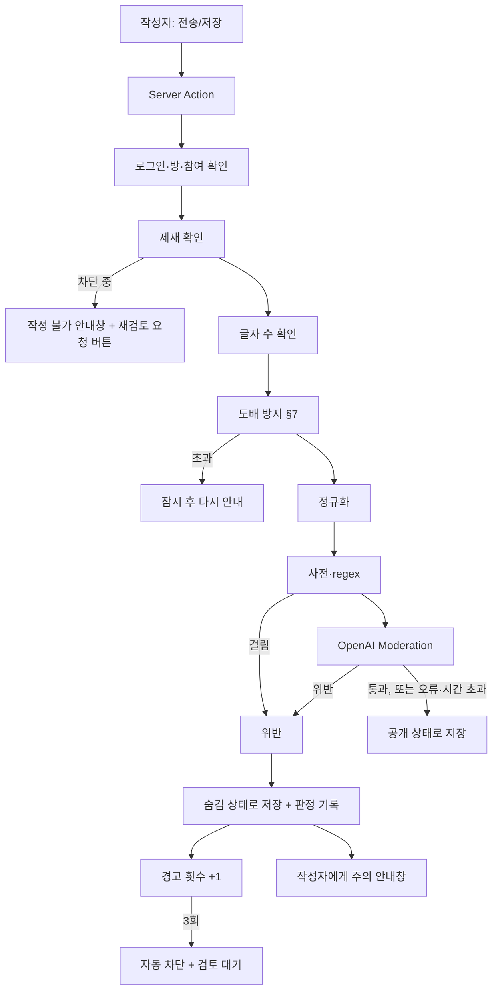

# 12. 커뮤니티 규칙 위반 판정과 제재 (모더레이션)

- 상태: [결정] 2026-11-19 범위와 규칙 확정. 구현 전
- 대상 크리에이터: 러브쑤(lovesoo) [결정] (2026-11-19)
- 관련 문서: 02 (기능 범위), 03 (기술 스택 §6 보안·안전), 06 (인증), 09 (방의 쪽지 트리·방명록), 10 (공모전 규정)
- 관련 이슈: 개인정보 처리방침 반영 (이 문서 §11)

팬이 글을 남기는 세 곳(버블 채팅, 쪽지, 방명록)에서 욕설, 성희롱, 비난처럼 커뮤니티 규칙을 어기는 글을 걸러 냅니다. 세 곳은 **같은 판정 구조**를 씁니다. 저장하는 테이블과 화면의 안내창만 다릅니다.

## 1. 결정 사항 요약

| 항목 | 결정 |
|---|---|
| 대상 언어 | 영어와 한국어 |
| 판정 도구 | 자체 사전·정규식(regex) + OpenAI Moderation API(`omni-moderation-latest`) |
| 사전 출처 | ProfanityBench(MIT, 게이트 동의 필요)에서 걸러 내 사람이 검토한 목록 + 커뮤니티 자체 목록 + 허용 목록 |
| 사전 공개 여부 | 사용자에게 보이지 않음. 판정은 서버에서만 하고, 목록은 공개 저장소에 커밋하지 않음 |
| 위반 글 처리 | 대화방·트리·방명록에 올리지 않음. **원문은 저장**하고 작성자에게 주의 안내창을 띄움 |
| 경고 누적 | 가입 후 영원히 셈. 세 곳을 합산 |
| 3회 누적 | **자동 차단**. 차단이 맞는지는 크리에이터나 관리자가 검토 |
| 크리에이터 신고 | 경고 1회와 같음 |
| 판정 실패 | 통과(fail-open). 대신 크리에이터에게 메시지 신고·차단 버튼을 줌 |
| 권한 | 크리에이터: 자기 계정과 연결된 미니룸·채팅방만. 관리자: 모든 방 |
| 차단 범위 | 크리에이터는 자기 방 안에서만 사용자를 차단. 관리자는 모든 방에서 차단 |
| 보관 기간 | 가입부터 탈퇴 전까지 (차단된 글 포함) |
| 이의 제기 | 작성 불가 안내창의 "재검토 요청" 버튼. 요청 여부만 저장, 글 입력칸 없음 |

## 2. 판정 흐름 (세 곳 공통)

| 단계 | 내용 |
|---|---|
| 제재 확인 | 공통 함수 `assertCanWrite(userId, creatorId)`. 전역 차단과 그 방의 차단을 함께 확인 |
| 정규화 | 소문자화, 숫자·기호 치환(`@`→a, `1`→i, `$`→s), 반복 글자 축약, 글자 사이 구분자 제거, 한글 자모 처리. 원문은 따로 보존 |
| 사전·regex | 사전은 단어 집합으로 조회. regex는 사전으로 못 잡는 우회 표기·문장 패턴만 소수로 둠. 허용 목록으로 오탐 제외 |
| OpenAI | 사전에 안 걸린 글만 보냄. 타임아웃 약 1.5초. `sexual/minors`, `harassment/threatening`, `hate/threatening`은 점수와 관계없이 위반. 나머지 카테고리는 평가셋으로 정한 임계값 |
| 저장 | 위반 글도 같은 테이블에 저장하고 `screen_status = 'blocked'`로 숨김. 공개 조회 쿼리는 `blocked`와 `removed`를 제외 |

- [결정] 판정은 저장 **전에** 합니다. 위반 글은 다른 팬에게 한 번도 보이지 않습니다.
- [가설] 크리에이터와 관리자가 쓴 글도 같은 판정을 거칩니다. 다만 경고 누적과 자동 차단은 구독자(`public`)에게만 적용합니다. (확인 필요, §12)

### 2-1. 표면별 차이

| 표면 | 저장 테이블 | 작성자 | 위반 시 안내 |
|---|---|---|---|
| 버블 채팅 | `bubble_messages` | 구독자, 크리에이터 | 입력창 위 주의 안내창 "규칙 위반으로 게시되지 않았어요 (경고 n/3)" |
| 쪽지 | `heap_notes` | 구독자 | 쓰기 종이 위 같은 안내창. 접어서 걸기 전에 판정 |
| 쪽지 답장 | `heap_note_replies` | 크리에이터 | 같은 판정. 경고 누적 없음 [가설] |
| 방명록 | `heap_guestbook` | 구독자 | 방명록 패널 안 같은 안내창 |

- [사실] 지금 방명록은 이름(12자)만 저장하고 본문 칸이 없습니다. 본문을 받으려면 `0011`에서 `body` 칸을 추가해야 합니다. 09 문서의 "이름과 날짜만" 결정을 이번에 바꿉니다.

## 3. 경고와 자동 차단

| 경고가 쌓이는 경우 | 횟수 |
|---|---|
| 자동 판정에서 위반 | 1 |
| 크리에이터 또는 관리자가 신고 | 1 |

- 경고 수 = 그 사용자의 `moderation_events` 중 `status = 'active'`인 행의 수. 기간 제한 없음.
- 3번째 경고가 생기는 트랜잭션 안에서 **자동 차단**(`sanctions`, `created_by = 'system'`, `review_status = 'pending'`)을 만듭니다.
- 자동 차단된 사용자는 로그인과 읽기는 할 수 있고, 세 곳 모두 쓸 수 없습니다. 쓰려고 하면 작성 불가 안내창이 뜹니다.
- 검토 결과
  - 유지: `review_status = 'upheld'`
  - 해지: `revoked_at` 기록. 오탐으로 판단한 경고는 `status = 'dismissed'`로 바꿔 횟수에서 뺍니다 [가설]
- [미정] 자동 차단의 범위. 경고는 모든 방을 합산하지만 크리에이터 권한은 자기 방까지라서, 자동 차단을 서비스 전체 쓰기 차단으로 둘지 3번째 경고가 나온 방의 차단으로 둘지 정해야 합니다. 지금은 크리에이터가 1명이라 결과는 같습니다. 이 문서는 **서비스 전체 쓰기 차단**을 기준으로 적습니다.

## 4. 신고

- 크리에이터 화면의 남의 말풍선·쪽지·방명록 항목에 "신고" 버튼을 둡니다.
- 누르면 그 글을 즉시 내리고(`screen_status = 'removed'`), `moderation_events`에 `source = 'report'`로 기록해 경고 1회를 더합니다.
- 내린 글은 대화방과 화면에서 사라지고, 크리에이터 페이지와 관리자 페이지에서만 볼 수 있습니다.
- 같은 글을 두 번 신고해도 경고는 한 번만 셉니다 (`moderation_events`에 글 하나당 한 행).

## 5. 권한

| 할 일 | 크리에이터 | 관리자 |
|---|---|---|
| 차단된 글과 작성자 조회 | 자기 미니룸·채팅방의 것만 | 전부 |
| 신고 | 자기 방의 글 | 모든 방의 글 |
| 사용자 차단·해지 | 자기 방 범위 차단만 | 모든 방, 서비스 전체 |
| 자동 차단 검토 | 경고 중 하나 이상이 자기 방에서 나온 경우 [가설] | 전부 |
| 재검토 요청 조회 | 자기 방에서 차단한 사용자의 요청만 | 전부. 어느 크리에이터 방에서, 어떤 메시지 때문에, 어떤 사용자가 차단됐는지 함께 봄 |

- 권한 조건은 화면이 아니라 repo 계층의 쿼리에 넣습니다 (`creator_id = viewer.id`). 화면에서 숨기는 것만으로는 막히지 않습니다.
- 지금 서비스의 크리에이터는 러브쑤 1명이지만, 코드는 `creator_id`로 범위를 나눠 둡니다.

## 6. 차단 종류와 Better Auth 기능 분담

| 종류 | 만드는 사람 | 효과 | 구현 |
|---|---|---|---|
| 방 단위 차단 | 크리에이터, 관리자 | 그 크리에이터의 미니룸·채팅방에서 쓰기와 채팅방 참여 불가. 읽기는 됨 | 자체 테이블 `sanctions` (`scope = 'room'`) |
| 서비스 쓰기 차단 | 시스템(3회 자동), 관리자 | 모든 방에서 쓰기 불가. 로그인과 읽기는 됨 | 자체 테이블 `sanctions` (`scope = 'global'`) |
| 계정 정지 | 관리자 | 로그인 자체가 안 되고 기존 세션이 끊김 | Better Auth `banUser` |

- [사실] Better Auth의 `banUser`는 로그인을 막고 기존 세션을 모두 끊습니다 (§10). 그래서 차단된 사용자에게 "작성 불가 안내창 + 재검토 요청 버튼"을 보여 줄 수 없습니다.
- [결정 제안] 자동 차단과 크리에이터 차단은 자체 테이블로 하고, Better Auth `banUser`는 관리자가 쓰는 가장 강한 조치(계정 정지)로만 씁니다. 계정 정지 사용자에게는 Better Auth의 `bannedUserMessage`로 로그인 화면에 사유를 보여 줍니다.

## 7. 도배 방지

판정 전에 "시도" 기준으로 셉니다. 위반 글도 저장하므로, 저장된 글과 위반 글을 함께 셉니다.

| 장치 | 값 (안) | 위치 |
|---|---|---|
| 채팅 연속 전송 간격 | 10초 (현재 값 유지) | `bubble/policy.ts` |
| 채팅 시간창 | 10분에 15건 (현재 값 유지). **위반 글도 셈** | `bubble/policy.ts` |
| 쪽지 | 한 방에 하루 5장 (현재 값 유지). 위반 글도 셈 | `heap/policy.ts` |
| 방명록 | 한 방에 하루 1건 (현재 값 유지). 위반 글도 셈 | `heap/policy.ts` |
| 같은 글 반복 | 정규화한 본문이 10분 안의 내 글과 같으면 판정 없이 거절 | `moderation/policy.ts` |
| 위반 직후 대기 | 위반 판정 뒤 60초 동안 같은 곳에 쓰기 불가 | `moderation/policy.ts` |
| OpenAI 호출 상한 | 사용자당 10분에 20회. 넘으면 사전·regex만으로 판정 | `moderation/policy.ts` |
| 링크 개수 | 구독자 글 하나에 링크 1개까지 | `moderation/policy.ts` |
| 가입 속도 | Better Auth의 요청 제한 설정 확인 후 적용 [미정] | `auth.ts` |

- 모든 숫자는 `src/lib/moderation/policy.ts` 한 곳에서 바꿉니다 (버블 정책 파일과 같은 방식).
- OpenAI 호출 상한에 걸린 경우도 판정 실패와 같이 "사전·regex 통과면 저장"입니다 (fail-open과 일관).

## 8. 재검토 요청

- 작성이 막힌 사용자가 쓰려고 하면 안내창을 띄웁니다: "커뮤니티 규칙 위반으로 글을 쓸 수 없어요." 버튼은 **확인**과 **재검토 요청** 두 개입니다.
- 재검토 요청은 `sanction_appeals`에 한 행만 남깁니다. 입력칸은 없습니다.
- 같은 차단에는 한 번만 요청할 수 있습니다 (`sanction_id` 유니크). 이미 요청했으면 버튼 자리에 "재검토를 요청했어요"를 보여 줍니다.
- 크리에이터와 관리자는 요청 목록에서 해당 차단의 경고 3건 원문을 보고 유지 또는 해지를 고릅니다.

## 9. 데이터 모델 (`0011` 안)

| 테이블 / 칸 | 내용 |
|---|---|
| `bubble_messages`, `heap_notes`, `heap_note_replies`, `heap_guestbook`에 칸 추가 | `screen_status` (`published` / `blocked` / `removed`), `screened_at` |
| `heap_guestbook.body` | 방명록 본문 (길이는 [미정]) |
| `moderation_events` | `id`, `user_id`, `creator_id`, `surface` (`chat` / `note` / `reply` / `guestbook`), `target_id`(글 id), `source` (`auto` / `report`), `matched`(사전·regex 근거 종류), `categories`, `scores`, `status` (`active` / `dismissed`), `reported_by`, `created_at`. 글 하나당 한 행 |
| `sanctions` | `id`, `user_id`, `scope` (`room` / `global`), `creator_id`, `created_by` (사용자 id 또는 `system`), `reason`, `review_status` (`pending` / `upheld`), `reviewed_by`, `reviewed_at`, `revoked_at`, `revoked_by`, `created_at` |
| `sanction_appeals` | `id`, `sanction_id`(유니크), `user_id`, `status` (`pending` / `reviewed`), `created_at` |

- `matched`에는 사전 단어 자체를 넣지 않고 근거 종류(예: `lexicon:severity5`, `regex:threat`)만 넣습니다. 사전이 관리 화면을 통해 새지 않게 하기 위해서입니다.
- 마이그레이션 번호는 #25 규칙대로 이슈로 알리고 `bubble_migrations`를 확인한 뒤 씁니다. 현재 저장소의 마지막 번호는 `0010`입니다.

## 10. Better Auth admin 플러그인 기능 (공식 문서 기준)

출처: https://better-auth.com/docs/plugins/admin (2026-11-19 확인, 문서 표기 버전 1.7.26). [사실] 우리가 쓰는 버전은 1.7.19라서 쓰기 전에 설치된 패키지에서 같은 메서드가 있는지 확인합니다.

| 기능 | 메서드 | 내용 | 우리 쓰임 |
|---|---|---|---|
| 사용자 만들기 | `createUser` | 관리자가 계정 생성 | 크리에이터 계정 발급 (01 문서 §2) |
| 사용자 목록·조회 | `listUsers`, `getUser` | 검색, 필터, 정렬, 페이지 나누기 | 관리자 페이지의 사용자 목록 |
| 역할 지정 | `setRole` | 역할 변경 | 크리에이터 계정 전환 |
| 비밀번호 지정 | `setUserPassword` | 관리자가 비밀번호 설정 | 크리에이터 계정 전달 |
| 사용자 정보 수정 | `updateUser` (서버 `adminUpdateUser`) | 사용자 칸 수정 | 닉네임 강제 변경 등 |
| 계정 정지 | `banUser` | 로그인 차단 + 기존 세션 모두 끊음. 사유(`banReason`)와 기간(`banExpiresIn`, 초) 선택. 기간이 없으면 영구 | §6의 계정 정지 |
| 정지 해지 | `unbanUser` | 로그인 다시 허용 | 계정 정지 해지 |
| 세션 목록·끊기 | `listUserSessions`, `revokeUserSession`, `revokeUserSessions` | 사용자의 로그인 기기 확인, 하나 또는 전부 끊기 | 계정 탈취 의심 시 |
| 대신 로그인 | `impersonateUser`, `stopImpersonating` | 관리자가 그 사용자로 접속 (기본 1시간) | 사용하지 않음 권장 [가설]. 쓰면 기록을 남겨야 함 |
| 사용자 삭제 | `removeUser` | DB에서 완전히 지움 | 탈퇴 처리 |
| 권한 확인 | `hasPermission` (서버 `userHasPermission`), `checkRolePermission` | 역할의 권한 확인 | 관리자 화면 접근 확인 |

- 정지 관련 설정: `defaultBanReason`, `defaultBanExpiresIn`, `bannedUserMessage`(문자열 또는 함수로 사유 표시).
- 추가되는 칸: `user.role`, `user.banned`, `user.banReason`, `user.banExpires`, `session.impersonatedBy`.
- 권한 모델: 기본 `user` 자원의 동작은 create, list, set-role, ban, impersonate, impersonate-admins, delete, set-password, set-email, set-phone, get, update. `session` 자원은 list, revoke, delete. `createAccessControl`로 직접 권한을 정의할 수 있습니다.
- [사실] 우리 `src/lib/access.ts`의 `creator` 역할은 빈 권한이라 Better Auth 관리 API를 쓸 수 없습니다. 크리에이터의 방 단위 차단은 Better Auth가 아니라 자체 테이블로 처리하는 것이 맞습니다.

## 11. 개인정보 처리방침 유의 사항

[가설] 아래는 기획 단계의 점검 목록입니다. 법률 자문이 아니며, 제출 전 공식 자료나 전문가 확인이 필요합니다.

| 항목 | 우리 상황 | 처리방침에 적을 것 |
|---|---|---|
| 수집 항목 | 작성 글(위반으로 숨긴 글 포함), 판정 결과와 카테고리 점수, 신고 기록, 제재 기록, 재검토 요청 여부 | 항목과 수집 목적(커뮤니티 규칙 위반 방지) |
| 보유 기간 | 가입부터 탈퇴 전까지 [결정] | 같은 문구. 탈퇴 시 파기 방법 |
| 외부 전송 | 사전에 안 걸린 글은 OpenAI(미국)로 보내 판정 | 받는 회사, 국가, 전송 항목, 목적, 시기와 방법, 그 회사의 보유 기간. 국외 이전 고지 요건 확인 |
| DB 위치 | Render 공유 DB가 싱가포르에 있음 (03 문서) | 같은 국외 이전 고지에 포함 |
| 열람하는 사람 | 크리에이터(자기 방), 관리자 | 열람 범위. 관리자 열람 기록을 남길지 [미정] |
| 자동화된 결정 | 3회 경고 시 사람 검토 전에 자동 차단 | 자동 결정이 있다는 사실, 기준, 재검토 요청 방법. 국내 자동화된 결정 관련 규정과 해외(EU 이용자가 있다면 GDPR) 확인 |
| 제3자 열람 | 크리에이터는 회사 밖 사람 | 크리에이터가 팬의 글과 제재 정보를 보는 근거 |
| 탈퇴 후 재가입 | 기록이 지워지면 경고가 0으로 돌아감 | 재가입 제한용 최소 정보를 남길지 결정하고, 남기면 항목·기간 고지 [미정] |
| 미성년자 | 가입 나이 확인 없음 | 만 14세 미만 가입 처리 방식 확인 |

- [사실] 공모전은 상용화 심사에서 "콘텐츠의 적법한 사용"을 본다고 밝힙니다 (10 문서 §1). 개인정보 처리도 같은 심사 대상이 될 수 있습니다.
- OpenAI API로 보낸 데이터의 보관 기간과 학습 사용 여부는 OpenAI의 최신 정책 문서로 확인해 처리방침에 적습니다.
- 가입 화면에 처리방침 링크와 동의 단계를 넣어야 합니다. 지금 가입 화면에는 없습니다.

## 12. 미정

- 자동 차단의 범위: 서비스 전체 쓰기 차단인지, 3번째 경고가 나온 방의 차단인지 (§3)
- 크리에이터·관리자 글의 경고 누적 제외 여부 (§2)
- 해지된 차단의 경고를 횟수에서 뺄지 (§3)
- 방명록 본문 길이와 하루 건수 (§2-1, §7)
- 탈퇴 후 재가입 제한 여부 (§11)
- 관리자 열람 기록(누가 언제 어떤 원문을 봤는지)을 남길지 (§11)

## 13. 구현 순서

1. 사전 준비: ProfanityBench 게이트 동의와 다운로드, 영어·한국어 추출, 사람 검토, 저장소 밖 보관 (`moderation_terms` 테이블 또는 Render Secret File)
2. 평가셋: 영어·한국어 300~500문장 라벨링 (정상, 관용 표현, 욕설, 비난, 성희롱, 위협)
3. 판정 모듈 `src/lib/moderation/` (정규화, 사전·regex, OpenAI 호출, 결정, 정책 값) + 단위 테스트
4. `0011` 마이그레이션 (#25 통보 후)
5. 세 곳의 Server Action에 `assertCanWrite`와 판정 연결, 공개 조회에서 `blocked`·`removed` 제외
6. 주의 안내창, 작성 불가 안내창, 재검토 요청
7. 크리에이터·관리자 페이지: 위반 글 목록, 신고 버튼, 차단·해지, 재검토 요청 목록
8. 검증: Playwright로 3회 누적 → 자동 차단 → 재검토 요청 → 해지 흐름, 오탐·누락 측정
9. 개인정보 처리방침과 가입 동의 화면 (§11)
