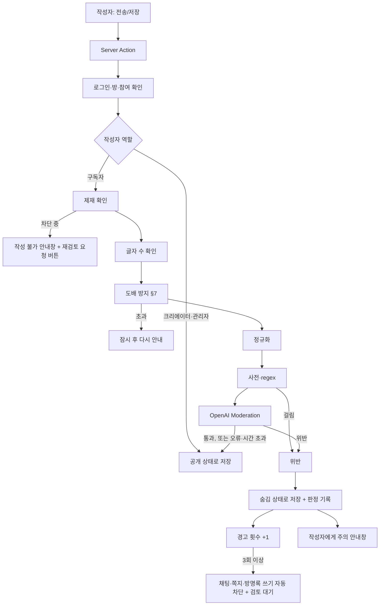

# 12. 커뮤니티 규칙 위반 판정과 제재 (모더레이션)

- 상태: [결정] 2026-11-19 범위와 규칙 확정. 구현 전
- 대상 크리에이터: 러브쑤(lovesoo) [결정] (2026-11-19)
- 관련 문서: 02 (기능 범위), 03 (기술 스택 §6 보안·안전), 06 (인증), 09 (방의 쪽지 트리·방명록), 10 (공모전 규정)
- 관련 이슈: #81 개인정보 처리방침 반영 (이 문서 §11)
- **제재 규칙(경고, 차단, 신고, 재검토, 탈퇴·재가입)의 기준 문서는 13 문서입니다.** 이 문서와 다르면 13 문서를 따릅니다.

팬이 글을 남기는 세 곳(버블 채팅, 쪽지, 방명록)에서 욕설, 성희롱, 비난처럼 커뮤니티 규칙을 어기는 글을 걸러 냅니다. 세 곳은 **같은 판정 구조**를 씁니다. 저장하는 테이블과 화면의 안내창만 다릅니다.

## 1. 결정 사항 요약

| 항목 | 결정 |
|---|---|
| 대상 언어 | **영어 중심**. 한국어는 보조(사전·regex 일부)로 두고 영어 판정 체계를 먼저 완성 [결정] 11-19 |
| 판정 대상 | **구독자(`public`)가 쓴 글만**. 크리에이터와 관리자의 글은 판정하지 않음 |
| 판정 도구 | 자체 사전·정규식(regex) + OpenAI Moderation API(`omni-moderation-latest`) |
| 사전 출처 | **ProfanityBench**(https://huggingface.co/datasets/BibbyResearch/ProfanityBench, MIT, 게이트 동의 필요)의 영어 항목을 1차 목록으로 씀 [결정] 11-19. 여기에 커뮤니티 자체 목록과 허용 목록을 더함. 한국어는 보조 목록 |
| 사전 공개 여부 | 사용자에게 보이지 않음. 판정은 서버에서만 하고, 목록은 공개 저장소에 커밋하지 않음 |
| 위반 글 처리 | 대화방·트리·방명록에 올리지 않음. **원문은 저장**하고 작성자에게 주의 안내창을 띄움 |
| 경고 누적 | 가입 후 영원히 셈. 세 곳을 합산. 차단을 해지해도 횟수에서 빼지 않음 |
| 3회 누적 | **채팅·쪽지·방명록 쓰기만 자동 차단**. 로그인, 읽기, 방 구경 등 다른 기능은 막지 않음. 차단이 맞는지는 크리에이터나 관리자가 검토 |
| 크리에이터 신고 | 경고 1회와 같음 |
| 판정 실패 | 통과(fail-open). 대신 크리에이터에게 메시지 신고·차단 버튼을 줌 |
| 권한 | 크리에이터: 자기 계정과 연결된 미니룸·채팅방만. 관리자: 모든 방 |
| 차단 범위 | 크리에이터는 자기 방 안에서만 사용자를 차단. 관리자는 모든 방에서 차단 |
| 보관 기간 | 작성 글(위반 글 포함)과 제재 기록은 가입부터 탈퇴 전까지. 이메일도 가입부터 탈퇴까지. **경고 1회 이상 또는 제재를 받은 사용자는 탈퇴 후 90일 동안 이메일 해시와 경고 수·제재 상태를 보관** (§9-1, 13 문서 §10) |
| 이의 제기 | 작성 불가 안내창의 "재검토 요청" 버튼. 요청 여부만 저장, 글 입력칸 없음 |
| 연락처 공유 | 처음은 안내 + 글 숨김만, 2번째부터 걸릴 때마다 경고 1회 (§2-3) |
| 자해 관련 글 | 숨기고 크리에이터·관리자에게 알림. 경고 없음 (§2-4) |
| 신고로 내린 글 | 말풍선 자리에 "커뮤니티 정책 위반으로 삭제되었습니다". 크리에이터·관리자는 원문 열람 (§2-5) |
| 차단 상태 | 입력창을 비활성으로 바꾸고 재검토 요청 버튼 표시. 새로고침 없이 반영 (§2-6) |
| 판정 순서 | 먼저 판정, 그다음 저장 (§2-7) |

## 2. 판정 흐름 (세 곳 공통)

| 단계 | 내용 |
|---|---|
| 역할 확인 | [결정] 크리에이터·관리자 글은 판정, 경고, 도배 방지의 판정 단계를 모두 건너뜀. 기존 글자 수·간격 규칙은 그대로 |
| 제재 확인 | 공통 함수 `assertCanWrite(userId, creatorId)`. 자동 차단과 그 방의 크리에이터 차단을 함께 확인 |
| 정규화 | 소문자화, 숫자·기호 치환(`@`→a, `1`→i, `$`→s), 반복 글자 축약, 글자 사이 구분자 제거, 한글 자모 처리. 원문은 따로 보존 |
| 사전·regex | 사전은 단어 집합으로 조회. regex는 사전으로 못 잡는 우회 표기·문장 패턴만 소수로 둠. 허용 목록으로 오탐 제외 |
| OpenAI | 사전에 안 걸린 글만 보냄. 타임아웃 약 1.5초. `sexual/minors`, `harassment/threatening`, `hate/threatening`은 점수와 관계없이 위반. 나머지 카테고리는 평가셋으로 정한 임계값 |
| 저장 | 위반 글도 같은 테이블에 저장하고 `screen_status = 'blocked'`로 숨김. 공개 조회 쿼리는 `blocked`와 `removed`를 제외 |

- [결정] 판정은 저장 **전에** 합니다. 위반 글은 다른 팬에게 한 번도 보이지 않습니다.

### 2-1. 표면별 차이

| 표면 | 저장 테이블 | 판정하는 글 | 위반 시 안내 |
|---|---|---|---|
| 버블 채팅 | `bubble_messages` | 구독자 메시지 (크리에이터 메시지는 판정 안 함) | 입력창 위 주의 안내창 "규칙 위반으로 게시되지 않았어요 (경고 n/3)" |
| 쪽지 | `heap_notes` | 구독자가 쓴 쪽지 본문과 표시 이름 | 쓰기 종이 위 같은 안내창. 접어서 걸기 전에 판정 |
| 쪽지 답장 | `heap_note_replies` | 판정 안 함 (크리에이터가 씀) | 없음 |
| 방명록 | `heap_guestbook` | 구독자가 남기는 **이름**(12자) | 방명록 패널 안 같은 안내창 |

- [사실] 방명록은 이름(12자)만 남기고 본문이 없습니다. 본문 칸은 만들지 않습니다 [결정]. 판정 대상은 이 이름입니다. 12자 안에서도 욕설이나 비난을 쓸 수 있기 때문입니다.
- [가설] 짧은 이름은 OpenAI 판정이 불안정할 수 있습니다. 방명록 이름은 사전·regex를 우선하고, OpenAI 결과는 평가셋으로 확인한 뒤 쓸지 정합니다.

### 2-2. OpenAI 카테고리별 처리

[사실] `omni-moderation-latest`는 아래 13개 카테고리마다 두 값을 돌려줍니다. `categories`는 OpenAI가 정한 기준으로 걸렸는지(참/거짓), `category_scores`는 0~1 사이 점수입니다. 응답 전체에는 하나라도 걸렸는지 나타내는 `flagged`가 있습니다.

| 카테고리 | 뜻 | 우리 처리 | 경고 |
|---|---|---|---|
| `sexual/minors` | 미성년자가 나오는 성적 내용 | OpenAI가 걸었으면 무조건 위반 [결정] | +1 |
| `harassment/threatening` | 괴롭힘 + 해치겠다는 위협 | OpenAI가 걸었으면 무조건 위반 [결정] | +1 |
| `hate/threatening` | 혐오 + 폭력·위협 | OpenAI가 걸었으면 무조건 위반 [결정] | +1 |
| `harassment` | 괴롭힘, 비난, 모욕 | 우리 점수 기준을 넘으면 위반 [결정] | +1 |
| `hate` | 인종, 성별 등 집단에 대한 혐오 | 우리 점수 기준 [결정] | +1 |
| `sexual` | 성적 내용 (성희롱 포함) | 우리 점수 기준 [결정] | +1 |
| `violence` | 폭력 묘사 | 우리 점수 기준 [결정]. "you're killing it" 같은 관용 표현 오탐 주의 | +1 |
| `violence/graphic` | 잔혹한 폭력 묘사 | 우리 점수 기준 [가설] | +1 |
| `illicit` | 범죄 방법 안내 | 우리 점수 기준 [가설] | +1 |
| `illicit/violent` | 폭력이나 무기 조달이 포함된 범죄 안내 | 우리 점수 기준 [가설] | +1 |
| `self-harm` | 자해·자살을 부추기거나 묘사 | §2-4 자해 처리 [결정] | 없음 |
| `self-harm/intent` | 자해 의도 표현 | §2-4 자해 처리 [결정] | 없음 |
| `self-harm/instructions` | 자해 방법 안내 | §2-4 자해 처리 [결정] | 없음 |

- "무조건 위반"은 OpenAI의 참/거짓 값이 참이면 점수를 다시 따지지 않고 위반으로 본다는 뜻입니다. 이 세 카테고리는 놓치는 비용이 커서, 평가셋으로 우리 기준을 OpenAI보다 더 낮게(더 엄격하게) 잡을 수는 있어도 느슨하게 하지는 않습니다.
- "우리 점수 기준"은 OpenAI의 참/거짓 대신 `category_scores`를 우리가 정한 기준값과 비교한다는 뜻입니다. 팬 채팅에 맞게 오탐과 누락을 조절하려는 것이고, 기준값은 평가셋으로 정합니다 (§13). 기준값을 정하기 전 초기값은 OpenAI의 참/거짓을 그대로 씁니다.
- 받은 13개 점수는 모두 `moderation_events.scores`에 저장합니다.

### 2-3. 연락처 공유 [결정] 2026-11-19

- 전화번호, 이메일, 카카오톡·라인·인스타그램 등 메신저·SNS 아이디와 링크를 regex로 잡습니다. OpenAI에는 이 카테고리가 없습니다.
- 패턴은 비밀이 아니므로 코드(`src/lib/moderation/contact.ts`)에 둡니다. 쪽지 표시 이름과 방명록 이름에도 적용합니다.
- **처음 걸리면**: "연락처나 SNS 계정은 공유할 수 없어요" 안내 + 글을 올리지 않음(위반 글처럼 숨긴 채 저장). 경고는 없습니다.
- **2번째부터**: 걸릴 때마다 경고 1회. 경고 누적 규칙(13 문서)과 같습니다.
- 오탐 주의: 날짜·시간·점수 같은 숫자, "카톡 왔어요" 같은 일상 문장, 크리에이터를 부르는 `@러브쑤`. 확실한 것(전화번호, 이메일, 메신저 링크)부터 켜고, "키워드 + 아이디 모양"은 평가셋으로 확인한 뒤 켭니다.

### 2-4. 자해 관련 글 [결정] 2026-11-19

- OpenAI의 `self-harm`, `self-harm/intent`, `self-harm/instructions` 중 하나라도 걸리면 글을 **숨기고**, 크리에이터·관리자 페이지의 "확인 필요" 목록에 올려 **알립니다**.
- **경고를 더하지 않습니다.** 처벌이 아니라 확인이 목적입니다.
- [가설] 작성자에게는 경고 안내 대신 "글이 공개되지 않았어요. 힘든 일이 있다면 도움을 받을 수 있는 곳이 있어요"처럼 처벌하지 않는 안내와 상담 연락처를 보여 줍니다. 문구와 연락처(국가별)는 정해야 합니다.

### 2-5. 신고로 내린 글의 표시 [결정] 2026-11-19

- 신고로 내린 글은 말풍선을 지우지 않고, 같은 자리에 **"커뮤니티 정책 위반으로 삭제되었습니다"**를 보여 줍니다. 그 글을 볼 수 있던 사람 모두에게 똑같이 보입니다.
- 크리에이터(자기 방)와 관리자는 그 자리에서 원문을 펼쳐 볼 수 있고, 검토 페이지에서도 볼 수 있습니다.
- 쪽지와 방명록도 같은 문구로 바꿔 보여 줍니다.
- 자동 판정으로 처음부터 숨긴 글은 다른 팬에게 보인 적이 없으므로 대화방에 자리를 만들지 않습니다. 크리에이터·관리자 검토 페이지에서만 보입니다.
- [사실] 지금 `?since=` 조회는 새로 생긴 글과 삭제된 글만 돌려줍니다. 신고로 상태가 바뀐 글도 다시 내려가도록 상태가 바뀐 시각(`status_changed_at`)을 기준점에 넣어야 합니다.

### 2-6. 차단 상태의 화면 반영 [결정] 2026-11-19

- 차단된 구독자의 입력창(채팅, 쪽지 쓰기, 방명록)은 비활성으로 바꾸고 "커뮤니티 규칙 위반으로 글을 쓸 수 없어요"와 **재검토 요청** 버튼을 보여 줍니다.
- 반영 시점: 화면을 처음 열 때(Server Component가 차단 여부를 읽음), 전송 응답을 받았을 때(3번째 경고로 막힌 경우), 폴링 응답에 들어 있는 "내 작성 가능 여부"가 바뀌었을 때. 그래서 새로고침 없이 바뀝니다.
- 해지되면 같은 경로로 입력창이 다시 열립니다.

### 2-7. 순서와 실시간 전환 대비 [결정] 2026-11-19

- **먼저 판정, 그다음 저장**을 유지합니다. 다른 팬이 위반 글을 먼저 보는 일이 없게 하기 위해서입니다.
- 지금은 5초 폴링입니다. 나중에 #19의 SSE + `LISTEN/NOTIFY`로 바꿀 때를 위해 다음을 지킵니다.
  - 글 저장과 상태 변경은 repo 계층 함수 한 곳에서만 합니다. 나중에 여기에 `pg_notify` 호출만 넣습니다.
  - 알림은 **공개 저장**과 **상태 변경(신고로 내림, 해지)**일 때만 보냅니다. 위반으로 숨긴 저장은 알리지 않습니다. 작성자는 전송 응답으로 결과를 받습니다.
  - 차단·해지는 해당 사용자에게만 가는 알림으로 보냅니다 (§2-6).

## 3. 경고와 자동 차단

| 경고가 쌓이는 경우 | 횟수 |
|---|---|
| 자동 판정에서 위반 | 1 |
| 크리에이터 또는 관리자가 신고 | 1 |

- 경고 수 = 그 사용자의 `moderation_events` 행 수. 기간 제한 없음.
- [결정] 차단을 해지해도 경고 수에서 빼지 않습니다.
- 경고가 3회 이상이 되는 트랜잭션 안에서, 활성 자동 차단이 없으면 **자동 차단**(`sanctions`, `scope = 'auto'`, `created_by = 'system'`, `review_status = 'pending'`)을 만듭니다.
- [결정] 자동 차단이 막는 것은 **채팅 전송, 쪽지 쓰기, 방명록 쓰기 세 가지뿐**입니다. 로그인, 읽기, 방 구경, 쇼츠 재생, 나만의 방 등 다른 기능은 그대로 씁니다. 쓰려고 하면 작성 불가 안내창이 뜹니다.
- [가설] 경고는 모든 방을 합산하므로, 자동 차단도 모든 방의 세 기능에 적용합니다. 지금은 크리에이터가 러브쑤 1명이라 차이가 없습니다.
- 검토 결과
  - 유지: `review_status = 'upheld'`
  - 해지: `revoked_at`, `revoked_by` 기록. 경고 수는 그대로입니다.
- [결정] 해지 뒤에도 경고 수가 3 이상이므로, **다음 경고(4회째부터) 한 번으로 바로 다시 자동 차단**됩니다.

## 4. 신고

- 크리에이터 화면의 구독자 말풍선·쪽지·방명록 항목에 "신고" 버튼을 둡니다.
- 누르면 그 글을 즉시 내리고(`screen_status = 'removed'`), `moderation_events`에 `source = 'report'`로 기록해 경고 1회를 더합니다.
- 내린 글은 대화방과 화면에서 사라지고, 크리에이터 페이지와 관리자 페이지에서만 볼 수 있습니다.
- 같은 글을 두 번 신고해도 경고는 한 번만 셉니다 (`moderation_events`에 글 하나당 한 행). 이미 자동 판정으로 숨겨진 글은 신고할 수 없습니다.

## 5. 권한

| 할 일 | 크리에이터 | 관리자 |
|---|---|---|
| 차단된 글과 작성자 조회 | 자기 미니룸·채팅방의 것만 | 전부 |
| 신고 | 자기 방의 구독자 글 | 모든 방의 구독자 글 |
| 사용자 차단·해지 | 자기 방 범위 차단만 | 모든 방 |
| 자동 차단 검토 | 경고 중 하나 이상이 자기 방에서 나온 경우 [가설] | 전부 |
| 재검토 요청 조회 | 자기 방에서 차단한 사용자의 요청만 | 전부. 어느 크리에이터 방에서, 어떤 메시지 때문에, 어떤 사용자가 차단됐는지 함께 봄 |

- 권한 조건은 화면이 아니라 repo 계층의 쿼리에 넣습니다 (`creator_id = viewer.id`). 화면에서 숨기는 것만으로는 막히지 않습니다.
- 지금 서비스의 크리에이터는 러브쑤 1명이지만, 코드는 `creator_id`로 범위를 나눠 둡니다.

## 6. 차단 종류와 Better Auth 기능 분담

| 종류 | 만드는 사람 | 효과 | 구현 |
|---|---|---|---|
| 방 단위 차단 | 크리에이터, 관리자 | 그 크리에이터의 미니룸·채팅방에서 채팅·쪽지·방명록 쓰기와 채팅방 참여 불가. 읽기는 됨 | 자체 테이블 `sanctions` (`scope = 'room'`) |
| 자동 차단 | 시스템(경고 3회) | 모든 방에서 채팅·쪽지·방명록 쓰기만 불가. 로그인과 다른 기능은 됨 | 자체 테이블 `sanctions` (`scope = 'auto'`) |
| 계정 정지 | 관리자 | 로그인 자체가 안 되고 기존 세션이 끊김 | Better Auth `banUser` |

- [사실] Better Auth의 `banUser`는 로그인을 막고 기존 세션을 모두 끊습니다 (§10). 그래서 차단된 사용자에게 "작성 불가 안내창 + 재검토 요청 버튼"을 보여 줄 수 없습니다.
- [결정 제안] 자동 차단과 크리에이터 차단은 자체 테이블로 하고, Better Auth `banUser`는 관리자가 쓰는 가장 강한 조치(계정 정지)로만 씁니다. 계정 정지 사용자에게는 Better Auth의 `bannedUserMessage`로 로그인 화면에 사유를 보여 줍니다.

## 7. 도배 방지

판정 전에 "시도" 기준으로 셉니다. 위반 글도 저장하므로, 저장된 글과 위반 글을 함께 셉니다. 구독자에게만 적용합니다.

| 장치 | 값 (안) | 위치 |
|---|---|---|
| 채팅 연속 전송 간격 | 10초 (현재 값 유지) | `bubble/policy.ts` |
| 채팅 시간창 | 10분에 15건 (현재 값 유지). **위반 글도 셈** | `bubble/policy.ts` |
| 쪽지 | 한 방에 하루 5장 (현재 값 유지). 위반 글도 셈 | `heap/policy.ts` |
| 방명록 | 한 방에 하루 1건 (현재 값 유지). 위반 글도 셈 | `heap/policy.ts` |
| 같은 글 반복 | 정규화한 본문이 10분 안의 내 글과 같으면 판정 없이 거절 | `moderation/policy.ts` |
| 위반 직후 대기 | 위반 판정 뒤 60초 동안 같은 곳에 쓰기 불가 | `moderation/policy.ts` |
| OpenAI 호출 상한 | 사용자당 10분에 20회. 넘으면 사전·regex만으로 판정 | `moderation/policy.ts` |
| 링크 개수 | 구독자 글 하나에 링크 1개까지 | `moderation/policy.ts` |
| 가입 속도 | Better Auth의 요청 제한 설정 확인 후 적용 [미정] | `auth.ts` |

- 모든 숫자는 `src/lib/moderation/policy.ts` 한 곳에서 바꿉니다 (버블 정책 파일과 같은 방식).
- OpenAI 호출 상한에 걸린 경우도 판정 실패와 같이 "사전·regex 통과면 저장"입니다 (fail-open과 일관).

## 8. 재검토 요청

- 작성이 막힌 사용자가 쓰려고 하면 안내창을 띄웁니다: "커뮤니티 규칙 위반으로 글을 쓸 수 없어요." 버튼은 **확인**과 **재검토 요청** 두 개입니다.
- 재검토 요청은 `sanction_appeals`에 한 행만 남깁니다. 입력칸은 없습니다.
- 같은 차단에는 한 번만 요청할 수 있습니다 (`sanction_id` 유니크). 이미 요청했으면 버튼 자리에 "재검토를 요청했어요"를 보여 줍니다.
- 크리에이터와 관리자는 요청 목록에서 해당 사용자의 경고 원문을 보고 유지 또는 해지를 고릅니다.

## 9. 데이터 모델 (`0011` 안)

| 테이블 / 칸 | 내용 |
|---|---|
| `bubble_messages`, `heap_notes`, `heap_guestbook`에 칸 추가 | `screen_status` (`published` / `blocked` / `removed` / `held`), `screened_at`, `status_changed_at`. `held`는 자해 관련으로 숨긴 글. 판정하지 않는 크리에이터 글은 `published` |
| `moderation_events` | `id`, `user_id`, `creator_id`, `surface` (`chat` / `note` / `guestbook`), `target_id`(글 id), `source` (`auto` / `report`), `kind` (`abuse` / `contact` / `self_harm`), `counts_as_strike`(경고로 세는지), `matched`(사전·regex 근거 종류), `categories`, `scores`, `reported_by`, `created_at`. 글 하나당 한 행 |
| `sanctions` | `id`, `user_id`, `scope` (`room` / `auto`), `creator_id`(방 단위일 때), `created_by` (사용자 id 또는 `system`), `reason`, `review_status` (`pending` / `upheld`), `reviewed_by`, `reviewed_at`, `revoked_at`, `revoked_by`, `created_at` |
| `sanction_appeals` | `id`, `sanction_id`(유니크), `user_id`, `status` (`pending` / `reviewed`), `created_at` |
| `withdrawn_accounts` | §9-1 |

- `matched`에는 사전 단어 자체를 넣지 않고 근거 종류(예: `lexicon:severity5`, `regex:threat`)만 넣습니다. 사전이 관리 화면을 통해 새지 않게 하기 위해서입니다.
- 마이그레이션 번호는 #25 규칙대로 이슈로 알리고 `bubble_migrations`를 확인한 뒤 씁니다. 현재 저장소의 마지막 번호는 `0010`입니다.

### 9-1. 탈퇴 후 이메일 보관

- [결정] 이메일은 가입부터 탈퇴까지 보관합니다. 단 경고를 1회 이상 받았거나 제재(자동 차단, 방 단위 차단, 계정 정지)를 받은 적이 있는 사용자는 탈퇴 후 **90일 동안** 이메일의 HMAC 해시와 탈퇴 시점의 경고 수·차단 상태를 `withdrawn_accounts`에 남깁니다.
- [결정] 90일 안에 같은 이메일로 다시 가입하면 이전 경고 수와 차단 상태를 이어받습니다.
- [사실] 지금 DB는 사용자를 지우면 글이 함께 지워집니다 (`on delete cascade`). 그래서 기록은 계정을 지우기 전에 남깁니다. 탈퇴 기능 자체는 아직 코드에 없습니다.
- 칸 구성, 탈퇴·재가입 순서는 13 문서 §10에 있습니다.

## 10. Better Auth admin 플러그인 기능 (공식 문서 기준)

출처: https://better-auth.com/docs/plugins/admin (2026-11-19 확인, 문서 표기 버전 1.7.26). [사실] 우리가 쓰는 버전은 1.7.19라서 쓰기 전에 설치된 패키지에서 같은 메서드가 있는지 확인합니다.

| 기능 | 메서드 | 내용 | 우리 쓰임 |
|---|---|---|---|
| 사용자 만들기 | `createUser` | 관리자가 계정 생성 | 크리에이터 계정 발급 (01 문서 §2) |
| 사용자 목록·조회 | `listUsers`, `getUser` | 검색, 필터, 정렬, 페이지 나누기 | 관리자 페이지의 사용자 목록 |
| 역할 지정 | `setRole` | 역할 변경 | 크리에이터 계정 전환 |
| 비밀번호 지정 | `setUserPassword` | 관리자가 비밀번호 설정 | 크리에이터 계정 전달 |
| 사용자 정보 수정 | `updateUser` (서버 `adminUpdateUser`) | 사용자 칸 수정 | 닉네임 강제 변경 등 |
| 계정 정지 | `banUser` | 로그인 차단 + 기존 세션 모두 끊음. 사유(`banReason`)와 기간(`banExpiresIn`, 초) 선택. 기간이 없으면 영구 | §6의 계정 정지 |
| 정지 해지 | `unbanUser` | 로그인 다시 허용 | 계정 정지 해지 |
| 세션 목록·끊기 | `listUserSessions`, `revokeUserSession`, `revokeUserSessions` | 사용자의 로그인 기기 확인, 하나 또는 전부 끊기 | 계정 탈취 의심 시 |
| 대신 로그인 | `impersonateUser`, `stopImpersonating` | 관리자가 그 사용자로 접속 (기본 1시간) | 사용하지 않음 권장 [가설]. 쓰면 기록을 남겨야 함 |
| 사용자 삭제 | `removeUser` | DB에서 완전히 지움 | 탈퇴 처리. 지우기 전에 §9-1 이메일 기록 |
| 권한 확인 | `hasPermission` (서버 `userHasPermission`), `checkRolePermission` | 역할의 권한 확인 | 관리자 화면 접근 확인 |

- 정지 관련 설정: `defaultBanReason`, `defaultBanExpiresIn`, `bannedUserMessage`(문자열 또는 함수로 사유 표시).
- 추가되는 칸: `user.role`, `user.banned`, `user.banReason`, `user.banExpires`, `session.impersonatedBy`.
- 권한 모델: 기본 `user` 자원의 동작은 create, list, set-role, ban, impersonate, impersonate-admins, delete, set-password, set-email, set-phone, get, update. `session` 자원은 list, revoke, delete. `createAccessControl`로 직접 권한을 정의할 수 있습니다.
- [사실] 우리 `src/lib/access.ts`의 `creator` 역할은 빈 권한이라 Better Auth 관리 API를 쓸 수 없습니다. 크리에이터의 방 단위 차단은 Better Auth가 아니라 자체 테이블로 처리하는 것이 맞습니다.

## 11. 개인정보 처리방침 유의 사항

[사실] 2026-11-19 기준 저장소에 개인정보 처리방침 문서나 화면이 없습니다. 처리방침 초안을 만들기 전까지는 이 절을 기준으로 삼습니다 (#81).

[가설] 아래는 기획 단계의 점검 목록입니다. 법률 자문이 아니며, 제출 전 공식 자료나 전문가 확인이 필요합니다.

| 항목 | 우리 상황 | 처리방침에 적을 것 |
|---|---|---|
| 수집 항목 | 구독자의 작성 글(위반으로 숨긴 글 포함), 방명록 이름, 판정 결과와 카테고리 점수, 신고 기록, 제재 기록, 재검토 요청 여부 | 항목과 수집 목적(커뮤니티 규칙 위반 방지) |
| 보유 기간 | 가입부터 탈퇴 전까지 [결정] | 같은 문구. 탈퇴 시 파기 방법 |
| 탈퇴 후 보관 | 이메일은 가입부터 탈퇴까지. 경고 1회 이상 또는 제재를 받은 사용자만 탈퇴 후 90일 동안 이메일 해시와 경고 수·차단 상태 보관 [결정] (§9-1) | 보관 항목(이메일 해시, 경고 수, 차단 상태), 대상(경고 또는 제재 이력이 있는 사용자), 목적(제재 회피 재가입 방지), 기간(탈퇴 후 90일), 기간 뒤 자동 파기, 재가입 시 이어받는다는 사실 |
| 외부 전송 | 사전에 안 걸린 구독자 글은 OpenAI(미국)로 보내 판정 | 받는 회사, 국가, 전송 항목, 목적, 시기와 방법, 그 회사의 보유 기간. 국외 이전 고지 요건 확인 |
| DB 위치 | Render 공유 DB가 싱가포르에 있음 (03 문서) | 같은 국외 이전 고지에 포함 |
| 열람하는 사람 | 크리에이터(자기 방), 관리자 | 열람 범위. 관리자 열람 기록을 남길지 [미정] |
| 자동화된 결정 | 3회 경고 시 사람 검토 전에 채팅·쪽지·방명록 쓰기를 자동 차단 | 자동 결정이 있다는 사실, 기준, 재검토 요청 방법. 국내 자동화된 결정 관련 규정과 해외(EU 이용자가 있다면 GDPR) 확인 |
| 제3자 열람 | 크리에이터는 회사 밖 사람 | 크리에이터가 팬의 글과 제재 정보를 보는 근거 |
| 미성년자 | 가입 나이 확인 없음 | 만 14세 미만 가입 처리 방식 확인 |

- [사실] 공모전은 상용화 심사에서 "콘텐츠의 적법한 사용"을 본다고 밝힙니다 (10 문서 §1). 개인정보 처리도 같은 심사 대상이 될 수 있습니다.
- OpenAI API로 보낸 데이터의 보관 기간과 학습 사용 여부는 OpenAI의 최신 정책 문서로 확인해 처리방침에 적습니다.
- 가입 화면에 처리방침 링크와 동의 단계를 넣어야 합니다. 지금 가입 화면에는 없습니다.
- 탈퇴 화면에서 경고·제재 이력이 있는 사용자에게 "제재 이력과 이메일 확인 정보가 90일 동안 보관된다"는 안내를 보여 줘야 합니다.

## 12. 미정

- 관리자 열람 기록(누가 언제 어떤 원문을 봤는지)을 남길지 (§11)
- 가입 속도 제한 값 (§7)
- 그 밖의 제재 관련 미정은 13 문서 §14

## 13. 구현 순서

1. 사전 준비: ProfanityBench 게이트 동의와 다운로드, 영어·한국어 추출, 사람 검토, 저장소 밖 보관 (`moderation_terms` 테이블 또는 Render Secret File)
2. 평가셋: 영어 중심 300~500문장 라벨링 (정상, 관용 표현, 욕설, 비난, 성희롱, 위협, 연락처, 자해). 방명록 이름처럼 짧은 글도 포함. 한국어는 보조로 일부. 구현 뒤 점수 기준을 정하고, 이후에는 회귀 테스트(고친 뒤 예전 결과가 깨지지 않았는지 확인)로 계속 씀
3. 판정 모듈 `src/lib/moderation/` (정규화, 사전·regex, OpenAI 호출, 결정, 정책 값) + 단위 테스트
4. `0011` 마이그레이션 (#25 통보 후)
5. 세 곳의 Server Action에 역할 분기, `assertCanWrite`, 판정 연결. 공개 조회에서 `blocked`·`removed` 제외
6. 주의 안내창, 작성 불가 안내창, 재검토 요청
7. 크리에이터·관리자 페이지: 위반 글 목록, 신고 버튼, 차단·해지, 재검토 요청 목록
8. 탈퇴 처리: 이메일 기록 후 삭제, 재가입 확인
9. 검증: Playwright로 3회 누적 → 자동 차단 → 재검토 요청 → 해지 → 4회째 재차단 흐름, 오탐·누락 측정
10. 개인정보 처리방침 초안과 가입·탈퇴 화면 안내 (§11)
