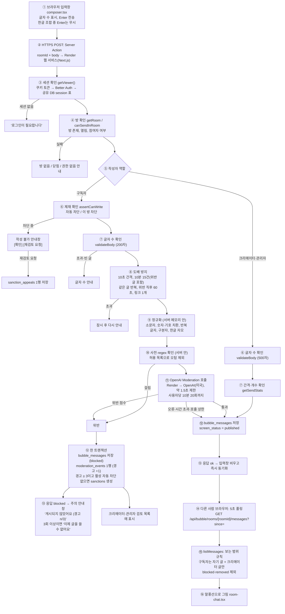
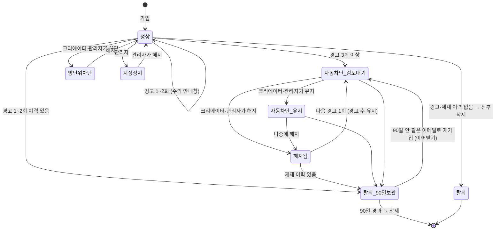

# 13. 제재 상세 명세 (경고, 차단, 신고, 재검토, 탈퇴·재가입)

- 상태: [결정] 2026-11-19 사용자와 확정한 규칙. 구현 전
- 이 문서가 **제재 규칙의 기준 문서**입니다. 12 문서(판정 구조)와 내용이 다르면 이 문서를 따릅니다.
- 관련 문서: 12 (판정 흐름, 사전·OpenAI, 도배 방지), 06 (인증), 04 (결정 로그), 09 (쪽지 트리·방명록)
- 관련 이슈: #81 (개인정보 처리방침)

## 1. 용어

| 용어 | 뜻 |
|---|---|
| 판정 | 구독자가 쓴 글이 커뮤니티 규칙을 어기는지 서버가 확인하는 일. 사전·regex + OpenAI Moderation (12 문서 §2) |
| 위반 글 | 판정에서 걸린 글. 화면에 올리지 않고 숨긴 채 저장 (`screen_status = 'blocked'`) |
| 경고 | 위반 글 1건 또는 신고 1건마다 1회. 사용자에게 쌓임 |
| 자동 차단 | 경고가 3회 이상이 되면 시스템이 거는 차단. 채팅·쪽지·방명록 쓰기만 막음 |
| 방 단위 차단 | 크리에이터(자기 방)나 관리자(모든 방)가 거는 차단 |
| 계정 정지 | 관리자만 거는 가장 강한 조치. 로그인 자체를 막음 (Better Auth `banUser`) |
| 신고 | 크리에이터·관리자가 구독자 글을 내리는 일. 경고 1회와 같음 |
| 검토 | 자동 차단이 맞는지 크리에이터·관리자가 판단해 유지 또는 해지하는 일 |
| 재검토 요청 | 차단된 사용자가 "억울하다, 다시 봐 달라"는 뜻만 남기는 일. 글 입력 없음 |
| 해지 | 차단을 푸는 일. 경고 수는 줄지 않음 |

## 2. 확정 규칙 한눈에 보기

| # | 규칙 | 결정일 |
|---|---|---|
| 1 | 판정과 경고는 **구독자(`public`) 글만**. 크리에이터·관리자 글은 판정하지 않음 | 11-19 |
| 2 | 판정하는 곳: 버블 채팅, 쪽지(본문·표시 이름), 방명록(이름 12자). 쪽지 답장은 크리에이터가 쓰므로 판정 안 함 | 11-19 |
| 3 | 위반 글은 화면에 올리지 않고 **원문을 저장**. 작성자에게 주의 안내창 | 11-19 |
| 4 | 경고는 **가입 후 영원히** 세고, 세 곳을 **합산** | 11-19 |
| 5 | 크리에이터·관리자의 **신고 = 경고 1회** | 11-19 |
| 6 | 경고 **3회 이상이면 자동 차단**. 막는 것은 **채팅 전송·쪽지 쓰기·방명록 쓰기뿐**. 로그인, 읽기, 방 구경, 쇼츠 재생 등 다른 기능은 그대로 | 11-19 |
| 7 | 자동 차단은 크리에이터나 관리자가 **검토**해 유지 또는 해지 | 11-19 |
| 8 | **해지해도 경고 수는 그대로**. 그래서 해지 뒤 **다음 경고 1회로 바로 다시 자동 차단** | 11-19 |
| 9 | 크리에이터는 **자기 방 안에서만** 사용자를 차단. 관리자는 **모든 방**에서 차단 | 11-19 |
| 10 | 판정이 실패하거나 시간이 초과되면 **통과**(fail-open). 그 대신 크리에이터의 신고·차단 버튼으로 보완 | 11-19 |
| 11 | 차단된 사용자가 쓰려고 하면 **작성 불가 안내창**(확인, 재검토 요청). 재검토 요청은 **여부만** 저장 | 11-19 |
| 12 | 작성 글(위반 글 포함)과 제재 기록은 **가입부터 탈퇴 전까지** 보관 | 11-19 |
| 13 | 이메일은 **가입부터 탈퇴까지** 보관. 단 **경고를 1회 이상 받았거나 제재를 받은 사용자는 탈퇴 후 90일 동안** 이메일(해시)과 경고 수·제재 상태를 보관 | 11-19 |
| 14 | 탈퇴 후 보관하는 이메일은 **해시값**으로 저장 | 11-19 |
| 15 | 90일 안에 같은 이메일로 다시 가입하면 **이전 경고 수와 차단 상태를 이어받음** | 11-19 |
| 16 | 차단 사전은 사용자에게 보이지 않음. 서버에서만 판정하고 공개 저장소에 커밋하지 않음 | 11-19 |
| 17 | **연락처 공유**: 처음은 안내 + 글 숨김만(경고 없음). 2번째부터 걸릴 때마다 경고 1회 | 11-19 |
| 18 | **자해 관련 글**: 숨기고 크리에이터·관리자에게 알림. 경고 없음 | 11-19 |
| 19 | **신고로 내린 글**: 말풍선 자리에 "커뮤니티 정책 위반으로 삭제되었습니다". 크리에이터(자기 방)·관리자는 원문 열람 | 11-19 |
| 20 | **차단 상태**는 입력창에 바로 반영 (비활성 + 재검토 요청 버튼) | 11-19 |
| 21 | **먼저 판정, 그다음 저장** 유지 | 11-19 |

## 3. 경고

### 3-1. 경고가 생기는 경우

| 경우 | 생기는 기록 | 경고 |
|---|---|---|
| 구독자 글이 자동 판정에서 위반 (욕설·비난·성희롱 등) | `moderation_events` (`source = 'auto'`, `kind = 'abuse'`) | +1 |
| 연락처 공유, 처음 | `moderation_events` (`kind = 'contact'`, `counts_as_strike = false`) | 0 (안내만) |
| 연락처 공유, 2번째부터 | `moderation_events` (`kind = 'contact'`, `counts_as_strike = true`) | +1 |
| 자해 관련 글 | `moderation_events` (`kind = 'self_harm'`, `counts_as_strike = false`) | 0 (숨김 + 알림) |
| 크리에이터·관리자가 구독자 글을 신고 | `moderation_events` (`source = 'report'`) | +1 |
| 판정 실패·시간 초과 | 기록 없음 (글은 공개 저장) | 0 |
| 크리에이터·관리자가 쓴 글 | 판정 안 함 | 0 |

### 3-2. 세는 방법

- 경고 수 = 그 사용자의 `moderation_events` 중 `counts_as_strike = true`인 행 수. 기간 제한 없음.
- 연락처 공유가 "처음"인지는 그 사용자의 `kind = 'contact'` 행이 이미 있는지로 판단합니다. 가입 후 영원히 셉니다.
- 글 하나에는 경고가 한 번만 생깁니다. `moderation_events`에 (`surface`, `target_id`) 유니크 제약을 둡니다.
  - 이미 자동 판정으로 숨겨진 글은 신고할 수 없습니다.
  - 같은 글을 두 사람이 신고해도 한 번만 셉니다.
- 해지, 검토 결과와 관계없이 경고는 지우거나 빼지 않습니다.
- 재가입으로 이어받은 경고는 `moderation_events`가 아니라 `users_strike_carryover`(§10-3)에서 더합니다.

## 4. 자동 차단

| 항목 | 내용 |
|---|---|
| 거는 조건 | 경고가 생긴 직후 경고 수가 **3 이상**이고, 활성 자동 차단(해지 안 된 것)이 없을 때 |
| 거는 주체 | 시스템 (`created_by = 'system'`) |
| 범위 | 모든 방 (경고를 모든 방에서 합산하므로) |
| 막는 것 | 채팅 전송, 쪽지 쓰기, 방명록 쓰기 |
| 막지 않는 것 | 로그인, 방 구경, 쇼츠 재생, 쪽지·방명록·채팅 읽기, 본인 계정 설정, 재검토 요청, 탈퇴 |
| 기간 | 사람이 해지할 때까지 |
| 처음 상태 | `review_status = 'pending'` (검토 대기) |

- 경고 기록과 자동 차단은 **한 트랜잭션** 안에서 만듭니다. 짧은 시간에 위반 글 두 건이 동시에 들어와도 자동 차단이 두 개 생기지 않게 합니다 (활성 자동 차단 유니크 조건).
- 예시

| 경고 | 결과 |
|---|---|
| 1회, 2회 | 주의 안내창만 ("경고 n/3") |
| 3회 | 자동 차단 + 검토 대기 |
| 해지 후 4회 | 다시 자동 차단 + 검토 대기 |
| 해지 후 5회 | 다시 자동 차단 + 검토 대기 |

## 5. 방 단위 차단

| 항목 | 크리에이터 | 관리자 |
|---|---|---|
| 걸 수 있는 범위 | 자기 계정과 연결된 미니룸·채팅방 | 모든 방 (방마다 또는 전체) |
| 막는 것 | 그 방의 채팅 전송·채팅방 참여, 쪽지 쓰기, 방명록 쓰기 | 같음 |
| 해지 | 자기가 건 차단, 자기 방의 차단 | 모든 차단 |
| 경고 | 방 단위 차단은 경고를 더하지 않음 (신고만 경고를 더함) | 같음 |

- 신고와 차단은 별개 버튼입니다. 신고는 **글**을 내리고 경고를 더하고, 차단은 **사람**의 쓰기를 막습니다.

## 6. 계정 정지 (관리자 전용)

- Better Auth `banUser`를 씁니다. 로그인을 막고 기존 세션을 모두 끊습니다. 기간(초)과 사유를 줄 수 있고, 기간이 없으면 영구입니다.
- 로그인 화면에는 `bannedUserMessage`로 사유를 보여 줍니다.
- 정지된 사용자는 로그인할 수 없어서 작성 불가 안내창과 재검토 요청 버튼을 볼 수 없습니다. 그래서 일반적인 제재는 자동 차단과 방 단위 차단으로 하고, 계정 정지는 심각한 경우에만 씁니다.
- [미정] 계정 정지 사용자의 이의 제기 경로 (로그인 화면의 안내 문구에 연락처를 넣을지)

## 7. 신고

- 크리에이터·관리자 화면의 **구독자** 말풍선·쪽지·방명록 항목에 "신고" 버튼을 둡니다. 크리에이터는 자기 방의 글만 신고할 수 있습니다.
- 신고하면 한 트랜잭션에서
  1. 글을 내림 (`screen_status = 'removed'`)
  2. `moderation_events`에 `source = 'report'`, `reported_by` 기록 (경고 +1)
  3. 경고가 3 이상이면 자동 차단 (§4)
- 내린 글은 말풍선 자리에 "커뮤니티 정책 위반으로 삭제되었습니다"로 바뀌어 보입니다 (12 문서 §2-5). 원문은 크리에이터(자기 방)와 관리자만 그 자리에서 펼쳐 보거나 검토 페이지에서 봅니다.

## 8. 검토와 재검토 요청

### 8-1. 작성 불가 안내창

차단된 사용자가 채팅을 보내거나 쪽지·방명록을 쓰려고 하면 띄웁니다.

| 요소 | 내용 |
|---|---|
| 문구 | "커뮤니티 규칙 위반으로 글을 쓸 수 없어요." |
| 버튼 1 | 확인 (닫기) |
| 버튼 2 | 재검토 요청. 이미 요청했으면 "재검토를 요청했어요"로 바뀌고 누를 수 없음 |

### 8-2. 재검토 요청

- 누르면 `sanction_appeals`에 한 행만 남깁니다 (`sanction_id`, `user_id`, `created_at`). 입력칸은 없습니다.
- 차단 하나당 한 번만 요청할 수 있습니다 (`sanction_id` 유니크).
- 다시 차단되면(새 `sanctions` 행) 다시 요청할 수 있습니다.

### 8-3. 검토 화면

| 보는 사람 | 볼 수 있는 것 |
|---|---|
| 크리에이터 | 자기 방에서 생긴 위반 글·신고 글과 작성자. 자기 방에서 차단한 사용자와 그 사용자의 재검토 요청. 자동 차단 중 경고 하나 이상이 자기 방에서 나온 것 [가설] |
| 관리자 | 전부. 어느 크리에이터의 방에서, 어떤 메시지 때문에, 어떤 사용자가 차단됐는지와 재검토 요청 여부 |

- 화면 항목: 사용자 닉네임, 경고 수, 경고 목록(시각, 채널, 원문, 판정 근거 종류, 자동/신고), 현재 차단 상태, 재검토 요청 여부
- 동작: 유지 (`review_status = 'upheld'`), 해지 (`revoked_at`, `revoked_by`). 해지해도 경고 수는 그대로입니다.
- 판정 근거에는 사전 단어 자체를 보여 주지 않고 종류만 보여 줍니다 (예: `lexicon:severity5`, `openai:harassment`).

## 9. 권한 매트릭스

| 할 일 | 구독자 | 크리에이터 | 관리자 |
|---|---|---|---|
| 자기 경고 수 보기 | 주의 안내창에서만 (n/3) | — | — |
| 위반 글·신고 글 원문 보기 | 불가 (신고 글은 삭제 문구만 보임) | 자기 방 | 전부 |
| 자해 관련 "확인 필요" 목록 | 불가 | 자기 방 | 전부 |
| 신고 | 불가 | 자기 방의 구독자 글 | 모든 방의 구독자 글 |
| 방 단위 차단·해지 | 불가 | 자기 방 | 모든 방 |
| 자동 차단 유지·해지 | 불가 | 자기 방 관련 건 [가설] | 전부 |
| 계정 정지·해지 | 불가 | 불가 | 가능 |
| 재검토 요청 | 본인 차단 | — | — |
| 재검토 요청 보기 | 불가 | 자기 방에서 차단한 사용자의 요청 | 전부 |

- 모든 조건은 repo 계층 쿼리에 넣습니다 (`creator_id = viewer.id`). 화면에서 버튼을 숨기는 것만으로는 막히지 않습니다.

## 10. 탈퇴와 재가입

### 10-1. 보관 기간

| 데이터 | 보통 사용자 (경고·제재 없음) | 보관 대상 사용자 (경고 1회 이상 또는 제재) |
|---|---|---|
| 이메일 | 가입부터 탈퇴까지 | 가입부터 탈퇴까지 + **탈퇴 후 90일** (해시값으로) |
| 작성 글 (위반 글 포함) | 가입부터 탈퇴까지 | 가입부터 탈퇴까지 |
| 경고·제재 기록 | 가입부터 탈퇴까지 | 탈퇴 후 90일 동안 **요약**(경고 수, 차단 상태)만 보관 |

- "보관 대상 사용자" = 경고를 1회 이상 받았거나, 자동 차단·방 단위 차단·계정 정지 중 하나라도 받은 적이 있는 사용자. 해지된 차단도 포함합니다.
- [결정] 경고만 1~2회 받은 사용자도 보관 대상입니다 (2026-11-19). 그래서 경고를 피하려고 탈퇴했다가 다시 가입해도 경고가 이어집니다.
- 경고도 제재도 없는 사용자는 탈퇴하면 이메일을 포함해 모두 지웁니다.

### 10-2. 탈퇴 처리 순서

[사실] 탈퇴 기능은 아직 코드에 없습니다. 새로 만듭니다.

1. 본인 확인 후 탈퇴 안내 화면을 보여 줍니다. 보관 대상 사용자에게는 "경고·제재 이력과 이메일 확인 정보가 90일 동안 보관된다"는 문구를 보여 줍니다.
2. 보관 대상 사용자이면 `withdrawn_accounts`에 한 행을 씁니다 (§10-3).
3. Better Auth `removeUser`(또는 사용자 삭제)로 계정을 지웁니다. 지금 DB는 사용자를 지우면 채팅, 쪽지, 방명록 등이 함께 지워집니다 (`on delete cascade`). 그래서 2번은 반드시 3번보다 먼저 합니다.
4. 하루 한 번 정리 작업이 `expires_at`이 지난 `withdrawn_accounts` 행을 지웁니다 (Render Cron Job 또는 Render Workflows).

### 10-3. `withdrawn_accounts`

| 칸 | 내용 |
|---|---|
| `email_hash` | 이메일을 소문자로 정리한 뒤 서버 비밀 키로 만든 HMAC-SHA256 값. 유니크 |
| `strike_count` | 탈퇴 시점의 경고 수 |
| `auto_sanction_active` | 탈퇴 시점에 활성 자동 차단이 있었는지 |
| `room_sanction_creator_ids` | 탈퇴 시점에 활성 방 단위 차단을 건 크리에이터 id 목록 |
| `account_banned` | 탈퇴 시점에 계정 정지 상태였는지 |
| `withdrawn_at` | 탈퇴 시각 |
| `expires_at` | `withdrawn_at` + 90일 |

- 그냥 해시(SHA-256)만 쓰면 흔한 이메일을 대입해 원래 이메일을 알아낼 수 있습니다. 그래서 서버 비밀 키를 섞는 HMAC을 씁니다. 키는 Render 환경 변수에만 둡니다.

### 10-4. 재가입

1. 가입이 끝나면 새 이메일의 HMAC 값으로 `withdrawn_accounts`를 찾습니다.
2. 있고 만료 전이면 이어받습니다.
   - 경고 수: `users_strike_carryover`(`user_id`, `carried_strikes`, `source_withdrawn_at`)에 기록해 경고 수에 더합니다.
   - 자동 차단: 활성이었으면 새 계정에 자동 차단을 다시 겁니다 (`review_status = 'pending'`).
   - 방 단위 차단: 같은 크리에이터 방에 다시 겁니다.
   - 계정 정지: 정지 상태였으면 새 계정도 Better Auth로 정지합니다.
3. 이어받은 뒤 `withdrawn_accounts` 행을 지웁니다.
4. 90일이 지나 행이 지워진 뒤 가입하면 새 사용자로 시작합니다.

## 11. 채팅 전송 시 글자의 이동 경로

구독자가 버블 채팅에 글을 보낼 때의 순서입니다. 쪽지와 방명록은 저장 테이블과 안내창 위치만 다르고 순서는 같습니다.

- 그림을 단순하게 하려고 ⑩의 regex 결과 중 **연락처**(처음은 안내만, 2번째부터 경고)와 ⑪의 OpenAI 결과 중 **자해**(숨김 + 알림, 경고 없음)는 "위반" 칸에 함께 그렸습니다. 세부는 §3-1과 12 문서 §2-3, §2-4입니다.

| 단계 | 글자가 있는 곳 | 비고 |
|---|---|---|
| ① | 사용자 브라우저 메모리 | 사전 검사를 브라우저에서 하지 않음 (사전 노출 방지) |
| ② | 인터넷(HTTPS) → Render 웹 서비스 | 암호화된 연결 |
| ③~⑩ | Render 웹 서비스 메모리 | DB에는 세션·방·통계 확인만 읽음 |
| ⑪ | OpenAI 서버(미국) | 사전에 걸리지 않은 구독자 글만. 처리방침 국외 이전 고지 대상 (#81) |
| ⑫ | 공유 PostgreSQL(싱가포르) | 공개 글과 위반 글 모두 저장. 처리방침 국외 이전 고지 대상 |
| ⑭~⑯ | 다른 사용자 브라우저 | 공개 글만 전달. 위반 글은 크리에이터·관리자 검토 화면에서만 |

## 12. 상태 흐름

- 그림을 단순하게 하려고 "방 단위 차단"과 "계정 정지" 상태에서의 탈퇴 화살표는 생략했습니다. 두 상태도 제재 이력이 있으므로 탈퇴하면 90일 보관 대상입니다.

## 13. 경계 사례

| 상황 | 처리 |
|---|---|
| 판정 중 OpenAI 오류·시간 초과 | 통과. 경고 없음 |
| 위반 글 두 건이 동시에 들어와 3회를 넘김 | 한 트랜잭션과 유니크 조건으로 자동 차단은 하나만 생김 |
| 자동 차단 중에 신고가 더 들어옴 | 경고는 더해지고, 새 자동 차단은 만들지 않음 |
| 해지 직후 위반 | 경고 4회 → 바로 자동 차단 |
| 차단된 사용자가 예전에 쓴 공개 글 | 그대로 둠. 지우려면 신고로 하나씩 내림 [가설] |
| 크리에이터가 남의 방 글을 신고·차단하려 함 | 서버에서 거부 (`creator_id` 조건) |
| 크리에이터가 다른 크리에이터나 관리자 글을 신고 | 불가. 구독자 글만 신고 대상 |
| 제재 이력이 있는 사용자가 이메일을 바꾼 뒤 탈퇴 | 탈퇴 시점의 이메일로 해시를 남김 [가설] |
| 90일 안에 다른 이메일로 재가입 | 막을 수 없음. 이메일 기준 확인의 한계 |

## 14. 미정

1. 자동 차단 검토 권한을 크리에이터에게 어디까지 줄지 (§8-3 가설)
2. 차단된 사용자의 예전 공개 글을 함께 내릴지 (§13)
3. 계정 정지 사용자의 이의 제기 경로 (§6)
4. 관리자·크리에이터의 원문 열람 기록을 남길지 (12 문서 §11)

## 15. 데이터 요약

| 테이블 | 용도 | 상세 |
|---|---|---|
| `bubble_messages`, `heap_notes`, `heap_guestbook` | 글 저장. `screen_status`, `screened_at` 추가 | 12 문서 §9 |
| `moderation_events` | 경고 기록. (`surface`, `target_id`) 유니크 | §3 |
| `sanctions` | 자동·방 단위 차단. `scope = 'auto' / 'room'` | §4, §5 |
| `sanction_appeals` | 재검토 요청. `sanction_id` 유니크 | §8 |
| `withdrawn_accounts` | 경고·제재 이력 사용자의 탈퇴 후 90일 보관 | §10-3 |
| `users_strike_carryover` | 재가입 시 이어받은 경고 수 | §10-4 |
| Better Auth `user.banned` 등 | 계정 정지 | §6 |

마이그레이션 번호는 #25 규칙대로 알린 뒤 정합니다 (저장소의 마지막 번호는 `0010`).
